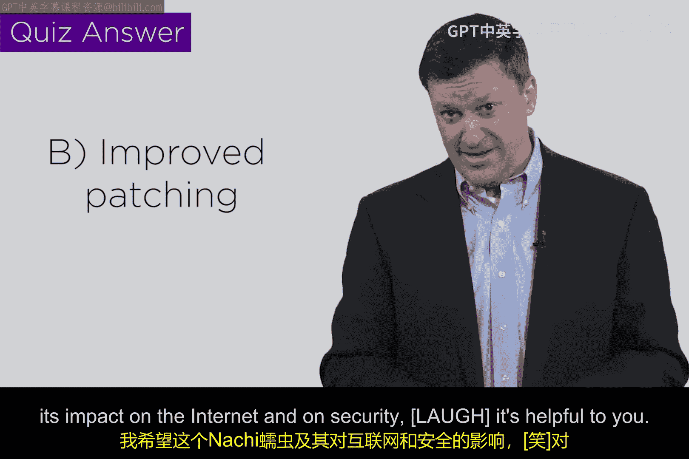

# 纽约大学《网络安全｜Introduction to Cyber Security》中英字幕（deepseek p29 29_2003年Nachi蠕虫.zh_en -BV1TFLZzYE26_p29-

Hi， in this video， I want to talk about another worm in 2003 called Nachi。 Now， this is a crazy one。

 Here here's how this one worked。 essentially。 There had been infections。

 malware infections that had been occurring through 2003。

 It was a big year for malware infections for whatever year whatever reason。

 It seemed like people were not patching properly and a lot of the offense noticed that they could break into systems through unpatch vulnerabilities。

 So we saw a lot of issues， particularly with worms， Well。

 one of them that popped up is this worm called the noty worm。

That's an interesting one because basically is a vigilante worm。

 if you're familiar with that concept， that means a good guy writing something， in this case， a worm。

 presumably to go out and find problems and fix them。

 I know that seems like a noble goal but it turned out to be a complete mess。

 And I want to tell you some of the building blocks involved in this noty wormm。

 So the first thing is that whoever wrote this worm。 And by the way。

 a lot of these attacks are still completely non-attributable。 know。

's one of the challenges that we have in cybersecurity isnt a lot of these unsolved crimes that go on for many。

 many years or decades or forever without knowing who who actually did it。

 But the first aspect to this of this worm is that it used something you're very familiar with ping。

 know， it's echo request response protocol using ICM to actually find systems that ultimately it would be trying to clean up。

 So think about that is extending all these ping。Traffic out across the internet saying。

 hey let's take inventory and then we'll go in and we'll see what's going on and blah， blah。

 blah Well as you might expect， the ping traffic went nuts and actually took out the internet now let's think about that to take out the internet。

Not an easy thing。 I know even back in 2003 had massive infrastructure， I mean it's grown since then。

 but the idea that ping traffic would cascade speaks to the power of an internet worm now here's what it was sort of like if you were working in an Internet service provider or in a research organization or university just collecting traffic What you would see is if you're in an op center you probably are doing something called analytics。

 you probably heard big data analytics as a term that's pretty frequently used where in the analytics sense。

 your monitoring stuff and being a little cynical， sometimes it's just counting and graphing So a typical sort of thing you might be counting and graphing would be the amount of ICMP traffic that you might be seeing through all the different monitoring points that are part of your analysis work So let's say you're big university and you have a big cooperative amongst other universities and you're all collecting data and doing some sort of analytics then what you would have seen just before。

the nay worm is essentially very quiet pipes in terms of ICMP traffic because that's not a big protocol。

 There's a lot of network management tools that use it。

 but it's not like HTTP or email any of the things that really dominate the internet。

 So you would see very quiet traffic and let's say each hour youre refreshing and looking at the amount of traffic that comes in on different pipes So at a particular time and on the chart I sort of circle and show the gradual rise of the noty worm in this section that I kind of circle that you see there on the chart where it's first evidence let me give you an idea what it was like imagining all all these different pipes and then in one hour change you might see one of the pipes increase just a little bit in terms of ping traffic Now here's the challenge that you have with something like that。

 The question is。What do you do， Like， do you call someone， Do you not call someone。

 Do you mark it down， Do you keep track， Do you ignore it， What's the threshold。

 What's the driver that would actually make you take action， So let's say it's a little increase。

 And you go，ll leave it alone。 we'll keep an eye on it。 And then an hour later。

 it increases some more。 And the question now is。Has that increased sufficiently to take action and furthermore？

What action what are you going to do， are you going to turn off ICMP。

 like make it impossible to ping either across your network or at least on that one gateway or whatever is you're looking at。

 you see the point it's very difficult A to determine when you should take action and then B。

Difficult to figure out exactly what you do。 Now， if you kept watching what you would see is it an hour。

3，4，5， maybe in the first five or 6 hours， it went from nothing to this massive explosion of ICMP traffic。

 and， in fact。When this thing reached full strength。

 I almost can't believe I'm going to say the following metric， blows my mind to this day。

 But for the latter portion of 2003 The noty worm， the traffic involved in the noty worm。

 Ping garbage bouncing all over the place accounted for get this up to 40% of the sessions on the public internet where session is a source destination pair。

 you think of it as a flow。 So that's mind boggling。

 like if you go back and you watch the kinds of things people were talking about on television in 2003。

 it certainly wasn't this。 and unfortunately， those of us in the network community probably didn't make a big enough fuss about this。

 because I think that's a policy issue。 I think it's part of the issue of Internet governance and how we determine what threshold would cause the international community to do something。

 maybe decide collective。That we're going to turn off ICMP traffic and again what does that mean if you turn off ICMP traffic that means that gateways you're looking for ping or for that basic echo handshake and if you see it you drop it you just don't allow it through and that would have the effect of essentially dampening the worm propagation but was it break as I said network management tools frequently use that protocol to find equipment that needs update to do network management network monitoring。

So the implications of taking action could be very consequential， so this nay worm was。

 I think another learning point we talked in a previous video about the slammeror and how it helped us understand that theyre indicators that noty worm I thought taught us a few things。

 number one， vigiantiors are a terrible idea。Number two。

 the idea that at what point do you actually do something， at what point Where do you set thresholds。

 Think about in your personal life， If you're at home， and someone is walking up your driveway。

 Do you call the police。 depending on where you live， you might have different answers。

 But I'm guessing that the vast majority of you listening would not be calling the local police if somebody was walking up toward your home。

 Now， what if they're banging on the door making a big commotion。

 Do you call the police at that point， again， where is the threshold。

 Let's say they break a window and they climb in， Well， of course。

 you would be calling the local police， the question is， have you waited too long。

 Is there consequence that's required before we spring to action。 And back in 2003。

 the whole Internet security community was grappling with these issues。

 So the good news is we were grappling。 The bad news is here we are so many years later。

 And I can't tell you that we've completely solved the issue。

I think we still have these residual problems of when when there's indication of warning that an attack may be brewing。

 where's the threshold and what specifically what sort of action would make sense in terms of doing something now to sort of test our understanding here we've got a very brief quiz as we do on many of our videos now as you consider the three let's go through them so firewalls yeah。

 there's certainly some risk reduction， probably not the primary means。

 but certainly a contributing fact and you know as we go through these quizzes。

 you know that there's generally not some you know absolute answer security is one of those things where you know there's a lot of different things if I said what would be the best way to be healthy and I said you know one is jog another one is eat better well they're both makes sense。

 one might be better than the other but so in any rate firewalls help the second one patching that it turns out has a significant impact on reducing worms only。

Because most worms find their way into your system by exploiting some sort of an unpatch vulnerability。

 so patching turns out of have a very strong effect where firewalls certainly have an effect。

 but perhaps less so and then third encryption is probably not a significant risk reduction because for the most part。

 traffic is going to just find its way across a network。

 whether it's encrypted plane test ciphertext sort of doesn't matter。

 So I would say probably the best answer would be to make sure that your systems are patched and to complement it with things such as firewalls。

 So I hope that helps your learning and I hope this noty worm and its impact on the internet and on securitycur is helpful to you。

 So we'll see in the next video。

