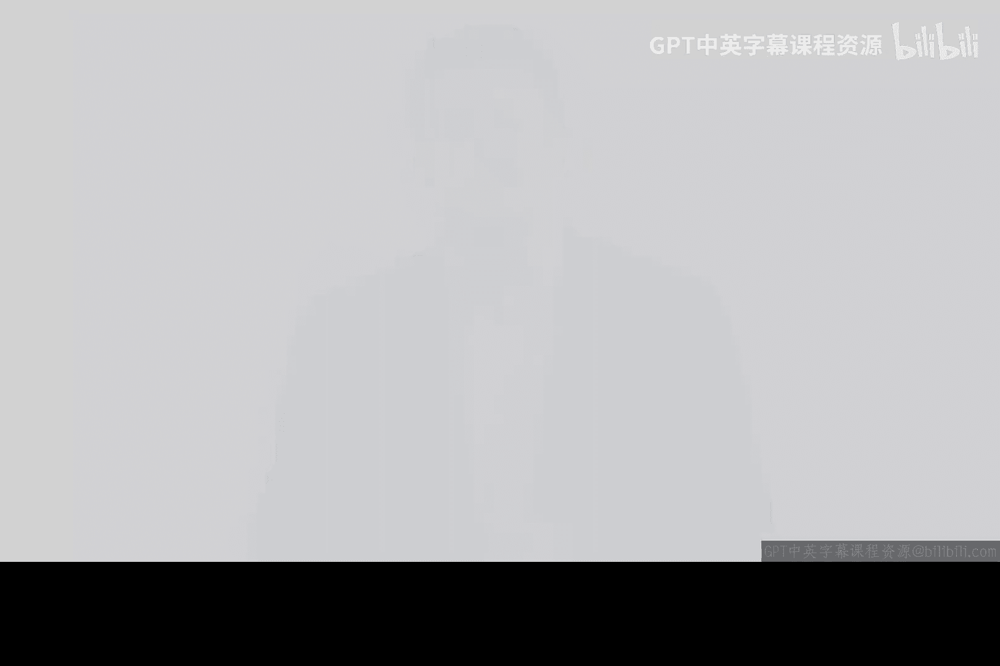

# 纽约大学《网络安全｜Introduction to Cyber Security》中英字幕（deepseek p30 30_僵尸网络设计.zh_en -BV1TFLZzYE26_p30-

Hi in this video I want to talk to you about a construct， a hacking construct called a bonet。

 Ill bet a lot of you have heard of this， but I want to give you some background history and to help you understand where this all comes from and what it means and how it plays and I'll tell some stories and kind of give you a good feel for this and we can see and you'll see as we continue on that botnets play such a significant role for the cyber offense had become kind of the offensive weapon of choice lately。

 So let's go back to 1999。 So in 99 you may remember and some of you may not remember the Y2K event was going on where we were worried that a lot of computers were going to break on the millennium change because of the date and so on and so forth。

 So there are a lot of projects going on all over the world' trying to keep track of how things were going to turn out through the millennium change。

 So one of the things I worked on。Was a project here in the United States for the White House。

 So the White House was setting up a big center where we're going to collect all this data and keep track of what was coming and going in terms of the Y2K event So we set that all up and in the months prior to setting this thing up。

 I got invited to a meeting at Carnegie Mellon University that's here in the United States at in Pittsburgh University has great tradition in in computer science and security。

 So invited us to a meeting and they told us about this thing that they called a zombie。

 I'd be honest with you back in 1999。 I really knew what a zombie was。

 I might have had a little bit of information I'd seen but I didn't understand it totally and here's what we were told we're told that there were these pieces of code malicious code that could be dropped on your machine。

 sort of like a remote access tool and reverse you know how your computer has remote access tool client to connect。

To a remote access server。 Well， this would be the reverse where a piece of software is drop where someone out there can connect to your machine。

 So basically like a little mini server。 they said in a sense makes you like a zombie where someone can connect and then take control of your computer。

 And I thought hows that going to work。 it just was kind of skeptical I not really seen it in the wild and they described it and they said that there was this protocol and maybe it would be using internet relay chat and other types of application level utilities for communicating between whoever it was doing this and everyone's computer。

 And again， the emphasis was everyone's computer and in those days in business for the most part it would be a Windows computer today maybe a little bit more heterogeneous distribution of Windows and Apple but years ago was almost entirely Microsoft Windows in every。

Business and a lot of homes as well so so I told us about the zombie thing and here's some signature that you can go look for meaning some file names and certain behaviors that might see in the operating system so I got back to I was sort of working in a number of different labs at the time and got back and looked。

I saw them everywhere。 Now I tell you， this is profound。

 Like when you don't see something that doesn't mean it's not there。

 I think that's an important sort of lesson for anybody。 not just in cybersecur。

 but it just in science period， for example， you know I'm here in the studio filming。

 And if you told me is you know radio free Moscow here in the room with us。 I would say， of course。

 that makes no sense。 And yet if I had a radio and you could tune it and you flip it to the right sort of settings。

 and it was sensitive enough， boom there it is。 you hear radio free Moscow。

 And does that mean it's here， yes， it doesn mean that And that's something is a science that you need to get used to this idea that when you're staring at something。

 And in our case， because we're a computer scientist we're staring at networks and systems and computer computer applications and software and so on。

 just because we don't see something doesn't mean it's not there。 So I went back and I looked and。

Saw that the zombie code was there because I'd been given the information to tune to that setting to set the sensitivity in such a manner。

 to actually see it was there， so it was a little frightening because you really came to grips with the idea that this stuff might be there now what does this have to do with the Y2K center Well。

 the reason zombies were important is because they could play that reflection amplification game that I think we alluded to in an earlier video。

 the idea that my voice can go out one to many to all of you listening？

And it works as long as you're able to hear my vocal cordds make noise。

 and it causes your ear drum to rattle a little bit。 That's an amazing concept， one to many。 Now。

 if I could make your eardrum reflect out and let's say reflect to one of your friends。

 then my voice to all of your ears Ref and hits one target。

 that's powerful concept because you can really build up a lot of traffic， a lot of volume that way。

 and furthermore， as I think we also alluded to in a previous video。

 amplification makes it even worse， meaning if I can not only hit all of your ears。

 but have your ears amplify what comes out， I say one thing and thousands of things come out of all of your ears from all of you at one target。

 So that's what we were worried about with these zombie that we' calling them zombie nets。

 Now we call it a bonet。😊，Back in 1999 for the Y2K center。 now think about this。 Y2K centers one day。

 the millennium changes a day。 So if everybody floods the Y2K center。

For one day you got a bit of a problem right because we didn't know at the time how you would stop something like this。

 So that was sort of the first time I started thinking about how we would actually stop this now if you're wondering how we did stop it。

 we didn't it didn't happen。 and I have to tell you that's another profound concept that I want you to take from this Listen is important。

When an attack doesn't occur。You should not and should never confuse the fact that it didn't occur with your own cleverness。

Cause you may have had absolutely nothing to do with it。

 And in the case of these attacks not happening。 It's not because of any steps that we took to mitigate。

 we got lucky。 few months later， March of 2000， the first big denial of service attacks from zombies or botnets occurred。

 took out CNN and ebay and so on。 Yahoo， So I remember feeling a little vindicated because I'd been running around getting everybody all spun up。

 including President Clinton at the time， got him very spun up that we're worried about this Y2 K center。

 But any rate， what this has evolved to is a botnet。 Now here the components of a bonet。

 We've got a diagram here that shows sort of the geographic distribution of a botnet。 First。

 it obviously includes bots。's your computers， your mom's computer， your friend's computer。

 your boss's computer at work。 computers scattered across the entire planet Earth or all in band to bot。

Insertion。 Now that's also profound。 If you go back again。

 I keep sort of likening back to Internet history back in the 1990s。

 a typical local area network in a business would be running a protocol other than I。

 It was a company called Nol still around had a protocol called Ix as part of a product called netwear or blah。

 blah blah。 But it was different than I。 So you weren't in band if a hackers trying to hack a business they'd hit a gateway where there's a different protocol be like driving your car up to the edge of a road and now you have to be a boat to get any further。

 It was like that。 Well， now we don't have that。 Now everything's running I。

 So the idea that you want to push bot software out to PCcs。

 piece of cake because everything's in band on I on TCpi has advantages has disadvantages。 And again。

 I hope you learn as you're going through these videos and going through the material。

 That security is。One of the consequences of all the interoperability and all the utility and fun that we have with the internet。

 let's face it， the fact that we can do so much that's good allows us unfortunately to be able to do a lot of things that are sort of bad so at any rate so the first component of all these bots。

 the second would be these things called command control elements they're like the monitoring and management of a bot and it's incredible how they do this because it's this sort of like think it almost like a past the token kind of scheme using the domain name system and here's what I mean。

Bots are programmed to go。Call back to their command and control and it's done via addresses and it says。

 you know hey， go to this domain and that's where you're gonna get your instructions。

 But let's say that that command and control is knocked out It's no longer available。

 Well the resilience that's programmed into a botnet is using an interesting capability。

 I'm not going to get too much into it， but it's called fast flux DNS。

 And if you have some time as additional learning， go off and Google it。

 look up fast flux you'll see how it works。 but the bottom line is is that it basically repoints and repurpos your call back to a command and control element that might have been knocked out to a different node。

 can you imagine the thing learns and reprograms and command and control is past other nodes It's one of the most resilient structures we have in computer science。

 It's amazing Like I hate to use terms like elegant and well designed and well put around。

P of malware， but I don't know that you can use any other terms。 is extremely elegant stuff。

 It's not written by little babies。 These are not the kinds of malware designs。come you know。

 from somebody who just woke up yesterday figuring out how to do this。

 These are well designed pieces of software network management。 So you have bots。

 you have botnet controllers and then you have drop sites and there's other ancillary features but in your own mind it's really it's the bots and it's command and control and and and that has become the attack as youre now sort of building on a theme I just alluded to。

 you know how we've been spending a lot of time talking about worms in previous videos。

 you might think wow， how did we ever fix worms。 Well you know how we fixed it。😊。

TheB guys figured botnets are more powerful。 So they stop using worms。 How' does that sound， I mean。

 as much as I would like to say that it is our cleverness because we did start notifying people when we saw worms propagating and telling everybody。

 there's packets on UDP， TC， but whatever。The reality is that it wasn't our cleverness that stopped these things。

 It's the fact that a better weapon came along。 So you don't see worm so much because botnets are easier。

 How's that make you feel， welcome to cybersecurity。 So again， to summarize。

 botnets are the attack weapon of choice today。 for almost every cyber intruder。

 And also for people who are doing things nonsecurity related。

 a lot of clicking fraudul and clicking on links and so on to drive up ad revenue。

 you see a lot of that as well。 But in our context in the context of cyber securitycur。

 offense defense。 botnets are certainly the attack weapon of choice。 So in a subsequent video。

 we'll talk about doing maybe some of the arithmetic and math on how these things can potentially cause big problems。

 So I hope this would been helpful。 We'll see you in the next video。😊。

