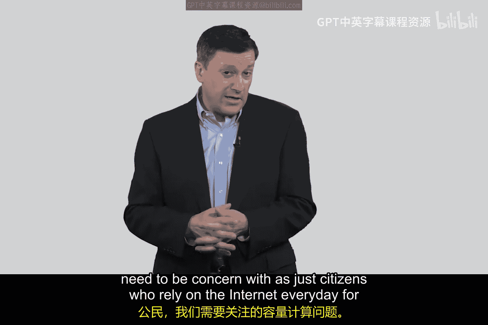

# 纽约大学《网络安全｜Introduction to Cyber Security》中英字幕（deepseek p31 31_僵尸网络算术.zh_en -BV1TFLZzYE26_p31-

Hi， today I'm going to spend some time with you on botnets and the impact a botnet can have on a target network。

 so it's a little bit of arithmetic that we'll go through to try to build up an understanding of the kind of consequence that you might see from a botnet that's aimed at some target for the purpose。

 presumably of denial of service。 I think that's for the most part。

 the primary mechanism that we see today for denial of service。

You could do it using other sorts of things， but think about it if I can hit you with multiple sources of traffic versus one probably makes sense to do multiple。

 Now， one thing as we think through the arithmetic that I want to make sure you keep in mind is that there really a couple of different kinds of botnets。

 There's ones that are very happy to be honest about their source IP address， meaning from a server。

 whatever I'm going to connect to a target and actually go through the threestep TCP handshake in order to establish a connection so I can really hitch you with some traffic。

 So that's the first。 The second would be a botnet where the individual bots are lying about their source IP address。

 So that way you can't attribute where the traffics coming from。 So I'm Alice， your Bob。

 I whip a S packet at you but I don't say that I'm Alice， I say that I'm George。

 Now what that means is that I'm not going to see the Sin act response。

 I'm not going to be able to open a session， but also hide myself。So。In either case。

 they're pros and cons， right， but certainly in the first case， I can create a lot more traffic。

 if I establish a session with you at the application I could ask you download the stuff。

 I can throw traffic at you。 I can do all kinds of really crazy things versus in first case or rather the second case where I'm hiding or sppoofing the source IP address。

 I'm just throwing one S packet at something we would call a Sfl So let's assume that we're probably dealing with bots that are establishing a connection to a server for the purpose of you know。

 really jacking things up。 Now， if you go back to the 1990s the kinds of connection that you would have to the internet would have been pretty bad just sort of learning how to connect to the Internet。

 and we had this thing in telecom called a T1 connection。

 maybe some of you may be familiar with that， it's a 1。5 meg connection， which today。

I bet on your iPhone， you get you know the multiple times that。

 but at the time that was a rocking connection， like a bunch of hippies here in the United States out in San Francisco would all go live in a hippie dorm and just live on top of each other literally to get access to a shared T1 connection。

 can you imagine well？Think about that a minute。 if you're talking about 1。5 MeG。

 then the arithmetic we do as we build botnets and try and understand the lethality or the consequence of a botnet is to figure out how much traffic can I generate from one bot。

At a target。 Okay， so then if I 10 of them， then I do 10 times that number。

 and that's the collective aggregate traffic being thrown at a target。 That makes sense。

 that's the methodology。 So let's think about。 And that's fast forward to the future to now。

 You know， where we we all brought broadband connections or connections， you know， at work。

 wherever you're connecting up to the Internet。 you might do it from a local public spot， a library。

 a school， wherever you're connecting。So your PC， the one you're using， if it has malware on it。

Bt software， then that bot software if wants to attack somebody is going to be generating traffic outbound from your computer。

 right， duh， that's how it would work。 So the malware sits on your machine and it emanates traffic out so。

Would it be smart if you're a designer。To generate so much traffic from the malware that it eats up your entire connection。

 well。If you did do that， you generate a lot of traffic。

 but you're also going to get the owner of the PC pretty annoyed。

They're going to notice that something is amiss， clearly。So that may not be the best thing could do。

Might make more sense。That if you know the size of the outbound connection or if you can sort of posit the size of the outbound connection。

 let's say it's a three meg connection outbound。Not unreasonable to assume that。

 How about if you design the bot？To just use a third of that。 So it's not all of it。 It's a third。

 So here's what it would mean to the user。 The user would notice a PC that's a little sluggish When you walk in the room。

 the PC is going like this。You know that noise？So if you do that。

And you have an owner who maybe is reasonably permissive in accepting of a sluggish PC。

 like most of us。Well， then you can get away with it for a long time。

 You might be able to leave that bot in place。Virtually indefinitely， I'll tell you my mother。

It's a PC at home when I walk in the house， It'sm hear the noise and's sluggish。 I say， mom。

 what do you do， You know， leave it alone， You know， it's fine， You know。

 not realizing that the bot software is probably attacking some country all day long。 So。

 so the design concept is to use a portion of that outbound connection。😊，And hopefully。

 the botnet would be able to rely on that bot being somewhat persistent。

 So let's assume that you're stealing one magg outbound。 So if you were。

And youre targeting a T1 connection that I really only one and a half computers。

With bots on them to be attacking。 And you can see in the chart， I have a list there。

 bots and outbound capacity and so on。 If I was at 75， then two of them takes out a T1。

Nobody has a T1 connection。 So it's almost a silly arithmetic to do， but again gets us going。

 So let's continue on。 So what if you have 10000 of these things and is 10000 a large botnet。

 I would say no， In fact， I would say anything from 0 to 50000 is considered somewhat pedestrian where you wouldn't name it。

You might keep track of it。But， yeah， bonet of 50000。 That's not that big a deal。

 Talk to me when you get to a million。 Then， then you've got a botnet that looks like it has some real consequence。

 like the ones you've read about， you know， the kinds of botnets that make their。

 their name known in， you know， the magazines and so on。They're usually a million。

 but let's say you at 10，000， and at 10，000 I'm stealing one of the three meg outbound， do the math。

That's a lot of traffic that's 10 gig。And I will tell you that the vast majority of you listening probably work for a company or go to a university or live in a town where there are buildings and companies and groups that are using 10 gig connections。

 In fact， it might be way less than that， depending on what country you're in here in the United States。

 very typical business connection to a data center，10 gig。 So what I'm saying is。

Just a reasonably pedestrian bonet of 10，000。Really small at one meg per bat will take out a business。

Now that freaks me out a little bit。I have some listed there that I didn't want to get to a million at a mag。

You really start talking about tearing down the fabric of the infrastructure。

 I've been worried about this for some time。And a few years ago， again here in the United States。

 I got invited to give a talk at the White House。And。

So I get there and I'm giving talk and there's some big crowd there。

 and I noticed there's some pretty interesting looking people there。 from like cabinet people。

 And I'm like why this pretty interesting。 So I get up and I was talking about what we're talking about right now。

 this concept of boarrithmetic and so on。 And as I'm speaking。President Obama walks in。

 He walks into the room。 I see a secret service， you， making the little thing with their finger。

 meaning， hey， I'd get off the podium。 So I step back。 President Obama walks over。

 I shake hands with him， and I sit down。 And before I get to what he was talking about。

 I'll tell you， I was sitting next to right behind him And right there on the screen。

 you can see a picture that I took， I needed proof。

 So I took a picture of his the back of the president。

 we'll make sure we have that for you on the video to look at I needed proof that I actually met him was talking。

 But the reason I bring it up is he got up and he started talking about this topic that we're talking about on the video right now。

 This topic， This is not， you know， some theoretical issue。

 The president of the United States was concerned with the arithmetic that we're dealing with in terms of bot capacity and the type of damages that can be produced from a collection of bots on a botnet at a target。

 So someone unsolved。 for those of you watching who may be thinking about。

Graduate studies in computer security， maybe a PhD in computer security。

 This is a topic that you should be looking at。 the ability to mitigate to shape to thwart to block to divert botnet traffic is an important consideration。

 particularly in the context of Io devices， which number in the billions。

 So if you have billions of devices generating a bunch of traffic at a target。

 How are we going to stop this， And I will tell you that this is still an open question。

 So now just to test our understanding here。 a little but like a brief little quiz question for you just a little math。

 The answer is half as many as we talked about before before we said a 10000 member botnet。

 I'd only need five if I double the capacity outbound on egress。

 So gets even easier if you're willing to take up more of the egress connection。 So again。

 I hope this discussion gives you a better feel for。The threat of botnets。

 the kinds of capacity arithmetic that we all need to be concerned with。

 as just citizens who rely on the internet every day for our personal and business use。

 so we'll see you on the next video。

