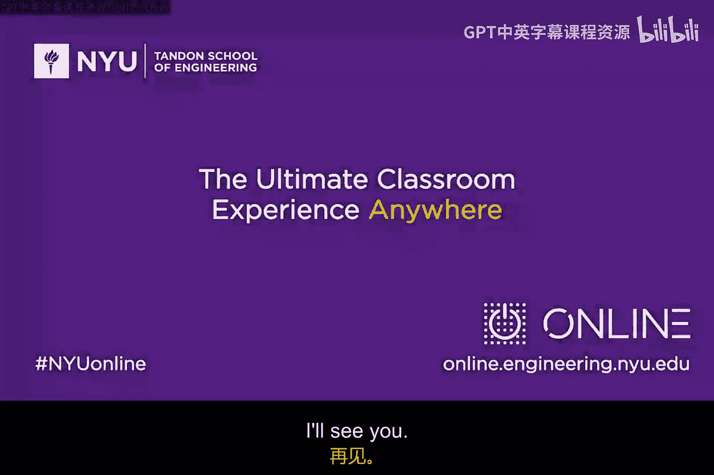

# 纽约大学《网络安全｜Introduction to Cyber Security》中英字幕（deepseek p32 32_欢迎Elad Yoran.zh_en -BV1TFLZzYE26_p32-

Hi everyone， I'm at Ammarosso and this week I'm standing with one of my good friends Alad Joran。

's the chairman of Copan。 A lot thanks for joining us delighted to be here standing here at in the lobby at NYU Tandan School and hey。

 we want to learn about you Tell us a little bit about yourself how you kind of got interested in technology and ultimately into cybersecurity。

 So first。😊，I spent a couple years at this very school at this very building fact before it was handing。

 so really wonderful to be back here with all of you guys back then it was Brooklyn Poly so shouting out shout out to all the Poly folks。

That's great so so you came here what we studying at the school so I was working with one of the professors here who was doing some research in area of infrastructure protection bringing in sort of things we had done in the cyber world into the area of urban urban infrastructure protection it was a very interesting two years now you'd been in military school before that I had been about school so undergraduate degree at West Point engineering management industrial engineering so all the electrical engineering equations on that board behind me you know kind of go way over my head at this point in time I used to know that years ago。

But West Point Under then served as an army officer。Deployed， came back。

 graduate school and got into cyber。It wasn't called cyber back then。

 we didn't have that sex and cyber security computer security network security。

 sometimes infofoec was about as cool as it got。But got into it because I think because of the military aspect it sort had already been trained and to think in terms of perimeter and security and defense and depth and all those sort of concepts that we had been talking about for years and applying into an era that I was just enjoyed you know。

 working in computers， hacking，playlaying with computers had my first computer and you know age of 12 and I guess sort of the rest as they say is history's awesome you know Ill bet during that time。

 you're probably working like the rest of us in sort of data security but now you work in a very interesting area when you focused on voice and mobility and you know people using smartphones to communicate tell us a little bit about the threat there like should people be worried about the voice security the way we've always worried about data So we start thing about networks and data and now it's voice and kind of a privilege to talking to to you the guru of you know telco security and networks and so we're not worried about voice that's the oldest thing that people you know talk on their mobile devices is just you know they used to be phone you used to call them phones now they smartphones but the simplest thing you do is still make a phone call maybe the second simplest is send a text message。

And we know because of internet workinging。With different carriers around the world， not。Many。

 I'm say， are as sophisticated as AT and T， obviously and you have。

Carriers in different parts of the world that are much less sophisticated。

 much less advanced internet workinging with ours and others around the world。

 and you create this environment that can be exploited。By by people， by foreign governments。

 by hackers and so it's a big deal and now it's an issue that's sort of rising up to the top of the awareness level I think tell me if I'm thinking about this right so obviously data security is about a bunch of ones and zeros and data and email and files and things but voice today is no longer analog it's ones in zero voice data so it' it kind of is that like as our community here thinks about that is that like this merge of voice and almost any type of of computing or communications they're all converging on common technology so this threats are probably converging to I'm thinking about that right I think you're thinking about it absolutely the right way I mean remember voice used to be on one network and data and now it's all integrated in our voice our voice calls today are IP based and so it's all one network。

And so whether we're thinking about voice。Or data I think the construct of sort of dealing with the issue is very similar you see a lot of business executives like worried as they travel and at all kinds of crazy places and bringing their phone。

 being worried maybe about eavesdropping and other kinds of things going on So we've been thinking about this problem for a number of years。

I'd say recently as two years ago， people said， who'd want to listen to my phone calls。

 they were sort of security by obscurity， right？I think today nobody thinks that。

Everybody's aware that。What they say is being intercepted and being monitored。

And interestingly enough， in all of sort of my entrepreneurial experience in different areas of cyber。

 just the first time where， frankly， the market evolved first overseas I think when we talked to our customers in South America。

 in Asia and Europe。Middle East。They've been worried about this issue a lot longer than we have and we're only catching up in the United States today I think it's the issue of trust right you know that that。

You know， they have less of when it comes to their own government。

 certainly our government and others in their communities， whether it's criminals， hackers。

 et cetera， you know。I don't know if it's a good thing， but on the trust。

's an equilibrium that we're being reached either we're losing trust here or somehow the equation is coming to an equilibrium whatever for whatever reason you know our community will resonate because it's very international you group that as' part of our learning community here now at Copan。

 how do you solve it， I assume software encryption on the device over the top over the top meaning services running on top of the underlying infrastructure on I and delivery correct correct correct？

So it's an application that's installed on the handset and can be downloaded from the Google Play store or iTunes store or be provisioned by my iPhone your iPhone or onto your Samsung phone or other Android device。

 and then it and most typically sort it's managed by your company's IT department or your company's security department。

And then they will and then you know to you as an employee of a company。

 it's just an app and you make your phone calls， you make your tech you know text through that。

 you know the one thing that we've been able to do that I think is is unique or sort certainly where the innovation takes place is the ability to encrypt the phone call and then boost the quality experience so you've used encrypted phone calls as of mine historically it's always been。

Tough experience right you use a phone call， you know what's supposed to sound like tinny robotic Yeah。

 you go secure and then get has all the， you know there's definite degradation there。

 but really interesting to be able to take a regular phone call。Add all the security around it。

And at the same time， boosted to a highest quality's awesome so I submit to you。That well。

 today people are using it because it's secure， they start using it because it's secure。

 they keep using it。Just because it sounds so much better， not like I sound today。

 but generally speaking， it sounds so much better than a regular phone call。

 I was saying a few years from now of four or five years， six years from now。

 every phone call by default would be secure。 I mean， why would you make。

A regular call and making a secure call so so much better I totally agree。

 Now here in the US have like government agencies kind of figured this out。

 you see sort of a trend toward you know more awareness reports coming out things like that that maybe point to mobility and mobility security So it's been a long time coming。

 but the short answer is yes， I can ap to two reports。 one was published in March March of 2017。

 the FCC working group published a set of recommendations around signaling system 7 and then more recently than that in late April Department of Homeland Security published what I think is really a wonderful report they did a bang up job addressing sort of a broad set of issues related to mobile security on the device side and on the network side and that's a great report that DHS report really does lay out the whole framework and threat landscape and make some good recommendations there are tables in that report that just。

Sucinctly some you know present what the issues are。

 technologies that are available to mitigate some of the risks and they did a great job it's a long report it's over 100 pages but。

Worthwhile reading， that's homework assignment for guys。You know。

 are you surprised that we don't see voice conversations on Wikileaks or maybe we have but seems like that may be sort of the next sort of big threat you know。

 Lord knows I wouldn't want to but any of my voice conversations posted to the internet it that I mean how could it not be I know it's interesting when we started our careers。

 you know the advice we got from Hill and then older and more experienced？F for。

Don't write it down if it's you don't want people to discover it later on， don't enter it into email。

 don't put it in email you know pick up the phone and you know keep it in the realm of voice because it's ephemeral。

 itll be gone right but to your question about Wikileaks。

 you know I don't think that advice necessarily as good advice anymore because Wikileaks could。

Have voice recordings， text messages just as easily as email sort of profound like that ephemeral or temporary nature of any kind of communication you wonder if that even exists anymore you know it's just sort of like anything you do that involves electronics is going to be there maybe forever either it'll be there forever and or the metadata associated there there's a whole separate conversation around metadata but it's a big deal it's becoming important I think over the next year two three we're going to be hearing an awful lot about the value of metadata or the value or potentially the risks associated with it depending on what side of the equation one's on。

Well， I appreciate it no I'm glad you do what you do a cool span helping us keep voice communication safe。

 I hope our whole community goes and takes a look at at Copan and you'll learn a little bit more about the product there and learn about maybe how they might use use the tool I appreciate you thank you Yeah and that's great the legend Thank you for the opportunity to coming in and chat you that's great thanks on behalf of To group I appreciate your time delighted to do it Thanks maam。

