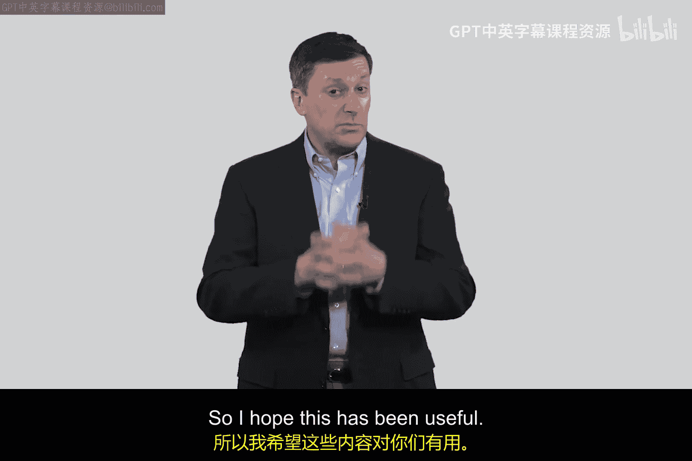
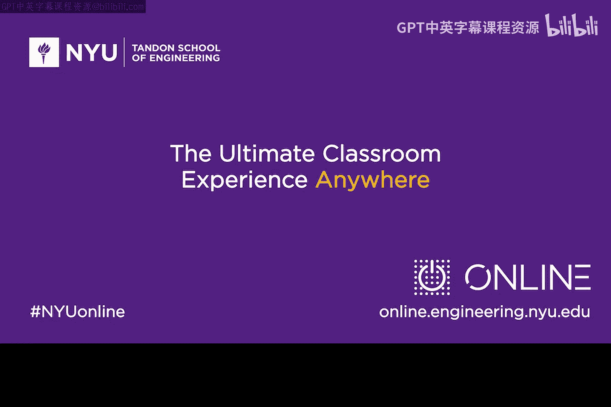

# 纽约大学《网络安全｜Introduction to Cyber Security》中英字幕（deepseek p33 33_资产与基础设施.zh_en -BV1TFLZzYE26_p33-

Hi Adam Miroso here， and for this video， I want to spend some time talking to you about assets。

So an asset is something of value。 So in your personal life， your money， your belongings， your home。

 your family， these are all assets。 In fact， there's also sort of intangible assets like your reputation。

 your personalityities and things that， you know， suddenly we would consider part of our personal asset base。

 but in computer security， we're going to spend time thinking about assets。

 here here's the reason if you' hacking someone if you're doing cyber offense。

 I think you would agree that it makes more sense to go after something that a target values。

 than to go after something that they don't value。 Does that make sense to you。 So for example。

 I remember I had a friend had this dumb bird cage with a bird in it。

 and I remember it was like when I was in college everybody just wanted to get rid of this bird。

 noisy and so on。 So if somebody come along and swipe the cage in the bird and left with it。

That's hardly a hack。 That's certainly not a consequential hack for me。 that you're doing us a favor。

 You get the point。 and it's a whimsical， kind of silly example。

 But I think you want to keep that in mind。 We can get kind of lost in the technology here very easily and think about protocols and firewalls and crypto and all this stuff that we'll be doing through the videos as we go through this。

 And as you study cybersecurity and completely forget that the whole point of this from an offensive perspective。

Let go after something you care about。That's the reason you do it。

 That's a successful hack is something that involves consequence to an asset。 Now。

 how do you figure out what your assets are and how do you figure out how to prioritize them。

 So let's go through another one of Edossa's dope analogies here。 But I think it'll help you。

 Imagine the whimsical example。 Imagine you're near your apartment， your home， your dorm， whatever。

 And I tell you you've got one minute to run into your house or dorm apartment。

 And grab everything that's important to you。And then get out。 And then we're going flip a coin。

 And if it's heads， you get a chance to go back of its tails， then that's it。

 You don't ever go good to go grab your stuff。 You just keep what you got the first round。

 So you go what and say， all right， okay， So you ready。 And I go， go， So you run in the house。

 What are you gonna grab。Are you going to grab money， Well， maybe， what make sense。

 Are you going to grab family heirlooms。 Yeah， Would you grab the newspaper on the table， No。

 would you grab a television， Maybe your phone， at the point you go through in your mind。

 a decision process around the value of an asset。 And one of the attributes that I think is pretty important in determining value is replaceability。

 That means is if a particular asset is just trivially replaced， I mentioned the newspaper。

Wellhyhy would you grab that， You， why would you waste 1 millisecond picking that up。

 You want to grab things that are not easily replaceable。 Now， some just simply can't be replaced。

 in your personal life， I mentioned family heirlos。 if there's some old pictures of。

 you know your grandparents or people that are very meaningful to you。

 You're gonna to run right to that and grab， because they can't be replaced。 if there's money。

 money can be replaced， but maybe not that easily。 So it might grab that。 do you get the point。

 I want you to think through in your mind this question of how do you value assets。

 How do you determine what's valuable， what's not。 Now。

 let's say you get out of your home and we flip the coin and you win， know。

 you're able to go back one more time。 So now that you've taken the first tier highest priority assets。

 You've set them aside。 Now you get to go in。 And now you have a second shot at it。

And in terms of prioritization， you're going to find that the second time in。

 you'll be a little bit more permissive about what you take and what you't。

 because you're already taking the most important things。 Now。

 what's the second most important things， And if you kept going successively through iterations on the set of assets you got in computing。

 it would be in your infrastructure。Youre a pretty good idea。 Now， I know that's hardly engineering。

 right， I mean， that's it seems so informal， But the reality is that this is the way we do it in cybersecurity。

 Cysecurity is a relatively new discipline。 Let's face it。

 We've probably trace our origins to the mid-1980s。 That's not that long ago。

 they're still sort of figuring out how to do this， But if you and I， you know， you and I together。

 And it's our task to walk， say into a data center and figure out what are the key assets in here。

 Well， how do we do it？ I think you think about it the same way as running into your apartment。

 You think， all right， let's let's go in and what items if。

Taken or replaced or destroyed or compromised would create great havoc。

And that's sort of a definition that a lot of people use for critical assets。

 or in the context of the society services that society depends on， critical infrastructure。

 so the idea of figuring out what's essential， what's high priority， what's critical。

Is is not some process that we can assign quantitative values to。

 but rather tends to be very qualitative。 And the judgment and experience of the person making that determination really plays a significant role in how you would actually do it。

 So let's say you walk in a data center。 How do you determine the assets。 Well。

 a lot of times it sort of plays into three categories。 not always。

 but a lot of times it's sort of three categories where category  one would be of like hardware。

 tangible physical pieces of equipment means less in the context of virtualization。 certainly。

 it was just a equipment。 Second would be kind of software， like the infrastructure code。

 the powers the way things operate and increasingly with cloud services and virtualization that we see a balance tipping more towards software in our society or infrastructure and in a data center than hardware used to be the other way。

 like 2030 years ago， a lot of hardware， a little bit of software And now it's a lot of。

For a little bit of hardware work， nevertheless Os would be the first couple and then all the information and your product and whatever whatever you would consider in some sense your intellectual property。

 the things that are of value say to a business in a data center customer records。

 let's say your software company， the code you're right Any design documentation and email correspondence。

 all that kind of your financials， these are the assets that you think through and make some determination in terms of priority I'll tell you I wish I could tell you that there was just a button you push and the answer pops out where the prioritization is driven by something that you can automate we're gonna do that that doesn't work that way actually have to have some judgment that you use and we'll go through some exercises and subsequent videos where I'll help you do that Now a lot of you might be wondering at this point sort of in our discussions When are we getting into crypto。

 when are we getting into firewalls， when are we getting to the real technology。Coming。

 but I think the difference between someone who's been properly grounded in cybersecurity and somebody who's not is that you have to think these things through。

 You have to have a good understanding of assets and prioritization and so on to really make sense of how you you put technology to practical use so I hope you keep that in mind and know a lot of you are very eager to jump in and start doing some real hardcore technology and we'll get there。

 but I do want you to have these background foundational concepts in mind as we go further with the materials。

 I hope this has been useful we'll see on the next video。

