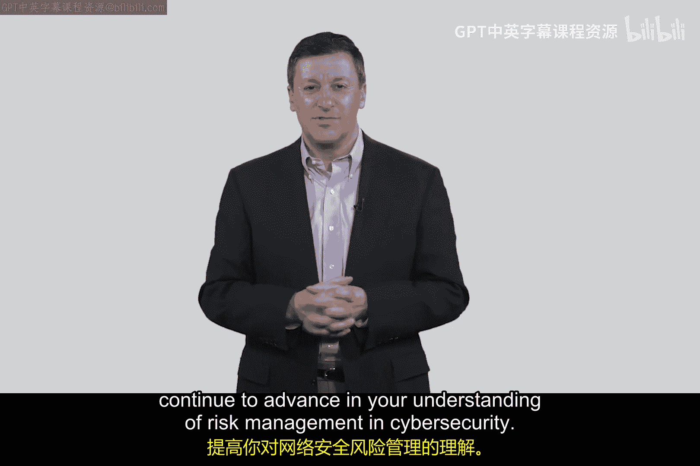

# 纽约大学《网络安全｜Introduction to Cyber Security》中英字幕（deepseek p34 34_风险计算.zh_en -BV1TFLZzYE26_p34-

Hi folks， Ed here， today we're going to talk about risk。Now in your personal life。

The concept of risk is this informal thing that we we assign sort of just an informal semantics to our definition。

 like you would say it's risky to do this thing， or it might be don't do that。 That's very high risk。

 like we do sort of informally， but in cybersecurity。

 we're actually going to use the term risk in a more quantitative way。

 So we're going to use it as a defined term that has some real meaning mostly focus on the probability and consequence associated with attack。

 So let let's use a couple of simple examples。 I always use these whimsical examples outside of computing。

 and then we'll bring it back to computing。 But imagine that you're driving in a car and it's you alone in the car。

 you're driving along。 and I say I would like to calculate the risk。

Associated with you may be getting into some sort of a serious crash。So you would say， well。

 there are two dimensions to that。 One is how likely is it that I would get into a crash。

 And then second， if I get into a crash， what ultimately is the consequence of that。

 So it's those two dimensions， probability and consequence that feed this。 Does that makes sense so。

Again， when we talk about computing， we're going to be focused more on networks and virtualization。

 software， and so on。But it doesn't hurt to think about a car and you're driving in it。

Let's imagine that I'm in car and suddenly the road becomes very slippery。 It good temperature drops。

There's precipitation， it freezes and I'm on an icy road。So the first question is。

Has the probability that I may get into an attack I into a crash。 as that increased。 Well， yes。

 of course， it does a slippery road。 Now， the consequence still is me， You know。

 some bad thing could happen to me or whatever is in the car with me。

 Let's have nothing of any value in the car's just me。 Well， the consequence。

 whether I'm in a safe car or whether I'm in an icy road is the same。

 So we'd say the risk is increased because it's an icy road， But really。

 it's just me in the car still。😊，So that's the first case， second possibility。

 let's say you're driving in the car and nothing changes about the road， the traffic， the weather。

 the car nothing， you know， distracted， it's your' driving。

 but now imagine that there's a little baby in the back seat in a car seat。

Are the consequences a little different now of a car crash。 You bet they are。

 And now it's not just you， but you're bringing a little baby along。 And if you get in an accident。

 then the first question anybody's going to ask is， is the baby O don't ask about you。

Because the consequences increased。 you follow， So there's really two ways that risk can be affected by some change in a system and risk is inherently something that's measured based on change。

 And we'll get to that in a minute。 But let's think about this。 The first thing is。

Probability of an attack in terms of cyber security can increase。

 or the consequence of the attack can increase。 So， for example。

 a system that's put in place that has customer records on it。 Let's say it's 100 customer records。

I put it on a system and it sits behind a gateway that's not connected to the internet and it's just private and is X amount of risk。

 I don't want my customer records exposed， but it's on a network that's private I think we're good you'd measure that risk as some number now it's tricky because you'd say what number？

Like is there some universal scale that we all use。 and you know， we have unity risk at zero。

 It's not like that。 What happens instead is that you pick some numeric scale。

 sort of like the stock market where there's a number， you buy a stock at a number。

 Does it matter how much that stock cost when you buy no。

 but it matters whether it goes up or down and risk is like that as well。

 So what we would do is something called baselineing。

 do that a lot in system security engineering where you baseline a number and you come up with some reasonable sensitivity in terms of probability and consequence。

 And you just say this is my baseline unit risk at some point in time。 Does that make sense。

 See baseline something。 Now， let's say you decide in this little local area network with 100 customer records on a server that you're going connect to the Internet you get your first Internet connection and now people from the Internet。

 can come in and do maintenance on your server or whatever reason you would be connecting。 Well。

 guess what？The probability of attack has now gone way up。Have the consequence changed， No。

 it's the same stuff。I you your customers would be just as angry if you lost the data。

 that hasn't changed， but the probability that something could happen has gone away off because you' connected it to the internet。

Now， let's unravel。 Let's go back to the case where it's still private network with no internet connection。

 I've got 1000 customer records。And you you suddenly realize， well。

 thousand just a small percentage of our customers。 Let's put all of them on。

 Let's put a million customer records on that server。 How are you feeling about risk now。

 it's gone way up because you have more consequential assets on that server。

 So there's these two ways that risk can be affected now。

 every one of you right now are thinking the correct question and that's well。

 what if one goes up and one goes down， right Like what if I went from 100 customer records to 10 at the same time that I connected to the Internet。

 Wee to security risk management， And you can see how that's a very subjective judgment that you'd have to make that the discomfort that anybody doing cybersecurity has。

Particularly in a practical setting is how informal a lot of this is。 You know， as an academic。

 particularly somebody who's always giving exams and helping students， you know。

 work out answers to questions and to problems。 always look for things that are quantitative where there's a number and they can't really argue with you one way or another。

 but cybersecurity doesn't work like that in practice。 I wish it did。

 but it just doesn't in practice， judgment。Qulititative versus quantitative judgment。

 And that question of， well， this， this one went down， the consequence went down。

 The probability went up。 Did they balance， as the risk stayed the same。

 Did this drop more than this increase， you follow is very difficult to kind of go through that。

 And that's where experience， and just having the the willingness to try to make good decisions。

 good management decisions about cybersecurity， maybe the most important factor here。

 So so just in terms of sort of your additional learning here。

Try and think about some scenarios in your own mind， seeing your own personal life。

 where the increase in probability of something might increase your risk or where increase in consequence might increase risk。

 Think that through， I'm sure in your own life， maybe even the context of things you do either at work or school that might be technically related。

 what decisions might one make that increase risk and correspondingly what sort of decisions might be made that could decrease risk。

 that'll be a good thought exercise phrase， you think about this lecture。

 And as you continue to advance in your understanding of risk management in cybersecurity。

 So we'll see on the next video。

