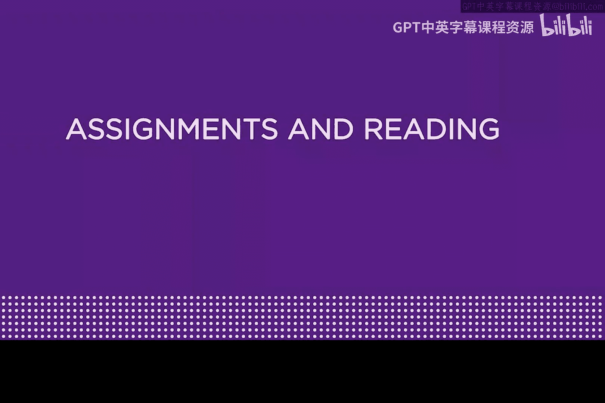
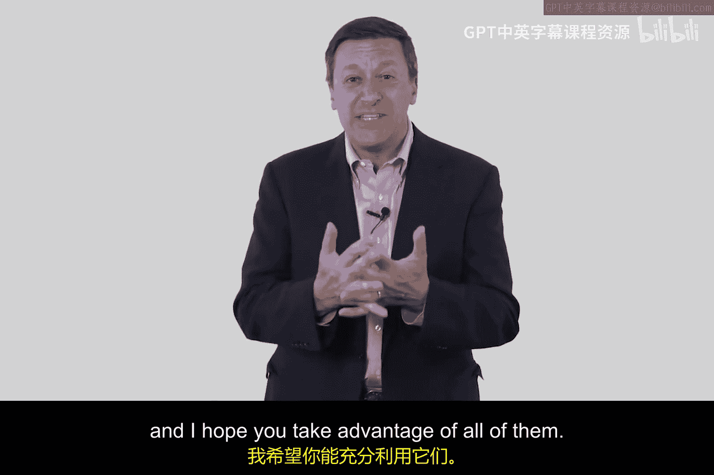
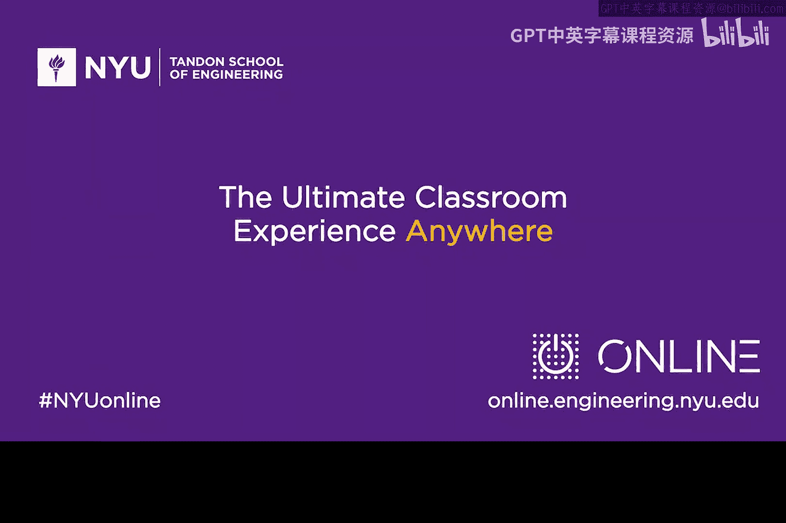

# 纽约大学《网络安全｜Introduction to Cyber Security》中英字幕（deepseek p37 37_作业与阅读.zh_en -BV1TFLZzYE26_p37-

Hi everyone Ed Emmarossi here and I want to welcome you to this module Our goal in this module is to help you learn pretty important technique in cybersecurity defense。

 which is mapping assets to threats， kind of understanding that intersection between problems that occur on the Internet and maybe some ways that we can deal with building a defense sort of starting to think about how we can reduce risk and there's some papers and materials that I think would be very useful to you as we go through this module So first off there just a couple of papers that I want to point out one is called Man in the middle attack on UMTS UMTS is a type of wireless technology。

 you learn about in the paper written by Meyer and Wetzel。

 Suzanne Wettzel's home friend of mine up a colleague at the Stevens Institute of Technology。

 very very cool paper about how you can in some sense， Eavesdrop on wireless。

 I think I enjoyed and the second is from one of the grand masters in Cysecurity Gene Spford we all call him。

Sff。And his paper is called our computer hack and break computer Haer breakakins Eical。

 That's good good paper。 And you'll see some of staff's personality come out。

 He's a professor Purdue University。 Now it a couple of optional books that I think would be useful for you to consider using as you go through the module。

 One is an ebook that I wrote with my son Matt， It's called from CIA to AP an introduction to cybersecurity。

 kind of a companion ebook to the course， again， optional。 but for some of you。

 you might want to go on Amazon and download it because some people like to have a book that they can read along with as lectures Progress as as you go through this module and you look at the different videos that we've been covering now。

A second book that you may consider is a TCPIP book and my favorite is by Richard Stevens and you know you really ought to have a good solid TCPIP textbook I think on your shelf if you want to do this for a Living Certainly you're going to have to know TCPIP in the way that a chemist knows the periodioic T So if you decide that such a book makes sense。

 chapterpt 7 and8 in Stevens book would be good ones to go through as we go through this module so I hope you'll do that a couple of TEed talks that I think you ought to look at one is from a former colleague of mine at AT&T Lori Faith Kraer she wrote I gave a nice talk called what's wrong with your Password and I think you'll enjoy Lori's veryfectious personalities I of enthusiasm she's very。

 very capable and I think you should hear her talk so list that and then Miko Hipppenm from E Secu。

 one of the great minds in cybersecurity。Here's a video called Fighting Vies Defefending the net。

 I think you should take a look at it， so hopefully all of these resources will complement your learning in this module and I hope you take advantage of all of them。

 so enjoy。

