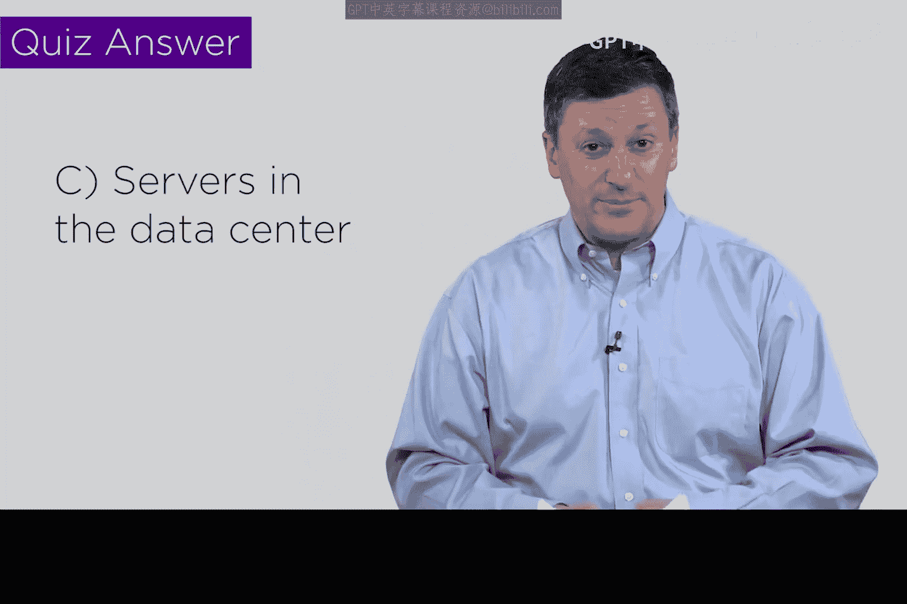

# 纽约大学《网络安全｜Introduction to Cyber Security》中英字幕（deepseek p38 38_资产与威胁的映射.zh_en -BV1TFLZzYE26_p38-

Hi， folks said， you know， I want to start this video with a little bit of career discussion。

 I think it'll be useful for you。 I'm going to guess that more than half of you who are watching this are considering careers in cybersecurity。

 and it probably makes sense for me to give you a little bit of advice as we go into this topic。

 which is really mapping assets and threats together。 I want to show you the topic。

 but I want to show it to you in the context of something called security consulting。

 It's a growth field。 It's something that when you have some skill。

 I can very easily do either on your own or do in the context of a large company or do as a consultant for any number of different industrial concerns。

 whether they be consulting firms， accounting firms， tech firms and so on。

 So the idea is that there's this burgeoning industry where experts will be hired by companies to take a look at their their situation。

 their network， their data centers， their applications， their software， whatever。 and provide。

To them something that's referred to as posture for me， posture means my standing uptray。

 but in the context of cyber， posture means what are my strengths。

 what are my weaknesses and what should I be doing about any gaps between the weakness where I need to be。

 that's the idea。 So an expert comes in looks at and assesses posture and makes recommendations。

 I'm going to guess for a lot of you frankly， if you work through these videos and work through the material we've been helping you with probably have as much skill as good percentage of the consultants that are out there today but I would urge you that if you have some interest in that then sort of the two worlds that come together to be a good consultant are the world of understanding cyber securitycur obviously you really do need to be an expert。

 but also the business skill of being able to interact and communicate and speak and write these are things that are very important my。

felt advice to you as we go through this threat asset matrix approach and we'll go through in several videos。

 you know how we use this in the context of assessing a system。

 I'll take you through some case studies but I want you to recognize that if this is something you like as you're going through this。

 you say I enjoy that I think it's fun to assess a system determine what sort of weaknesses are there。

 make recommendations about fixes， then I think you should make sure that you're sort of complementing your tech skill with communication skill。

 anytime you have the opportunity to give a talk to write something to present at a meeting to be sort of teaching whatever you can do that allows you to improve your communication skills。

 please do that I think that's something that you're going to find will be a big differentiators。

 you build your career， hopefully I'm a little biased。

 but I hope you go into cybersecurity Now let's talk about the technique It's called threat asset matrices。

That asset mapping， there's a lot of different ways of referring to it。

 but it's at the base of all security assessments。 it's at the base and what it starts with is an identification first of all your different asset types in whatever it is you're doing some sort of an evaluation for we'd said in some previous videos that。

The three categories are often hardware software information for now， we'll use that。

 but you'll see as we do a case study later， you can break it up into anything。 in your home。

 the assets might be my garage， my house， my basement， my backyard。 you know。

 there's five things that youd name or whatever。 you want it to be very specific to the setting。

 but just in a generic sense， we can say hardware software information for now。

 but the key point is it's a finite set。 It can be determined to have completeness now。

Within each category， maybe there's an infinity of different possibilities in terms of groupings and how you think through what the asset values are。

 but the reality is you really can make a finite set of assets。

 so let's start with that now we've said repeatedly that if we're willing to buy into the CIA model that all threats fall into those three categories confidentiality integrity denial service。

That's kind of cool， right？A finite set of assets and a finite set of threats， the cross product。

Produces a workable matrix。 That's really good news because you're gonna to see later。

 there's all kinds of infinite sets that pop up。 like if I said。

 what are all the vulnerabilities in some operating system like Linux， Good luck。 you know。

 that's probably not going to be an easily attainable finite set。😊，But in this case。

 mapping threats and assets， we can build a workable matrix。

 It's finite that has cells that we can look at。 So for example，3 by three。

 we've got a chart that's showing on the screen here that shows the three asset types and the three threat types cross product。

 And you can look at each one like confidentiality of hardware。

 what is that that means am I concerned that a hacker knows what my hardware is。

 maybe you are concerned， maybe you're not usually that's pretty low。

 but how about integrity of your information like that's pretty important confidentiality of your information that's a huge security concern in most cases So you can see how the structure provides a baseline foundational view of the kinds of things that we're going to be building on as we do security assessments now in subsequent videos we are going to dig into this little bit but for now let's take this do a little a little。

To test our knowledge。 obviously， your reputation is an asset。

 but we tend in cybersecurity not to include it as a tangible asset only because I can't really attack your reputation。

 I can attack your system I can attack what you say know in terms of your communication and that might have impact on your reputation like I can't attack your mood as a person。

 I can attack you a really bad mood， but generally we wouldn't consider that an asset and a threat asset matrix。

 cash in the bank ditto。 now granted the value itself， you know the balance value is a big issue。

 there's no question。 So certainly the integrity of your financial records is important。

 but we wouldn't so much think of the cash。 but then obviously servers is clearly an asset that we would be focused on。

 So I just want to get you thinking that these are the kinds of things that we'll be looking at as we do threat asset matrices and as we work through some case studies。

 So we'll see in the next。いや。

