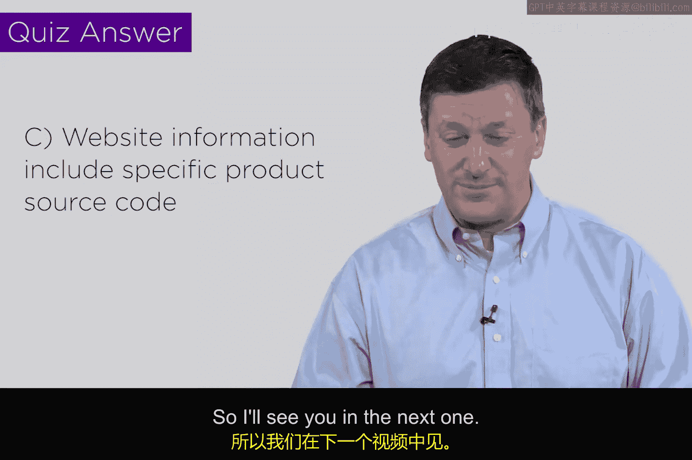

# 纽约大学《网络安全｜Introduction to Cyber Security》中英字幕（deepseek p41 41_案例研究矩阵示例第2部分.zh_en -BV1TFLZzYE26_p41-

Hi folks， So in this video， what we're going to do is build on the example network that we started with in our previous video。

 So we laid out the different assets that exist in a typical network。

 we came up with seven and we'd agreed that we would take those seven map them against the three threat types。

 confidentiality integrity and availability the my service and come up with a matrix。

 So that's kind of cool。 it gives us the ability now to look at each one。

 So let's look row by row and what I'm going to do is I'm going to cheat a little bit。

 you know when you're watching a cooking show and the cook just brings out the the cake and it's all made it' how you make that well they made it before。

 So I've already gone through and in my own mind， done a risk management assessment for each of the different cells。

 let。Try and justify some of them。 I won't go through all 21 but we'll go through a handful of them。

 I'll try and justify where I think they came from and help you understand how you might do it。

 And by the way， you do not have to agree。 you may decide that something else is important。

 remember we were talking about you know determining asset priority in a previous discussion and I had you running into your house picking up what you thought was important well you might do something different than say your roommate you run in and grab one thing。

 your roommate grabs something else。 So it's not that there's no right answer because there are some answers that we don't don't make a lot of sense like if your roommate runs into a burning house and takes a newspaper out。

 you're going to say what did you do that for no justification for that。

 but if you grab cash and your roommate grabs an important book they're both justifiable So that's something I want to make sure you have in your mind。

You work through these exercises as you do the system security analysis as you become an expert security consultant。

 making a whole bunch of money， you know， doing consulting work。

 you want to be able to justify your answer。 you want something that is reasonably justifiable。

 that makes sense if you can do that， I'm happy long as you can justify， I'm happy。

 you can't justify I'm not happy， so let's go to the first one so mobiles in a typical enterprise you know today I put confidentiality integrity and availability low now I totally disagree with that The reason I put it low's because I think all the interesting stuff is happening out in the cloud So you're mobile and I've spent my loan is a lifetime in mobility。

Is a window into other assets。 So it's important。 Look I walk 30 seconds without my mobile。

 I feel like I'm in a panic， but it's not the mobile。 It's what it represents。

So the ability to access things is really what's critical。 So for me。

 the way I've interpreted this is that the information that I grab。

 that's where I'm going to be placing highs and mediums。 But the mobile itself for me。

 I decided it has been low。 You may disagree， but I can justify it。 PCs。

 I made confidentiality and integrity a little bit higher only because most of you watching me right now。

 tend to store a lot of interesting stuff on your PCs。 You just do。 like if you're a hacker。

 And you have your choice of where to steal things from。 You're always going to pick the PC。

 because the PC has tons of files， directories， information， your tax forms， whatever。

 there's probably a treasure trove of interesting stuff there。 Whereas the mobile， Yeah not so much。

 but you might use the mobile to gain access to things that would exist in the cloud。

 So I put the PC is a little higher。 Local area network。 I put it low across the board。

Your local wFYes， somebody can maybe listen into wF and maybe the nasty kid next door is using your wfi to go out and surf the internet or whatever it's risk。

 it's not zero， but I put it at low。Storage， I think this is a little bit more interesting now。

 Like if we decide that the company that we were sort of positing in our。

 in our seven asset kind of characterization， let's say they're in the business of writing software。

 most companies nowadays are hard to find any company now in any industry that's not writing software of some type that's part of their intellectual property。

Well， the storage software is probably the most important thing they do。

 And I said certainly then the integrity of that software as it resides in storage is supremely important。

 There's no question about it。 I said low availability。 look if this was a service provider。

 Let's say this was your local phone company or telecommunications company。

 You might decide that storage would be a little bit more important from an availability perspective。

 but I'm just making the assumption that it's not email calendar。

 I just put across the board is medium there's a lot of confidential stuff that gets sent around an email。

 you want to make sure that's protected。 here in the United States which you said an election where some hacking into email was pretty consequential。

 So you'd never put that as zero， but I don't think there's too many companies that would say that email and calendar would be their top risks。

 I put them in medium business support。 again， high integrity。 your financials are embedded in there。

 Yout want people mucking around with that。 That is。

Absolutely critical keeping that Now you might say that if customer lists are in there。

 you could justify that being high， I didn't， but you could。

 you know you could make that determination in which case you might go medium to high and then finally your website I think that for most companies this is about the most important asset it's your customer facing visibility if you're an e-commerce site it's where you do business so I said high in terms of confidentiality and integrity so again you see my thought process here I said I was cheating know I already bake the cake if we were doing this together。

 we'd be doing a threat tree doing a full risk analysis under each cell。

 maybe doing it as a team really coming to some consensus about what we think would be the appropriate ratings and notice another shortcut is low medium high right I just pick that as a very simple scale you might decide that you want to pick a scale from one to1 or from one to1 thousand if you really want some sensitivity。

If you were doing this for a nuclear power plant， do you think it would be overkill to have scales from one to 1 thousand0 to have big teams doing the risk assessment in each of the different threat asset matrix components and really coming to a general consensus that you've properly characterized with。

 that's how it's done。If you were wondering， if you think how do you possibly do security in something like a nuclear power plant。

 this is it。 I'm showing you， okay， this is not familiar to most of you。

 You're looking at this going。This is not what is this， this is not cybersecurity， but I'm showing。

 this is how you do it。You make determinations， risk management determinations now behind all of this。

 as you'll see in the next video we're going to make some decisions about what to do and that's where we start talking about the things that are familiar so for example。

 if we decide to put cryptography somewhere，Well， it's going to be driven by this。

 I'm not going to put cryptography somewhere for the heck of it。 By this。

 Would I be encrypting all the mobiles， Is that where I'd spend my money。

 if I have $1 to spend on something， Am I putting encryption on the mobiles。 No。

 I'm doing something probably about the integrity of some of my important assets and the website。

 You get the point。 So you're going to be making those decisions， And you'll see that coming up。

 And now let's do a little quiz here， just as a little test of our understanding of how this works。

 So we said， what justifies making the mobile piece low， And then the website high， we said。

 hackers don't care。Mobile information beacons website information might include some important as some important products or things。

 and then mobile Android。 The answer C， right， I mean。

 the fact that the website probably includes some， so much consequential information for your company makes me say hi。

 Now， if you run a website that's just a little marketing thing with nothing important。

 And if it got knocked out， you wouldn't care less， then you wouldn't put high。

 you'd put a lower point。 remember， it's all about this being justifiable。

 not about being correct or incorrect， that it be justifiable。 So in the next video will go on。

 and we'll start learning a little bit about how safeguards connect up with the risk analysis activity。

 So I'll see you in the next one。

