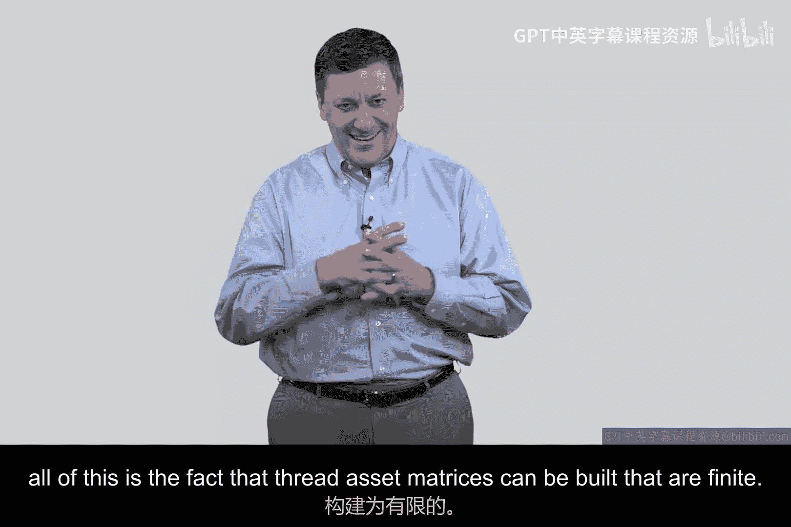
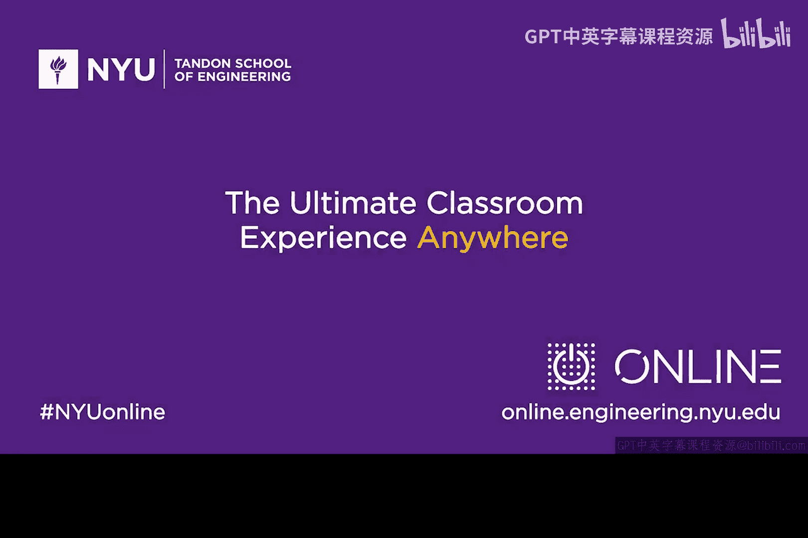

# 纽约大学《网络安全｜Introduction to Cyber Security》中英字幕（deepseek p42 42_案例研究矩阵示例第3部分.zh_en -BV1TFLZzYE26_p42-

Hi folks at Amarosso here。 And for this video， I want to start by first telling you a little bit about a position that exists in industry and in business and in academia called the chief information security officer。

 Cso CiISO It's a lot of different ways that it's referred to。

 I think I may have been the second one ever。 my good friend Steve Katz from the financial services industry here in New York City where we're filming this showed me in the mid-90s his business card。

 and it said chief information security officer， I was working at AT& T at the time。

 big telecommunications company here in America And I looked at it， and I went CISO。 wow。

 that's a cool title。 and he said yeah and I went back to work and I said。

 could I be that And they said， whatever you want。 he started writing CiISO I think it was the second guy to do it。

 But here's what that position is。 It's about the stuff we've been doing in these videos。

 It's about doing risk analysis and a structured man。

On an organization and then making determinations about what to do。

 I used to have a boss who used to say to me all the time。 he'd say。

 like I'd put these big charts up and explain stuff。 and I'd be so proud of myself。

 and he'd be sitting with his arms folded and would say， invariably。 So， Ed。

 you've shown me the what。😊，Now show me the so what， always be a little weaker on the so what。

 which what you do about a problem like anybody can say， hey boss， boom， boom， boom。

 look at all these problems we've got and then have no idea what to do about it。

 but this is where we start talking about using threat asset matrices。

 threat asset matrices as the basis。For deciding what sort of security technology or procedures we're going to put in place or policies to actually deal with the problem。

 And again， the CISO is the lead person in an organization making that decision。

 CiISOs in the old days we' sort of like back officeice IT folks and little by little that position is beginning to bubble up in the hierarchy in a typical company。

 reminds me of the personnel departments in most companies， say 50 years ago。

 if you go back and read old business books like one of my favorites is by one of the guys who ran General Motors for many years。

 Alfred Sloan， he wrote a book called my Year at General Motors and in the back of his book actually through the book。

 but in the back， the last one is a bunch of organization charts from General Motors in like 1960 and it's so cool to look at because you thumb through and you look at the org chart and there in the last page in the bottom。

 there's a little group called。Personnel department and you think of it as two people with typewriters typing badges for new employees Well what's happened to that position since then in the 50 years since then that personnel department became a personnel group and then human resources group and then HR team and now can you find a company anywhere that doesn't have a human resources or people executive probably reporting to the CEO it's accepted as so vital that the position is bubbled up information securities going through the same kind of thing where the little IT security group。

 couple of people in the back office typing firewall rules in your first firewall became an IT group doing antivirus and fire a little bit and then they became a bigger group doing something for the CIO and then they become peer to the CIO as a CO and I think inevitably you're going to see。

Chief risk or chief security officers at the top level probably reporting to the CEO and what is it that they'll be doing。

 they'll be mapping assets to threats， doing risk management projects in each case and the output of the risk management will be action what is it you're going to do and from that action。

 programs get built and big systems get put in place， and teams are hired to tend to them。

 that's how works， that's how an organization a company， an enterprise， a government， a sector。

Countrary protects itself from cyberattack。 It's not just you whip a firewall in place。

 And here's how we stop threats to some little thing。 That's security in the small。

 And we will spend some time on that for those of you who stick with this and continue on to later videos we are going to get into the nuts and bolts of some very。

 very， very specific things。 But I think it's important for you to understand the context。

 So what we're going to do here I've got a chart here that just shows the matrix that we had in our previous case study。

 And you can see I've sort of drawn some arrows to where the highs are。

 which imply that if you've got a budget now。 and you're going to do something you're going to focus on the high activities and you're going to do something called a safeguard。

 and we'll get into definitions of safeguards later and the categories and how they work and which are functional and how they get embedded。

 but you should have in your mind this idea that the output of a risk management activity。Is in fact。

 action， if it's not action， you're doing it wrong。 What's the point， right？

 think about it if I show you a problem。And we don't have a corresponding solution。

 then you're probably wasting my time。 So let's kind of recap here。

We said threat asset matrices were a good way to organize our thinking。Made sense， finite set。

 finite set。Then we said each of those different slots is basically a risk management activity。

 That makes sense。 Then we said risk management should be something you do in a complete manner。

 like threat trees and hierarchically decomposing instead of just Willy nilly doing structured brainstorming and guessing。

 you'd rather have a more structured process。 And then from that you make some sort of quasi quantitative determination of risk on a scale 1 to 10。

 high medium low， whatever makes sense， whatever sensitivity matches the importance of the system you're working on。

 And then from that a team will make decisions about what to do。

 and that's based on how much money is available and should cost me resources are available to apply to the problem。

 That's a complete view of how one goes about doing this Now in a subsequent video we're just going to touch on one sort of theoretical underpinning of that that I want to make。

you understand， but for now， just keep in mind that the basis for all of this is the fact that threat asset matrices can be built that are finite。

 so I hope this has been useful and I'll see you in the next video。

