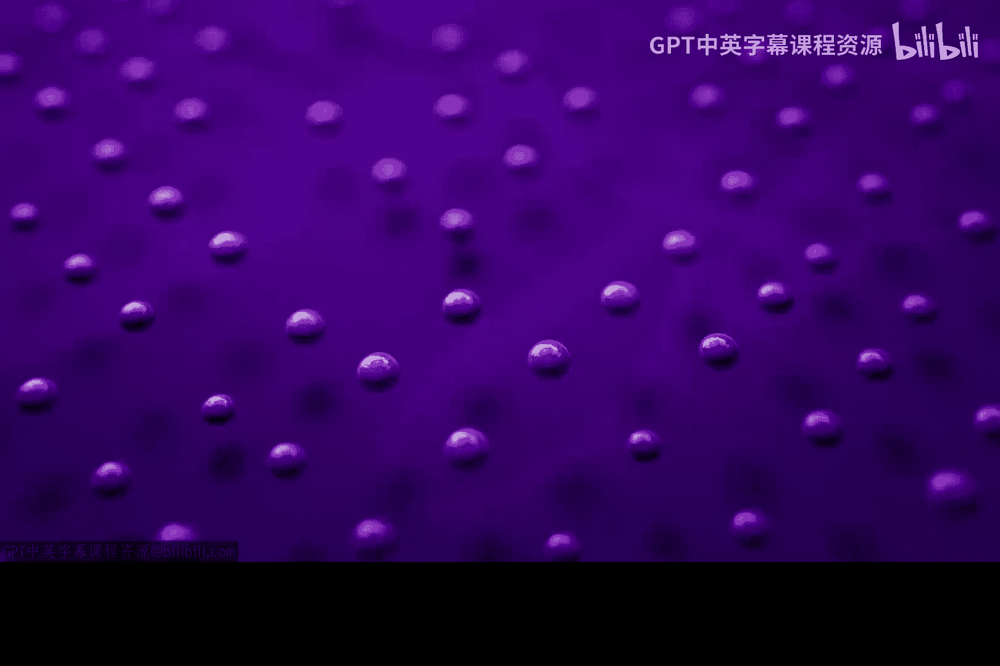
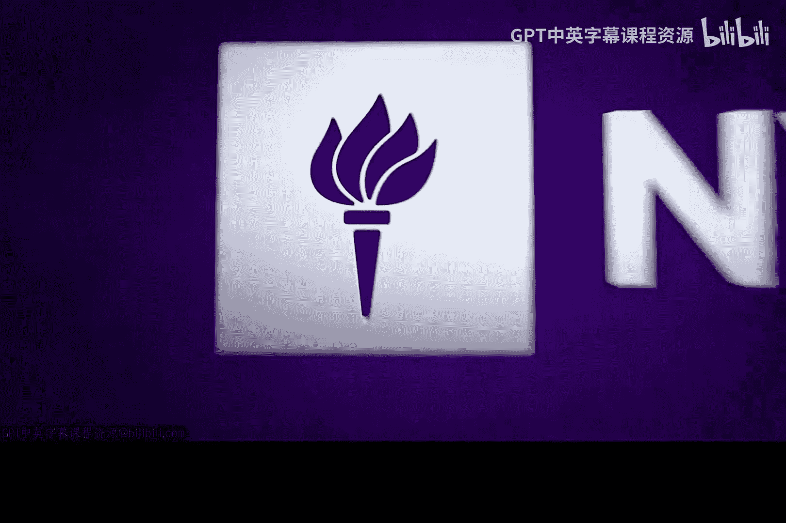
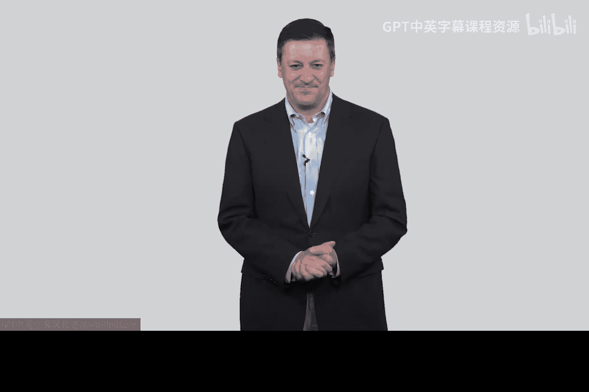

# 纽约大学《网络安全｜Introduction to Cyber Security》中英字幕（deepseek p45 0_网络安全课程介绍：你将学到什么.zh_en -BV1TFLZzYE26_p45-

Hi everyone， I'm Ed Ammarosso and I want to welcome you to our course on Introuction to Cyber Defense。

I think this is going to be very interesting and useful for you you know in cybersecurity my personal opinion is that there's way too much emphasis on cyber offense right hacking。

 breaking into things I know how fun that can be I know how challenging that can be but there's some pretty foundational issues that need to be covered need to be understood in order to really defend or stop these types of things and that's what we're going to be spending time on in this course it's an introduction to cyber defense with an emphasis on controls we'll be doing a lot of cryptography you'll be seeing the proverbial Allson Bob communicating and sending messages back and forth by the end of this course you'll probably be tired of hearing about Alice and Bob but you're going to learn quite a bit so so really the three main goals here that we have for this course are first to introduce the most important functional measures you'll see in a minute that safeguards you know'll have a little bit to do with policy procedure and so on we'll do that。

A subsequentent video， but really it's the functional mechanisms that lay the groundwork for the computer security。

 the cybersecur， the computer science aspects of what we're doing。 So that's our first goal。

 The second is to lay out practical applications here so we really do focus on this being a practicum。

 we want this to be something that can be applied。 This is not about building a theoretical basis even though I am going to spend some time building the theoretical foundations。

 I think you need that， but it's always about coming back to the real practical applications。

 So that's our second and then third I want to try and inspire you to a career in cyber defense again too many hackers and not enough defenders So hopefully by the end of this course you're going be inspired and you're going want to go really into a career as a good guy or good gal stopping attacks rather than designing new ones that I'm joking I understand that we do。

Have to understand how the hacks work。 And in a previous course， we spent some time on that。

 But I hope you'll stick with us through the lectures here， through the videos。

 read all the materials。 I think you're gonna learn quite a bit。

 So welcome to our course here on introduction to cyber defense， thanks。😊。

