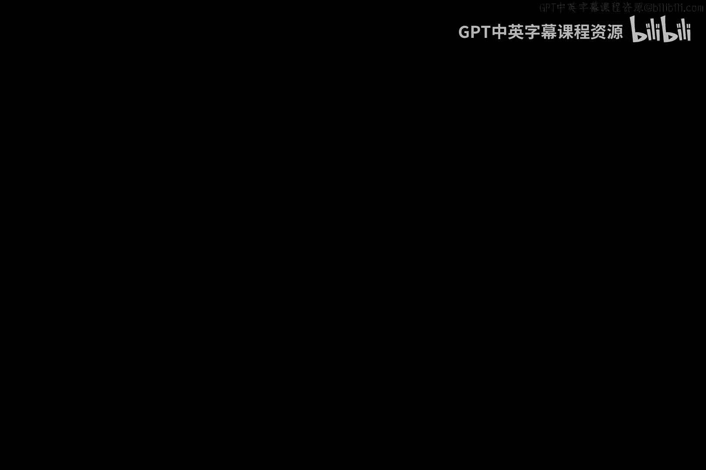
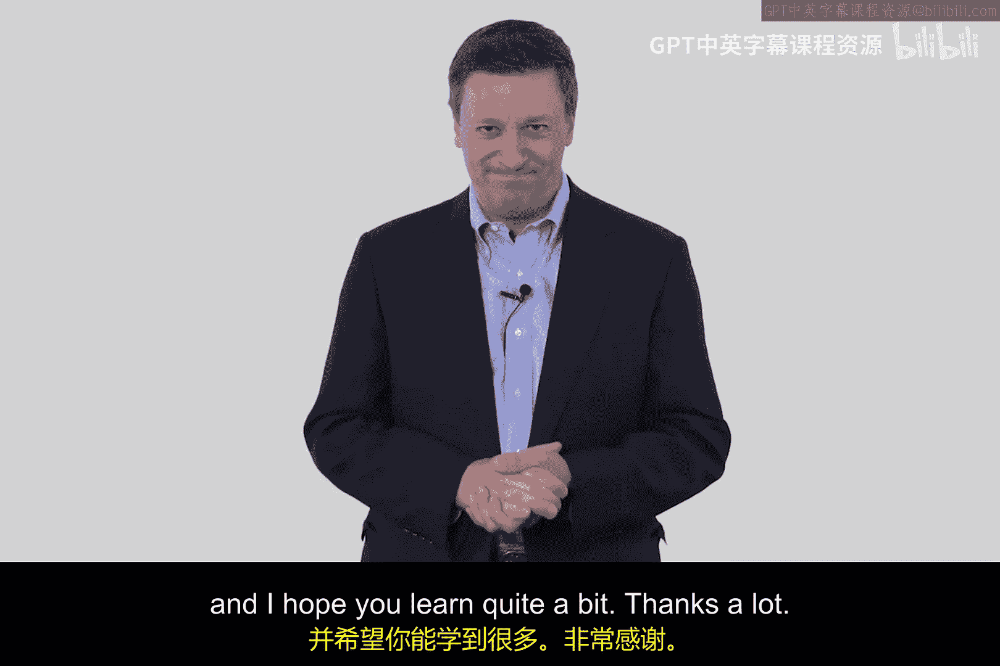

# 纽约大学《网络安全｜Introduction to Cyber Security》中英字幕（deepseek p46 1_作业与阅读.zh_en -BV1TFLZzYE26_p46-

Hi， everyone Ed I' Miroso here， and I want to welcome you to this module。

 The goal in this module kind of intro the basic cyber defenses in the context of modeling。

 creating these abstractions around how potentially you can arrange policy procedures and functionality to reduce cyber risk。

 a little mathematical some of the techniques that you'll see in this module。

 that's some papers and videos and resources that I think you ought to consider using as you go through the module。

 So first off a couple of cool papers。 One is called hookup theorem。

 and it's written by a mathematician named Darl McCulllough written some number of years ago。

 back in 1990， but it's a tricky little interesting paper， and I'd like you to take a look at。

 it'll match one of the videos in this module and help you understand it。

 Second is wonderful paper by two of the masters from Unis。

 Morrison Thompson about password security。 I'd just like you to read it。

 I think you're going to just enjoy。Some of the it's almost an historical survey and helps you understand where a lot of things come from in passwords and authentication that we take for granted today。

 so take a look at that paper I think you enjoy it there's a couple of optional books that you might consider one's an ebook that I wrote with my son Matt it's called from CIA to AP and introduction to cybersecurity。

 you to read chapters 9 and 10 as you go through the module。 it's optional。

 but a lot of you might like to go on Amazon download the book and have something to follow along with and then another optional is a good textbook on TPIP you don't need to do it。

 but if you want my advice， Richard Stevens， I think wrote the best one So TPIP Iusrated value1 by Stevens it's wonderful book and chapters 9 and 10 would be good ones to take a look at as you go through this and again totally optional Now a couple of videos that I think you should look at one if you look Richard Feynman。

Physicist， the Nobel Prize winningning physicist， talked a little bit about testing theories。

 Now you did that long before anybody even knew what cybersecurity was。

 but it's so relevant to what we do。 I would like you to watch that and then one of the famous sort of Pioneers and maybe one of the real leaders in cybersecurity Bruce Schneer。

 He's got a TEed talk called the Security Mirage that you should totally watch you want to make sure that you have some time spent watching Bruce talk if you can ever see him at a conference。

 make sure you go。 he's fantastic。 So I hope you enjoy all the great resources we have for this module and I hope you learn quite a bit。

 Thanks a lot。😊。

