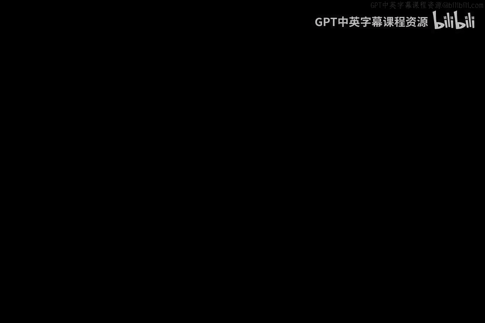
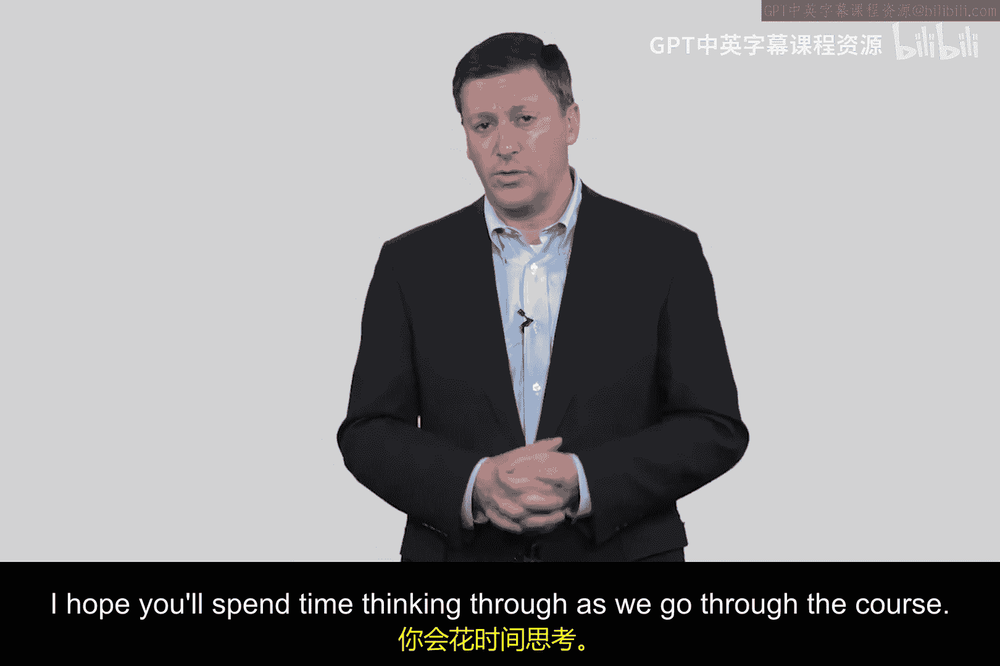

# 纽约大学《网络安全｜Introduction to Cyber Security》中英字幕（deepseek p47 2_安全措施与对策.zh_en -BV1TFLZzYE26_p47-

Hi， folks at Emmarosso here。 And in this video we're going to spend some time on a topic called Saguard。

 Cysecurity safeguards。 Now a lot of people like to assign meaning to safeguards。

 It's kind of a preventive thing stopping things before they can happen。

 a lot of times you'll see a term like countermeasure used to describe something something you do after an attack has already come in。

 We're not going to waste a lot of time in the semantics。

 I think way too many words in cybersecurity。 So what we're going to do is we're going to focus on this term safeguard as really the security。

 the defense that you follow to reduce risk and previous videos we spend a lot of time on risk management。

 We won't get into that。 but it turns out there's three different ways that you can employ a safeguard to actually reduce risk。

 let's go through them。 So the first is a functional safeguard。

 and we're going to spend a ton of time on this。 That's our firewalls。

 cryptography intrusion detection， any malware behavior。analytics。

 all the different functional computing controls， protocols， systems。

 real sort of tangible hardware software。 That's where they reside。

 We call those functional safeguards。 a second type is a procedural safeguard。

 That's where we get all the people together and we say， hey， here's how we are going to behave。

 this is the administrative procedures we're going to follow。

 these are configuration procedures we're going follow these are as users。

 this is how we're going to behave。 We're going to all promise not to click on things that look like this。

 and promise never to save things this way。 these procedural things that sometimes they're hard to enforce but a lot of times we have no choice right so functional and procedural。

 if you had your choice。 you'd have everything be functional and you tell everybody you can do whatever you want。

 you can't possibly cause problems， but you know that's not the way it works。

 So sometimes we have to follow procedural。Mechanisms or controls or step by step administrative agreements to do some sort of risk mitigation and we'll see a couple of those as we go through so procedural administrative safeguards would be a second category third category is policy and this is a funny one because it comes in a lot of different shapes sometimes it might be some some rule that if violated has consequences like say hey everybody you do something bad here and you're going to get fired for example so is that functional no is a procedural no but there are consequences yes。

 so these policies that we set up sometimes do reduce risk you might recall in a previous video and in a previous course I showed you soda machine and we broke into the soda machine and we all came to the conclusion that one of the more powerful solutions there's just a tape something onto the machine。

and say， hey listen， you better stop breaking into this machine because if you do and we catch you you're getting a lot of trouble that's not a functional control and that's not the procedural In fact。

 it's one of the things that's so unique about cybersecurity and is a practical cybersecurity engineer you have to keep in mind that unlike other branches of engineering sometimes just with a policy we can be more effective than a functional control'll give you an example and we'll spend some more time on this later。

 but take deception for example， suppose I have some function that actually is a trap。

That if you fall into the trap， you get caught and you get a lot of trouble。

 So it catches hackers and I have a functional mechanism。

 I put in place and I put them all over the place。 almost like mine fields。 Well。

 an alternative to that， would be to just tell everyone that you have a trap and that you have these mine fields that'll catch hackers that your policy is that it's okay to do that。

 Now， the interesting thing is that may be just as effective as really putting the functional controls in place。

 Do you follow if you think they're there， I may be affecting your behavior。

 So having policies sometimes complements procedures and functions。 So again。

 the three primary components and they work together functional procedural and policy。

 we're going to spend time through the entire course here going through those。

 So I hope this is useful to you， and I hope you'll spend time thinking them through as we go through the course。

 thanks。

