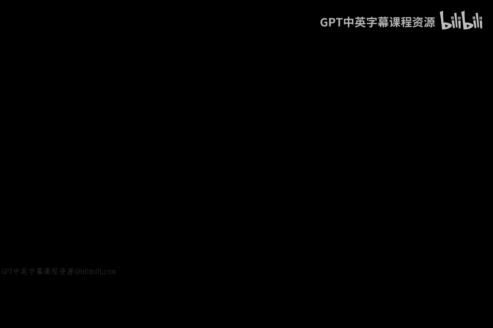
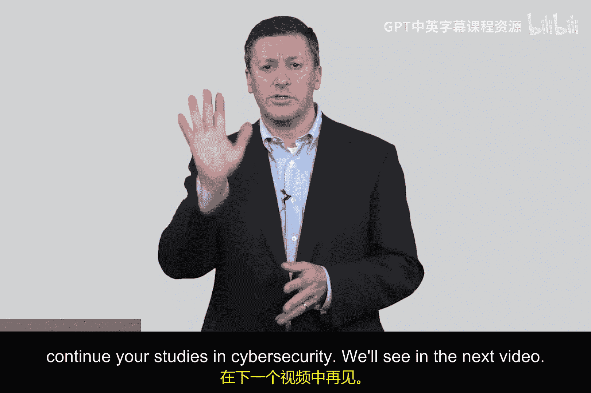
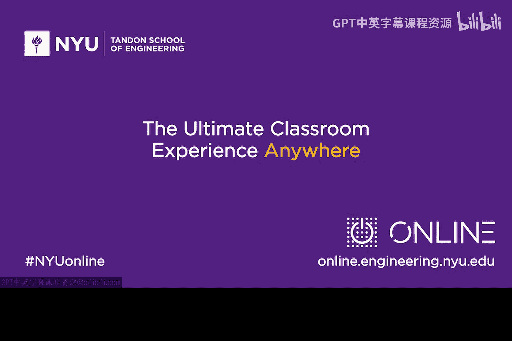

# 纽约大学《网络安全｜Introduction to Cyber Security》中英字幕（deepseek p49 4_橙皮书合规性.zh_en -BV1TFLZzYE26_p49-

Hi， folks Ed Rosa here。 I want to tell you a little bit about some of the early requirements work in cybersecurity built on the reference monitor concept that we showed you in a previous video from James Anderson。

 I want to tell you a little story first and kind of tracks my own career because I was involved in a lot of this。

 It was in the mid early 80s， I taking a job at a place called Bell Laboratories。

 if you can imagine you know those the Mecca for technology， particularly computer science。

 that was the place。 there were these masters doing Uniix。 so smart。

 there's guys that invented an operating system just by coding you know some very simplistic routines as part of leaving a bigger project。

 they were work on this big monster project， they called it mus and they thought this is getting too complicated and they went back home and the code is very simple operating system capability and smaller so they called it Uniix。

 and you would。Not it as the precursor to Android Linux。

 IOS but everything but these guys were geniuses and I remember being a little young pup working there and I would try and go into the hallways where these guys worked and hope that some of that genius would like come out of their office and hit me you know I would literally just find an excuse to go walk and be near them you know they looked cool to the beard and Bkenstocks like straight from Central casting but one of the things that they were not doing was adding cybersecur called it computer security then adding computer security mechanisms to underlying Unix So some teams started to look at this and one was led by a guy named Bob Morris Se who sort of in those days was sort of like one of the supervisors I was working for and the idea was how do we add security to Uniix Now think about this if I said to you。

 many of you watching take some system。I want you to add security to it， what would you do。

 you know would you start， what would be the framework that would help you decide what to do？

I'm not sure you'd have a good one， right， You'd go， well， add something here。 add something there。

 you'd， you'd come up with something in your mind that that you believe would be the right answer to the question。

 How do we add security to this system， So back in the 80s， The question was。

 how do we add security to Unix？ Now， luckily。There was a document being written by bureaucrats in the government that was awesome。

 Now， I know some of the more senior folks watching this might hearken back and say， well。

 wait a minute， there were a lot of mistakes in that thing。 And yeah， I mean， in 1983。

 our view of computing was very different。 for example。

 there was no real developed notion of networking in this document they were working on。

 but as I reflect back。 I think it's one of the best government reports I've ever seen。

 and here's what they came up with。The cover of the book was orange。

 So it' was called the Orange book in the TC sec trusted computer system evaluation crion and it had this big long government reference model。

 Dod 5200， blah， blah， blah， bh whatever， all these different ways of referring to it。

 but it was a criteria set of requirements where if you decide you have a system and you want to make it more security。

 you want to add security to it， it said here's our idea on how you do it。

 Like if you have a really terrible system， no security。

 then they would say you're in this one class like sort of the base class。

 the kindergarten version of cybersecur。 we have almost anything。

 say if you want to do a little better， then maybe you improve access control this way。

 improve auditing this way and demonstrate that you built a nice system through this thing called assurance。

 meaning you demonstrate correctness and bugfree operation Now if you want to go a little further here's some requirements that get you to the next。

ClAnd you can improve and add more access controls and add more auditing， I thought it was awesome。

That's what we did for Unix。 We thought， wait， look， we've got this wonderful operating system。

 We want to add security to it。😊，Why don't we use this document。

 So it's mind boggling now when you think about how nicely that document was written because anyone watching here。

would agree that usually the image that we have in our mind of a government document。

 and it's probably terrible。I'm not offending too many people watching。

 but usually government documents are written by committee and what was ever written by a committee that was any good。

 I would say this is one example。 So let's talk a couple of concepts that I think are really foundational that came from the orange book。

 So again， the functional mechanisms are not going to spend time on now because in subsequent videos we're going be spending hours together you know。

 on access and and audit and intrusion detection and certainly the authentication。

 which is a big deal。 But the second half of requirements。

 I want to spend a minute on and they're called assurance requirements。 Now here's the idea。

 the idea was that。😊，In addition to building something， correct。

You have to provide some evidence that you did a good job。 Isn't that weird， Like in security。

 It's not enough to just secure something。 You actually have to provide demonstrable evidence that you've done something you've done it right。

 And computer security for its first 20，30，40 years was as much focused on assurance as it was on functionality。

 And it's one of my great disappointments in cyber that we don't spend more time on assurance。

 We just don't。 But I think it needs to come back。 But here's one concept that was invented in the orange book that I think is is marvelous。

 It was the idea called a trusted computing base TCB。 And here's what that meant。

 It meant that every system should have some minimal set of functionality。That if all goes haywire。

 I know I can trust。Meaning Id provide high assurance that that piece of functionality is right。 Now。

 it's all but missing in computing with one exception in modern day sort of device and system management。

 some of you may be may know something about the idea of trusted execution。

 Like if you if you know a little bit about mobility and mobility design mobile operating systems。

 you probably heard about T Ee or trusted execution environment。

 and it's that TCB concept where I have one little embedded piece of functionality that I trust。

 sometimes it's hardware like on a lot of systems， you have called a trusted platform module。

 TPM that implements that TCB trusted computingbased concept invented by the orange book。

 almost 50 years ago， and not incredible。 like it well， I guess wasn't 50，40 years ago。

I think it's just absolutely magnificent that a government document had had the presence of mind to recognize how important a trusted base is to the overall secure operating system。

 really， really， really nice and elegant concept。 So what happened。 Well， the orange book， you know。

 kind of chugged along。 certainly became the basis for much of computer security from the 80s to maybe the 2000s。

 But it got a little tangled up in some bureaucracy as many government things will。

 like to demonstrate that you actually met a criteria class。

 It this long long evaluation process for a bunch of auditors would come in。 nobody liked that。

 You know， that turned out to be expensive， hard to do。 bureaucratic， a lot of paperwork。

 And everybody went， e And， and I think as computing kind of became more complex。

 And we became more impatient。With our ability to do computing， the orange book was screaming。 Hey。

 do it correctly。 S down。 Do it right。 But the world was saying， go faster。 I want more。

 I need more functionality。 I need more capability。 And you see a divergence。 And by the way， folks。

 that divergence from do it slow。 do it right to， I need more。 I need it fast。

 That divergence is the cybersecurity problem that we focus on in this class。

 That's it in a nutshell。😊，If you're wondering what is cybersecurity about， yeah。

 we have definitions and things that we give in an academic sense。

 but the way you want to think about it， the way you want to describe it to others is，Do it right。

 Do it slow。 That goes on one path。 Do it fast。 I need more。 That's a different path。

 The difference is what hackers exploit。 So that's why it's so important to make sure that we are rooted in an understanding of our history。

 The orange book is part of our history technologists。 we hate history， Comp sciences， in particular。

 hate history。 A book that was written a year ago。 might as well been written 100 years ago。

 It goes in the bargain bin at the local bookstore。 My gosh， that's a year ago。

 that's old stuff Pay no attention。 Weve no sense of history and we tend to make mistakes over and over and over and over again。

 because we never look back。 Not particularly in Silicon Valley here in the United States。

'm character。 but this unwillingness to slow down， because that's not how let's how you do it。

 That's not what's made Silicon Valley。 So exciting and successful。 So we have to understand that。

'Not not going to change that， but we can't be silly。

 we have to recognize that a lot of the problems we have in cyber are simply because we've divorced ourselves from some of the basic foundational concepts like trusted computing base that came with us through the orange book so keep that in mind as we go through this。

 I think it'll be helpful to you and useful to you as you continue your studies in cybersecurity。

 we'll see in the next video。

