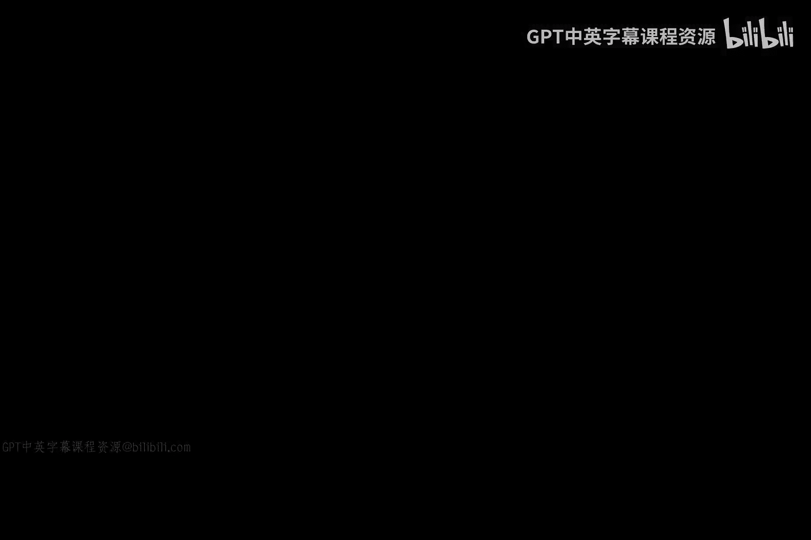
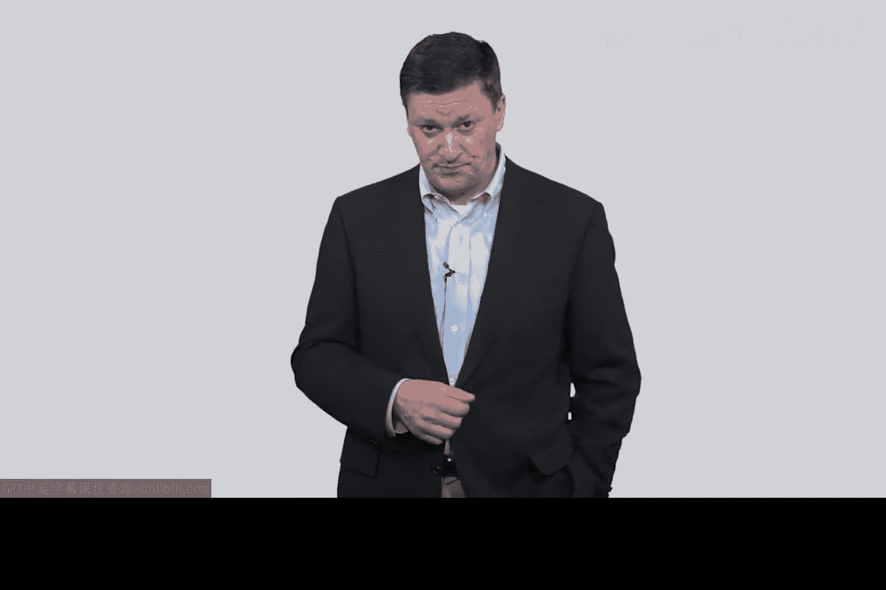

# 纽约大学《网络安全｜Introduction to Cyber Security》中英字幕（deepseek p50 5_Bell-LaPadula模型.zh_en -BV1TFLZzYE26_p50-

Hi， everyone at Emmarosso， and I want to talk to you in this video about some more history in cybersecurity always couched that because when I think historically。

 we didn't use the word cyber。 I have no idea where that came in。

 I've been writing books for years like in the 80s and 90s or books on cybersecurity。

 but I was calling them computer security。 And I remember an editor in maybe 1998 or 99 suggesting that I call a book that I wrote in 2000 intro to cyber securitycur。

 And I went， oh， Sure， I quite sure about that， it seemed a little odd now we use the term all the time。

 But anyway rate， let's hearken back and I want to tell you about a couple of guys that I know from a place called mire MIT R。

 It's MIT research and engineering。 They' were working in the 70s。 and I've admittedly。

 I was just still in high school then， but these guys were working in computing at a time when。😊。

Military， the US Department of Defense was starting to use computers for pretty critical。

 pretty sensitive military applications， and they asked these guys to look at how we might start protecting sensitive data。

From you know， prying eyes， from leaks from disclosure， from confidentiality issues。

 as they find a way onto the computers that we had in the 1970s were probably big monster mainframes that you've probably seen images of on old TV shows or old movies sort of big monster mainframe looks like。

 So these two guys， David Bell and Len La Plo。 good friends of mine。 In fact。

 Len La Palo wrote a nice liner notes for the first book I ever wrote in 1993。

 So he's a friend of mine。 they came up with this idea where they said， look。

 here's the way the military does it。 And we'll see if we can do this on a computer。

 They said first off。 Everybody in the military has this thing called the clearance。

 which means how trusted are you to have access to sensitive information or。

But you might be very trusted， but if you're the janitor cleaning the bathrooms， well。

 you're trusted， but you don't really need that information and setting need to know aside。

Clearances are things that are provided to people based on trustworthiness and kind of their position。

 So they looked and they said it sort of starts with the unclassified。

 which means you have no clearance。 but you could get， for example。

 something called a confidential clearance。 You could get something a little higher called a secret clearance。

 And then if you are a big shot。 you can get this thing called the top secret clearance。 whoa。

 you can read all this fancy， important sensitive stuff。 They saw that。 And they said。

 we have to start with that。 The idea that active entities， people。 And yeah， in a computer。

 that's going to be a process。 it's going to be some something running on behalf of a user application。

 They could have clearances。 So that's the first thing。 and they have good clearances for everything。

 Then the second thing they said， is all these files and documents we have are。

They have classifications， but the same scale， like an unclassified document confidential document secret。

 top secret， and so on。So we've got these two things。

 weve got people of these clearances and we have objects that have classifications and they went let's just call them labels because they're the same name。

 so I have a label on a person top secret， I have a label on a file let's say it's secret and they went。

How does the military do this and they looked and they went， hey， let's take some use cases。

 they said first off， is it fair for someone with a top secret clearance to read something that's top secret。

 dah， of course you can， that's the all idea you read it， but they said。

 what if though I have no clearance"，Can I read that top secret document and they went， no， you can。

 they thought， hm。That's interesting， so I can sort of read at the same level。

 but I can't be reading up so to speak。And they said similarly。

 someone with a top secret clearance can certainly read something unclassified。 So they went。

 it's okay to read down。 And they came up with this motto and said， let's call it no read up。

 interesting motto， right， The second thing that they noticed was when you're putting information into a repository into a file。

 a directory a document。 They said， if you're top secreting。 you're taking top secret information。

 you can certainly write it to a top secret document。 That's the whole idea。 But they said。

 what if you're at unclassified and you' got unclassified information。

 you want to put that in a top secret document， and they thought that's actually okay。

 Like it's al right to put unclassified in top secret， but flipping it。

 said can you take top secret information and write it down to an unclassified receptacle。

 they went no， say scratched their head and said， you know what， it's no write down。

 and they went they got it， No read up， No write down。

That was the whole idea now I got to tell you a funny story， the document they wrote around this。

Is really hard to read。 They wrote these two volumes using like field theory or something。

 Theyre big， fat， hard to read documents。I'm not sure anybody ever really read it。

But a friend of mine John Rushby， a very good researcher wrote a paper that explained it in a kind of a reasonable way I wrote you read that。

 and then I came up with a notation that I put in my first book that I think a lot of people have been using。

 I call them level diagrams and you see on the screen here， the level diagram shows yes。

 you can read down Yes， you can write up， but you can't no read down， no write I'm sorry， no read up。

 no write down for beop Pala can be explained with a simple diagram and you got to be real careful about these these big documents and so on。

 one time。Federal government asked me to review this big document。

And I won't tell you which one it is。 You may have heard of it， but it was really fat document。

 big long thing like this。 And I didn't have a lot of time to review it。

 So I wrote back to them and I said， I don't know the time and they said， well。

 just do whatever you can。 So I was teaching。 I was given a midterm。 And I said it to myself， right。

 during this midterm， I'm going to read this big document。 Send them my comments。

 That's all I have time to do。 So through a two and a half hour midterm。

 I read maybe this much of a document， this fat。 And I generated about 100 comments。

 and I sent it back to them， and I said I did the best I could，10 comments。

 whatever that's that's all I can do。 I don't have time。 So take my name off the reviewers list。

 because I didn't read the thing。 I read a little bit and they go， oh， that's fine。 Thank you。

 we appreciate your comments。 So months pass。 the document gets released。And as part of the release。

 they sent a thank you to everybody。 And I got a nice thank you No。

 because I did put two hours of time into it。 And they said bought big long list of reviewers。

 there must have been 50 fancy reviewers of this thing。 And they said， and by the way。

 were attaching a file here with everybody's comments on this。 And I thought， wow。

 I'm going to go look at this。 And I saw they made a mistake。

 They just sent me the file that had my comments。 So I sent him back a note， and I said。

 you sent me the file with my comments。 I'd like the ones with everybody's comments。

 and their answer was that is the file with everyone's comments。 They were all my comments。

 I read this much of it。😊，I think there's a lesson there。

 like as you're developing ideas as a computer scientist or as a research or whatever you do。

 when you write these big giant monster things， people tend not to read them。 Now。

 reference guides different story。 I think it's all right to build a reference guide that people can look up。

 But when you develop something that's got to be simple。 And you can see in a level diagram。

 get it very quickly， can see immediately how bell on the Pa will work versus trying to read 100 pages。

 So， so keep that in mind， No read up， No write down in a subsequent video will'll look at how the integrity threat is dealt with using a very different scale。

 but somewhat ironic conclusions with respect to level diagram。 So we'll see in the next one。

