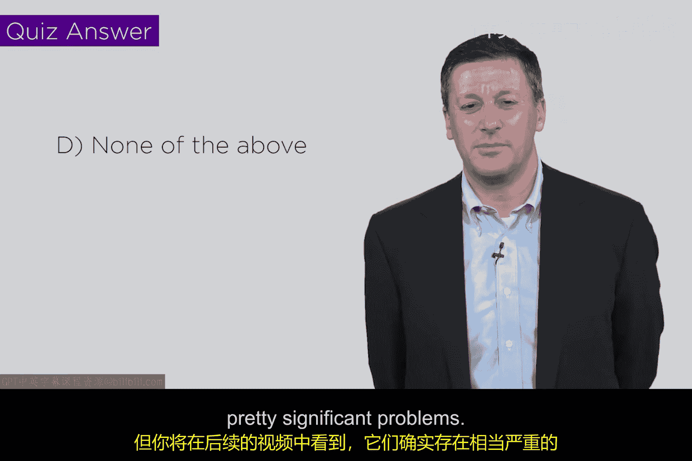
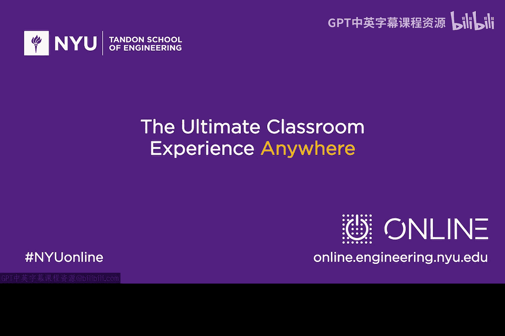

# 纽约大学《网络安全｜Introduction to Cyber Security》中英字幕（deepseek p51 6_Biba完整性模型.zh_en -BV1TFLZzYE26_p51-

Hi guys at Emmarosso here。 So I want to tell you about some work that was done at Mire just around the time that the Bell La Pala model was being developed for disclosure。

 was actually work that was done by another mire employee named Ken Biba。

 here's what he was interested in。 He thought Bell and La Palo were looking at how disclosure properties can be respected in systems that the military was building back in the 70s。

 And yeah， through the 80s and 90s and so on。 So his idea was。

 how would integrity properties be preserved and respected in a system along the lines of what Bell and La Pala did。

 So here's what he said， he said instead of the classic military thing where you have top secret。

 secret， confidential and classified for disclosure properties。

 we said they would be labels clearances for people。

 classifications for documents we call them both labels and again。

 top secret and so on the way military would do it。

 He said the way integrity works it's a different scale。 Like up at the top， you'd have。

high integrity people or high integrity documents where a high integrity document is something that has no corruption in it。

 has no changes in it， has not been modified。 it does what it says， it's something you can trust。

 ditto a high integrity person all the way down to a low integrity document which has a lot of garbage in it。

 it has insertions and special things you don't notice and it's Trojan and blah， blah， blah。

 and ditto people， low integrity people， people can't trust。 we said if we have that kind of scale。

 high and low。And medium。 What would that mean from whether you can read or write。 So he said。

 let's imagine a high integrity person reading a high integrity document。 Is that okay。 Yeah。

 it's perfectly fine， but he said， what about a really high integrity individual。

 I think of a beautiful little baby just born a beautiful high integrity baby。

 And and then as it gets older， it reads low integrity stuff。 It goes to school。

 It reads some thought。 it goes to college， reads really low integrity stuff。

 What happens then is it could corrupt the high integrity individual。 In fact。

 it could actually drop its integrity。 Like life could be this monotonically decreasing integrity function。

 I hope it's not that。 But anyway rate， he said you really ought not to allow high integrity processes。

 reading low integrity things。 And then for writing。

 He said it's kind of the opposite where a high integrity person can write to a high integrity document。

But should low integrity information be written up to a high integrity document。 He said no。

 So his two mottoes became no read down， no write up， which is the opposite of Bellopagla。

Be on the browser said，No read up， no write down。Flip it Bell for Bible。What does that mean， I mean。

 do you do them both？Like do you do one or the other， how would something like this be implemented。

 so very quickly this concept of modeling became a question and I'll tell you the idea of building a model and using that model is the basis for trying to describe how the world operates and works。

I think that thiss a good thing to do， it's just the world has to actually reflect the model。

 like because we as scientists， we develop theories。

 if the theory does not describe experimentation or your reality of the way the world is really operating。

 then the theory is wrong。And and ditto these models。

 So you had Biba beopaz Biba had some nice properties。 if you think about it， for example。

 if the high integrity stuff is， say your kernel， your operating system kernel and the lower integrity stuff for all your apps。

 The idea of somehow not having applications to be able to write into those high integrity system kernel functions or system objects is a pretty good idea。

 like it keeps viruses out of that sort of thing。 and then like administrators running as root high integrity processes probably ought not to be reading apps that come in know downloaded from an app store。

 shouldn't be reading down。 So the Bibleba model has some nice implications in cybersecurity。

 But it turns out that both Bllopagal and Biba had real problems， real problems。

 And in our next video what we're going to do is we're going to take a couple of minutes。

 and look at how those。Problems kind of realize themselves and the implication it has for modeling。

 Now， before we do that， we're going to just just sort of test our understanding here of Biba and bellopaglo type models with a very simple quiz。

 Do these respect the biba property。 And it turns out if you look at them they all inconsistence of the answers D you know none of them are considered acceptable in the context of biba。

 So hopefully that helps with your understanding of biba and the bellopagla model。

 Think about these properties for many years， they drove the way we did cybersecurity。

 but you're going to see in a subsequent video that they do have pretty significant problems。

 I'll see in a little bit。

