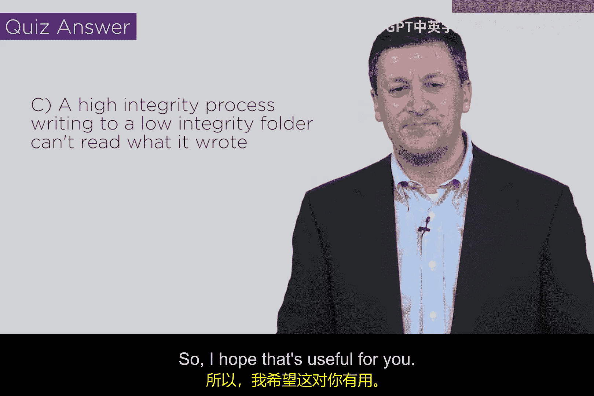

# 纽约大学《网络安全｜Introduction to Cyber Security》中英字幕（deepseek p52 7_主体对象操作模型的问题.zh_en -BV1TFLZzYE26_p52-

You know， in previous videos， we spent some time looking at Bop Palo and Biba and I explained to you how they were the basis of computer security now cybersecurity for so many years。

 and it's because they had a very compelling view for how you might deal with disclosure and integrity properties。

 and I think you may recall that we looked at how the integrity properties of Biba could be used maybe to protect like an operating system kernelel。

 So really compelling issues。 The problem is that the theory turned out to not match a lot of the experiences that people started to have with real operating systems and networks that were built to try to respect these properties。

 And again， I've said this and kind of touched on these themes in a lot of prior videos。

 and I want to do it again。 The idea of scientists creating theory is wonderful。

 but the theory has to match the experiments or it's wrong。

 something we've all learned from Richard Feynman if you' watched his。Videos are read his books。

 We've learned it from Einstein from all the great scientists would say you can develop a beautiful theory。

 You can have impeccable credentials。 You can do the mathematics。

 You can write all these wonderful papers， you can win awards。

 but if the observation that people make， the experimentation， the real worldor implementation。

 does not support the theory then it is wrong。 So now let's look at a couple of problems that emerge with respect to both be and the Pala。

 and the Bible model， and we'll start with something called a blind write。

 So the way a blind write works。 is that if I'm allowed for example， to write something up。

 like let's say I'm unclassified， and I'm writing up into a top secret document。

 which we all agreed no big deal。 If you want to put unclassified stuff in a top secret document。

 go ahead so you can write that。 But the corresponding operation of reading what you just wrote is not allowed in Bell and the Palaula。

😊，That's kind of weird right， Like if you're developing a Uni system and you're using a command line interface of the type that you might be familiar with if you're a Linux hacker or something。

 you know what a CI command line interface is Well。

 you're typing a command where you're putting something into a file and you're dropping it off into some top secret directory or something And then you want to go read what's there or even see if it's there。

 and you're not allowed to see it。 I'll say file not found or something Doest that seem weird to you。

 Would you like to work in a system like that。 those people came to the conclusion they didn't。

 is weird。 Its just know I love biba， but really， that's how my system is going to work。

 So it's one of the first hints that something was not right And here's a second problem。 And this。

 I think is the final nail in the coffin。 It's called the distributed read problem。

 And here's the way this works。Everyone knows， I hope you do。That in the TCPIP protocol。

 what happens between， say， Alice and Bob packets fly back and forth。 That's TCPIP。

 Alice says to Bob， hey， I'm here sends packet and then Bob goes。

 oh I see he sends a packet and then Alice goes， oh here sends a packet。

 you get this bidirectional traffic and once those packets fly back and forth。

An operation can be implemented on top of that between Alice and Bob， like sending a file。

 writing to something， reading， whatever， those operations。

 those application level operations are implemented after the TCP protocol has actually been established and do the handshake。

 So let's say you have a top secret Alice on a network who wants to write to Bob on the same network that would be a write。

 you would know that there'd be all this bidirectional stuff happening underneath， Similarlyly。

 if I have I don't know a top secret process that wants to read something across a network and a secret file or something。

 we've said before that that would be allowed， right。

 you're okay with somebody with top secret clearance reading something that's secret across a network Bell Lo Plo would say that's just fine。

 So top secret wants to read secret do it。But how do you feel about top secret writing to secret。

 We said we didn't like that。 But， it's like， wait a minute。

 I'm going to allow you to read so information can flow this way。 But to initiate that。

 I have to send a packet this way。And then packet it this way。 and then packet it this way。 And。

 and you go， just can't be right。 Like the model doesn't make sense。 Do follow。

 like I hope that that's sort of coming through in the discussion that the way science works is smarts。

 computer scientists， smart scientists， physicists， chemists， whatever。

 they propose theories about the way the world operates。

 We all look at those theories and the good ones makes sense。 And we think， wow。

 this is going to be useful over time。 they either stand the test of timer they don't。

 And it turns out that the be of Pa and Bible models did not。And other things have emerged。

 which we'll show。 But now again， just to sort of test our understanding here。

 just to do a little testing， make sure that you're sort of following， we do a little quiz。

 and it turns out that the answer is C， which is sort of the definition of this blind operation when you read or write you can't correspondingly write or read。

 so that would be the criticism that we would have of any of these types of models。

 So I hope that's useful for you。 we'll see in the next video。

