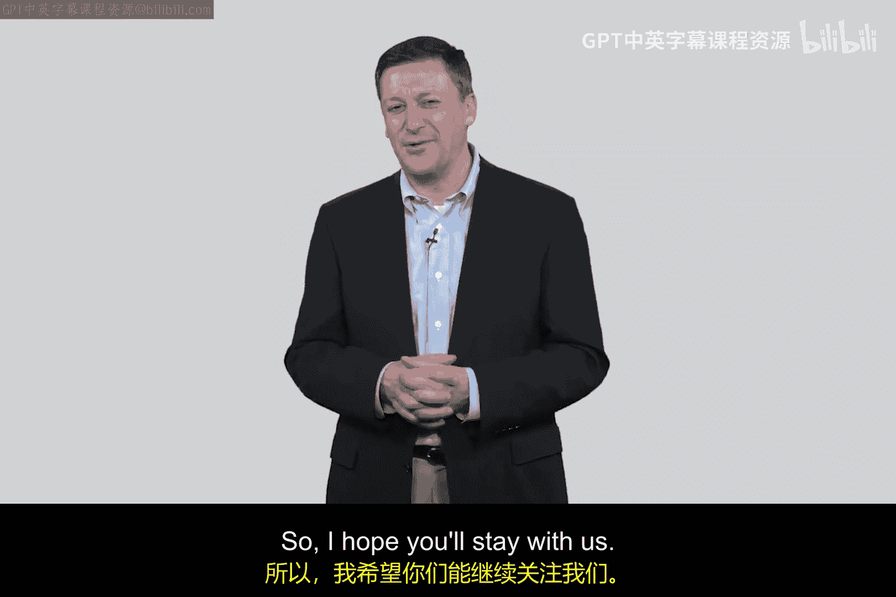

# 纽约大学《网络安全｜Introduction to Cyber Security》中英字幕（deepseek p53 8_隐蔽通道.zh_en -BV1TFLZzYE26_p53-

Hi folks， I want to talk to you in this video about communication channels now。

An overt communication channel is defined as something that is designed specifically to allow communication between two different entities。

 like me now， speaking with you across a video and you watching。

 that is an overt means for me to communicate with you。

 if I were to take out my iPhone and tap your number and then call you that is an overt communication channel was designed specifically for us to communicate。

 If I were to send an email to you or we meet in public over coffee in a coffee shop and we're chatting face to face。

 speaking my vocal cords making noise， your eard vibrating。

 that is an overt means for communication was intended for communication。 Now。

 if I told you that it was important for whatever reason， some legal policy， security。

 some sort of reason， that Alice， some Alice somewhere， absolutely should not be communicating with。

I'm Bob somewhere。Well， how would you do it， you'd say， okay， you guys can' communicate。Alice。

 no making videos and sending it to Bob and she goes， okay， you say。Alice， no phone calls to Bob。

 Alice says。All right， no phone calls。 You say Alice， no email to Bob and Alice。

 no meeting face to face over coffee and on and on and on。

 you make a big long list of all the overt communication channels。

 And once you've exhausted your list， you come to the conclusion that in your mind。

 Alice and Bob can't communicate and you can。Potentially say that if the policy is Alice can't communicate with Bob。

 you'd say we've met that policy because I've torn away the ability of Alice and Bob to use overt communication channels。

 And let me back up and tell you a little bit about I was a little kid My bedroom in my home shared an adjacent wall with my sisters。

 Her bedrooms here， my bedrooms there adjacent wall。 And my mother would say， all right， you kids。

 when we little settle down time to go to sleep。 no more talking， no more noise， no more anything。

 And in her mind， that meant no more me making noise with my vocal cord。 and my sister hearing it。

 It was bedtime， no more talking， be quiet。 We didn't have cell phones then。 So I wasn't texting her。

 But it was probably more like saying something。 But what we would do instead is when my mother would leave。

 is I'd go over to the wall。 and I' do like boom， boom， boom boom， boom to the wall。

 and my little sister would go， boom， boom now。Is that communicating？You bet it is。

 That's every kid does that。 It's fun and always the same sort of cadence， right。

 It's always boom boom boom boom boom， boom， boom。 I don't know where that came from。

 But every kid does that。 Now， what is that， Is that Is that an overt communication channel。

 Is the wall， an overt communication channel， when you're building a home。 Do you say， oh。

 it was beautiful bedroom。 Here's the door， There's the windows。

 Here's all the overt communication channel walls， I it ridiculous。 You would。

 you don't think of a wall that way， Was't designed that way。 And yet。😊。

We were using it for communication， and it's an example of something we call a covert communication channel。

 meaning it's a way of communicating。Va some shared mechanism or shared resource that allows for some sort of signaling between Alice and Bob。

 interesting question， right how you would shut the covert channels down， right？ I mean。

 in my home in my wall。 How does my mother stop us from doing。

 you can run in and say no knocking on the wall。 But there are other things she can do。

 It does turn out that there's two categories。 category 1 is what I said。

 you can just absolutely prevent me from touching that covert or shared wall。

 And that's not always so easy to do。 like in a dumb example like my sister and I in a room。

 you know the wall。 mom can say don't do it。 But suppose the shared resources something like a CPU on a shared。

 say say， let's say your two guest operating systems on a shared piece of hardware through hypervisor。

 and you don't want this guest operating system to be communicating with this。1。

And you say under no circumstances。 So I shut out all the overt communication channels。

 any sort of inter process communication or sending messages or whatever between the two processes on running on these respective guest Os is in a virtual operating system。

 one possibility is that this one guest Os at some prearranged time。

 might have agreed with the other one。 Hey， listen， we both share a CPU here。 Here's what I'll do。

 I'll launch this crazy job that'll make the CPU just come to a screeching halt。 and you'll see it。

 You'll notice it because we share a CPU here。 It's all virtual。

 but we got something common at 1 o'clock today。 Just watch。 if you watch the system。

 just go way down every response times low， that's me。 And that's me sending you a one。😊。

But if I don't do that， that's me sending you a zero and let's do that every minute。

Like every minute， I'll either bring the CPU down or not。

And what would happen is that if you can get that working。

 I've got a one bit per minute covert channel， Isn't that cool， How do you stop that？

I could launch jobs on a CPU， it's hard to block that。

A common mechanism that you're probably going to hate， but I'll tell you anyway。

 common mechanism that's been discussed， at least in the context of theoretical cybersecurity。

 which is where we are right now， we're doing theory。Is get this。You put noise in the system。

 random cookieooky noise。 So if the CPU is constantly just getting dragged down randomly。

 then you don't know anymore whether it was Alice's doing it or the system did it you know。

 like randomly， In't that crazy， or it would be like my mother getting a drum pedal on some kind of with a motor and just randomly。

 It's just tapping on the wall。 all night long random taps。 So if I want to go boom， boom。

 boom boom boom。 that's interpersed with all the noise coming from that dumb drum pedal on the wall。

 it's insane， welcome to to computer science theory， a lot of it does tend to be a little insane。

 But it's kind of interesting， right， because it closes the covert channel。 So the question is。

 if I want to respect the policy。 And I want Alice to not be able to communicate with Bob。

 which is a perfectly reasonable obligation or goal in cyber。😊，Se I shut all the overt channels down。

And then I shut all the covert channels down。It's kind of kind of an odd concept。

 right to be searching around for covert channels。 Theoreticians do it all the time。

 And in our next video， I'm going to show you something that I think is research from outer space。

 I mean， it's just really interesting and different。

 It's like nothing you've ever seen where we're going to take a couple of systems。

 I'm going to convince you that Alice can't signal Bob like I'll show you first that Alice can signal Bob。

 then we take out the ability of Alice and Bob to signal and I'm going to do another system like that。

 and we're going to analyze them and look at some of the properties are really interesting。

 So I hope you'll stay with us。 We'll see on the next video。😊。

