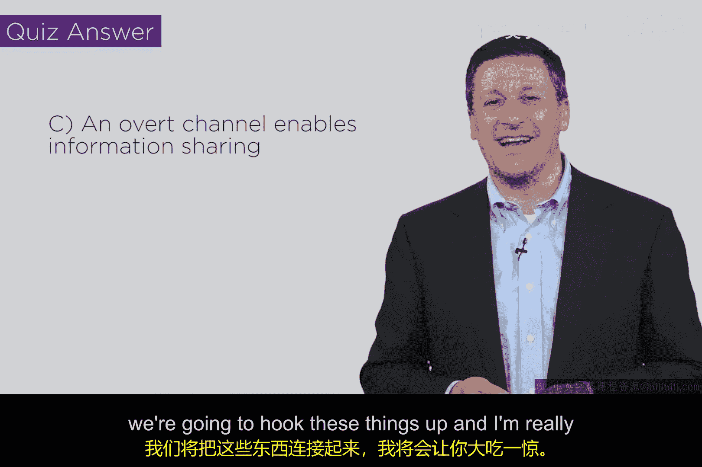

# 纽约大学《网络安全｜Introduction to Cyber Security》中英字幕（deepseek p54 9_信息流模型与Hook Up定理第1部分.zh_en -BV1TFLZzYE26_p54-

Okay， folks， So now what we're going to do in this video is crazy fun。

 some of you watching this are going to get turned on by this。 and like theoretical computer science。

 and some of you are going to say， forget it。 It's for the birds。

 but I want to expose all of you to this a little bit because again。

 from a cybersecurity perspective。 you should see some different angles。 Now you recall。

 we talked a minute ago in one of our previous videos。😊。

About the idea of an overt and covert channel being different， right。

 that overt is something you intend。 covert is the shared thing where I can signal someone。 Now。

 I'm going to posit some systems that I'll create that are。Kind of theoretical。

 It's due to some work by a guy named Darryl McCllough in the 1990s。

 very interesting researcher who's trying to come up with alternate ways to think about disclosure and integrity properties and computer system for cybersecurity。

 Here's what he came up with。 Now I'm going pop up a chart here。

 you'll see something we're calling system Y。 And on the left， we've got a user， user A。

 And on the right， we've got a user user B。 in the way this is dopey little system works。

 I that a sends a bunch of messages to this system system Y。

 And then at the end of sending a bunch of these messages。

 The parody or odd or evenness in the number of messages that were sent is sent to the user B。

 gott it。 So I go boom， boom boom boom boom boom boom。

 And then we add up how many of those there were。 if it was odd， I send odd。

 if it's even I send even。 And I think you would agree a can certainly signal B du I just if I want to do an even number of stuff。

 I do that。I send you even if I to do an odd number of stuff， I do odd。

 I send you odd and you're getting odd or even we can come up with an X bit per second covert channel or microsecond or millisecond or whatever it is you follow。

But now， if we look at I throw a chart up here that's going to show you the system itself introducing randomly generated messages。

 I have it shown as a0 popping out from the system。

 So we're going to make the zeros and ones be the inputs that are coming in And then some random thing the system does。

 And then the parody that B user B Cs is going to add up everything not just what user A does。

 but what randomly the system does as well。 it's noise。 So I want to send even。

 but the system generates some noise。 let's say it's odd。 user B is going to see odd。

 or let's say I want to send odd and the system generates odd as well。

 odd plus odd is even user B is going see even I've closed the channel。 Do you see what I mean。

 there's another example， I send one message， I send one the system sends one output。ly a zero。

 one and one that's two things that were sent。 it's even I'm not adding the ones and zeros。

 I'm adding the number of messages that are being sent。 You follow。

 I would claim that this system Y prime，We changed y to y prime when we added the noise。

Is called deducibility secure。 That's the definition that was introduced。

 meaning a can't signal B in this example。 And that's a property that we look for。

 It's something called information flow theory。 So instead of be and La Plo， who can read。

 who can write。 We say， is it possible for a somehow signal B。

 Can I have information flowing from A to B。 Don't worry about whether you've got TCP packets going this way or that I forget all that。

 I'm interested in information。 And I think it's a better model。

 So we can see the system Y is clearly deducibility secure。 So's look at another example。

 And this one I've drawn a little funny。 I put the user down in the bottom and saying user A can't even signal this system Z or Z。

 will'll say system Z。 user A can't do it。 there's no way of signaling the system。

 But then randomly from somewhere。 inputs and outputs are hitting the system randomly。

 No input from a。And then B just sees the parodity of the random stuff that's hitting its systemClearly。

 I'll show you in the next sort of diagram here。 you can see that system Z clearly deucibility secure it's sort of obvious given the fact that A can't signal B do you follow these are two examples of systems that respect a property that's focused on closing covert channels and we did it in both cases by introducing sort of crazy noise property Dar McCulllough did it and you're going to see in a subject of video we're going to put these things together to see what happens。

 you're probably wondering why is Ed showing me these weird systems but once we hook them up。

 you're going to see an interesting property come up now just to make sure we're all together let's do a little quiz here as we do on many of our videos and the answer is obviously C C is the definition。

Of an Not channel。So I think you probably have a pretty good understanding at this point of these things。

 now in a subsequent video， the next one， we're going to hook these things up and I'm really going knock your socks off with that。

 So we'll see you in the next video。

