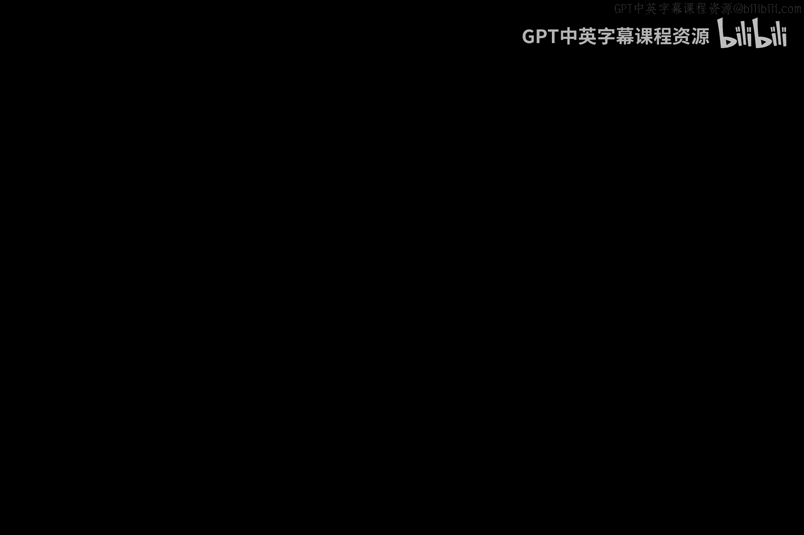
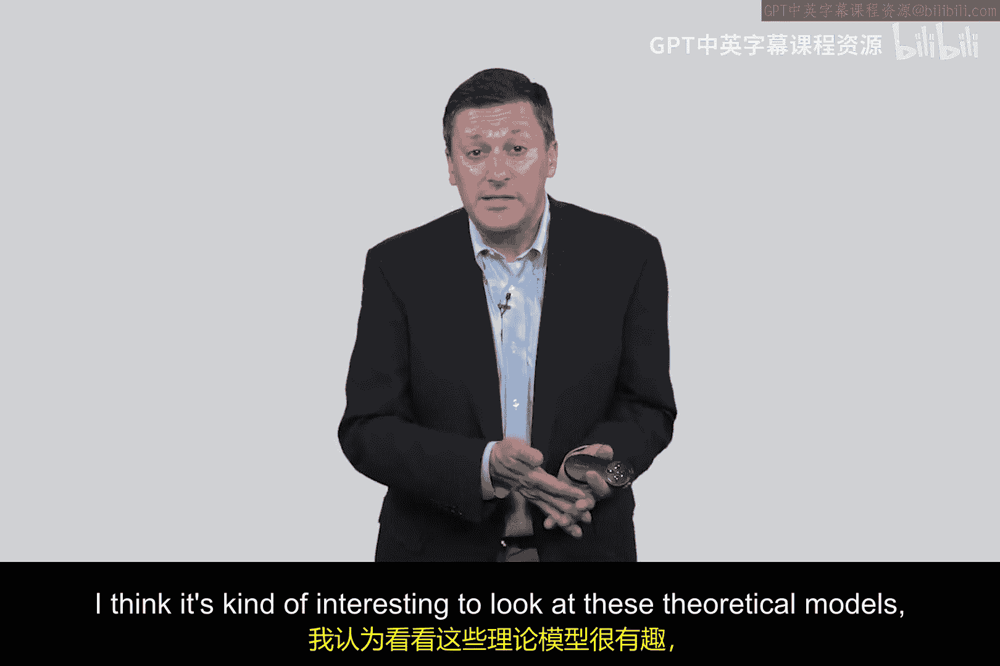

# 纽约大学《网络安全｜Introduction to Cyber Security》中英字幕（deepseek p55 10_信息流模型与Hook Up定理第2部分.zh_en -BV1TFLZzYE26_p55-

Hi， folks at Amarosso here。 So what we're going to do in this video in the previous when you remember。

 we introduced a couple of systems system Y prime and Systemed that we said were deducibility secure。

 Alice can't signal Bob user A can't signal user B。 And I think you are comfortable with that。

 So I've shown them on the board here shown on the screening C system Y Prime System a none they're both deducibility secure Now。

 if user B is the same user in both cases， and it doesn only the right end user A for the first one because I don't have any interaction with system then I can show you in the next chart that user B is reading the two parodies do you follow a is doing something to the first system to system Y prime。

 It can't touch System Z。So now it does something。 And at the end of the game。 So to speak。

 a bunch of inputs， user B sees the parody from both systems。 That makes sense。 Now。

 here's the best part。 If you do this， boom， you can see in the new chart they just hook them up。

 That's why drewew them in that funny way that I can take random stuff coming into and out of system Y prime and the random stuff coming into and out of system Z。

 just hook them up。😊，There you go。 We're done。 So now the way the games will work is that we'll say ready go and a will do a bunch of stuff。

 And again， a is going to be sending inputs to system Y prime。

System Z and system Y prime will then be doing their random things。 you know。

 sending and receiving messages when the game ends。

 you add up the parity of the number of things that happened in Y prime。

 You add up the parity of all the things that happened in Z。

 And you show both of these parodies to user B。 Okay， let's do a couple little games。

 Let's look at our first one。 So now user A sends0 messages。

 And let's say that nothing happens between Y prime and Z。 we said it was random。

 So random could be nothing。 So we get no messages from a。

 No messages from Y prime and no messages from Z。 Just the whole thing is quiet。

 What's going to happen。 Well， obviously， user B is going to see even parity at both places。

0 is even。Okay， so if a does nothing， parodies are even as long as nothing happens in the middle there。

 Let's look at another case。 How about again， user A does nothing。

But now the two systems are sending and receiving a total of four messages to each。Well。

Yhy prime is going to count up four things。 Z is going to count up four things，4 and 4。

 They're both even。 The paries then will be the same。 So user A does nothing。

Then in our first two games， we could see that the parodies that B Cs are even。

 What about now if user A does nothing but why Prime and Z do an odd number of things， they do  five。

 Well， then they're going to see odd oddd， but notice they're the same。 h Think about this。

As long as user A does nothing。All the traffic， all the adding up at Y Prime and'sed will be the same at both systems。

 The follow A just hangs out and does nothing and the two parodies will always be the same。

 Do follow。 So it's a way of forcing the parodies to be the same。

 but now watch user A does one thing。Now it doesn't matter what Y Prime and Z do because Y prime will always count。

The A inputs， but Z doesn't。So if a does an odd number of things。

 it'll always be one off in parody from Zed。 Do you follow In this case， user A sends one thing。

 Nothing happens between Y prime and Z。 I see odd parody at Y prime。 I see even parody at Z。

 Isn't that cool。 And another example here。 user A does one thing。

 And then a bunch of traffic happens between Y prime and Z 5 things total  three messages this way。

 Two messages that way。 Yet， it all up doesn't matter what they add up to because you're always going to be counting one more at Y prime and Z。

 You know what this means。😊，It's pretty profound。 Here's another example here3。

3 from user A and so on。 The profound conclusion we come up with is that deducibility security doesn't compose。

 Think about that。 What that means is I I have one secure system here。 We all agreed。

 it was theducibility secure。 And I got another system here， It's perfectly if fine secure。

 You agreed， right， both secure Why prime can't deduce Z can't deduce or both deducibility secure。

 H them up in a logical way and suddenly a can signal B through the respective parodies。

 It doesn't compose。This is pretty crazy， right？ I mean， from a theoretical perspective。

 this shows that just assuming that having a system that's secure and another system that's secure and putting them together。

 everything's gonna be fun。 It got secure。 It gets secure。 putting together。 it should be secure。

 Well， it's not necessarily true。 That interesting， look。

 if you're watching this from wherever in the world you're watching。 And this is turning you on。

 I like that，s fun。 It's interesting way of thinking about computer science。

 this is theoretical computer science is what this is。

 If you go off to grad school somewhere and you're studying computing and so on。

 this is the kind of thing you can get yourself involved in。 I think it's very fun。

 it's like thinking about puzzles and a different way of modeling the universe。 Now again。

 it may be that these models don't necessarily match reality。

 And that's what experimentation does for us。 But I hope it has been fun for you。 I think it's kind。

😊，Interesting to look at these theoretical models， see what makes sense and see what doesn't。

 We'll see you on the next video。

