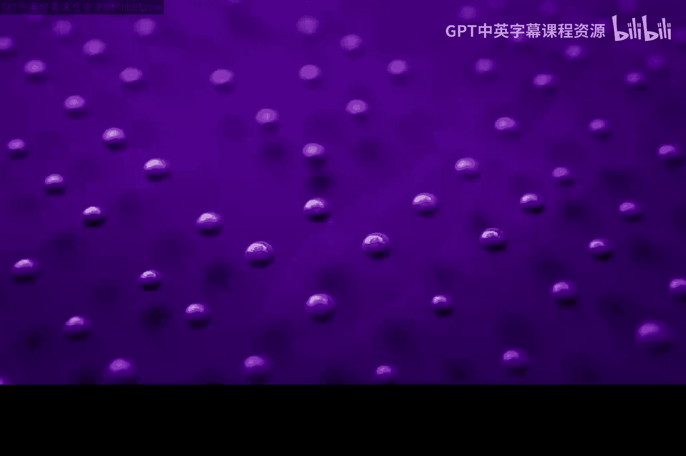
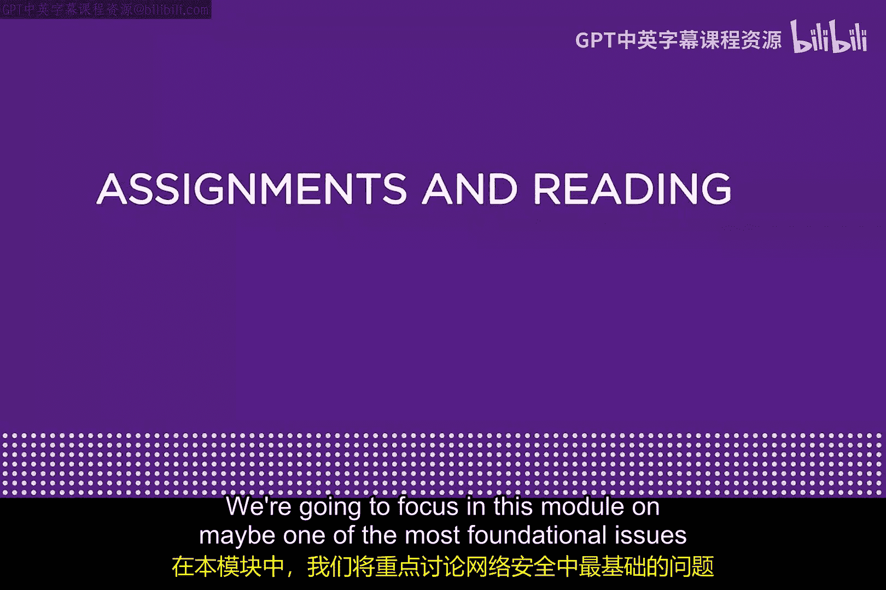
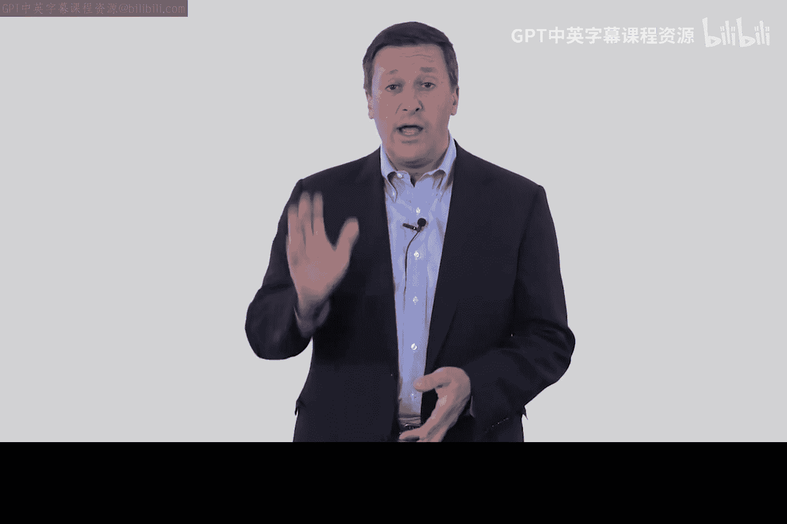
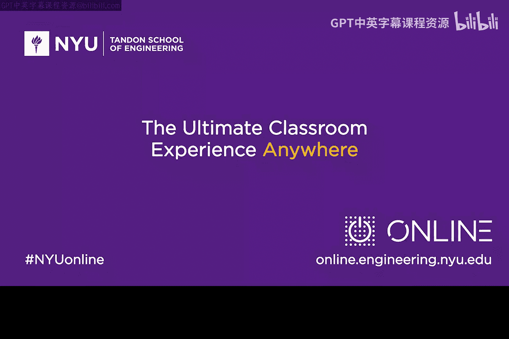

# 纽约大学《网络安全｜Introduction to Cyber Security》中英字幕（deepseek p57 12_作业与阅读.zh_en -BV1TFLZzYE26_p57-

Hi everyone at Ammarosso here。 I want to welcome you to this module。

 We're gonna to focus in this module on maybe one of the most foundational issues in cybersecurity and that's identification authentication。

 And you do that10 times a day and the Internet with apps and with services you use where you're presenting a user identity and then proving that you didn't lie might use a password or something。

 we're going learn lot better ways to do it than just typing a password And now there's some nice resources that I think you should use as you go through the module。

 some papers， optional books and some videos I tell you about them a couple of papers I pick two really old ones here。

 I'm a big proponent of going back and looking at things in our history that help illustrate what we're doing now。

 So these two papers from 1973 one is from Saltzer and Schroeder it's called the protection of information computer systems old paper but I think you need to look at it。

 we don't spend enough time。On our history in forget about cybersecurity。

 How about just in computer science。 we tend not to do enough of that。

 And the second is from one of the great pioneers。 Butler Lampsson wrote a paper called a note on the confinement Pro。

 really， really important paper and it's sort of predicted a lot of the techniques that are used today in virtual infrastructure。

 So take a look at those two older papers。 Now there's two optional books。 One is an optional ebook。

 you can get on Amazon written by myself and my son Matt。

 It's called from CIA to AP and introduction to cybersecurity。

 and some sense a companion ebook to this module into the course。 again。

 for those of you like to have something to read along with them go ahead and download the book。

 but it's optional。 and then also optional is a really good book on TCpiI。

 I think Stevens wrote one of the best ones， there's versions that he's written with co-authors。

 you just need to get a good book on TCpiIP。 and Steven's book。

 if you're going to do a chapters 11 and2。would be good ones to just sort of follow along with as you go through this module Now in terms of some videos is' an awesome Ted talk by Chris Do it's called the ones and zeros Be Cy warfare it was kind of a provocative title but really good and then I think there's this paper on the growth of cryptography by Ron Rve if you've ever heard of RSA Ron Reveta is the R in RSA and he's just wonderful and you know one of the great gems in cybersecurity and you should make sure you watch a video from Ron Reve So I hope you'll take advantage of these resources as you go through the module and I hope you learned quite a bit thanks a lot。

