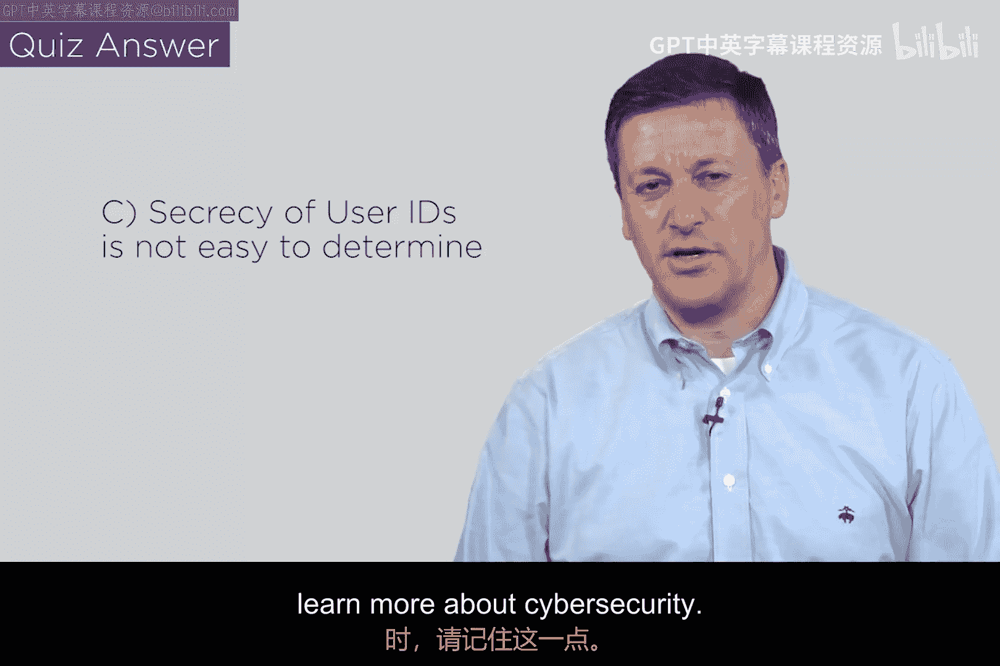
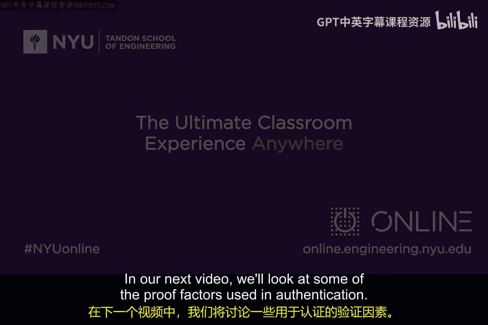

# 纽约大学《网络安全｜Introduction to Cyber Security》中英字幕（deepseek p58 13_识别与认证.zh_en -BV1TFLZzYE26_p58-

Hi， Ed Miosso， I want to welcome you to a section of our course now where we are digging into classical cybersecurity and we're going to start with what I think may be the most important primitive in cyber。

 It's called authentication。 And let's talk a little bit about this Because I think you he has 10 cybersecurity experts。

 What is the one most important thing you can do if you're allowed to have one thing。

 what would you pick， they'd all say authentication。

 the idea that if Alice and Bob are communicating this ability for Alice to identify herself to Bob in such a manner that Bob can be pretty confident that it's really。

 really Alice， that's for many people the most important thing that goes on。

 So let's start with the idea of identification。 How do we identify ourselves。 just in regular life。

 How do I identify that I'm Ed， if I meet you somewhere and I walk up to you and I say， hey。

 how are you doing I Ed， I hope。Enjoed the course。 and you see me， you see my face。 you see my voice。

 You see who I am contextually。 maybe there's a reason why we would see each other。 You're probably。

 pretty confident when I say I'm Ed， that's fine， and question is my name a secret。

 I your identifier a secret， Is your email address a secret， I your phone number a secret。

 These are weird questions， like your phone number。

 Let's say I said is your is your mobile number a secret， you would say， of course not。

 it's on my business card or I tell my friends or you know whatever。

 But if you're in some creepy bar somewhere and some weird O comes up to you and says， hey， you know。

 can I have your mobile number， you're probably not going to be sharing it。

 and you're glad that at least in some sense， it's secret。

 So is this weird kind of concept of what secret， what's not。

 your user I If I know your user I for a particular system you use。

 We all know that most systems have lock。😊，Out which means if I know your user I， I can type it in。

 I can type a bogus password。 It'll say no， I type your user I， type a bogus password。 It'll say no。

 I do enough times。 I lock you out just by knowing your user I。 So is it secret， Should it be secret。

Kind of an open question in cybersecurity， but the one thing we do know is that after reporting an identity。

 we want to be able to validate its authenticity so。

The definition of authentication is the process of reporting。

 rather the process of validating a reported identity。 Alice says I'm Alice。

 Bob takes some authentication steps to validate that reported identities。 that makes sense。

 So that possibility， as you'll see。I is harder than it sounds。 Now， again， human beings。

 we said a minute ago， you see me。 You probably look me over， hear my voice。

 Ask me a couple questions。 and you kinda know that I'm me。 But what if I'm behind a wall， And I say。

 he， I'm Ed。 And what if my voice is disguised。 So now you can't use my face。 You can't use my voice。

 How do you figure out that I'm me， Chs are。You're going to do something called challenge。

 meaningan you're gonna to say， all right， let's see if you're Ed。

 what did you say on the last video I watched that blah， blah， blah， blah， blah。

 And maybe that's a good test。 Maybe it's not it's probably a lot of people watching the video。

 So a lot of people could answer that。 Maybe that's a terrible challenge to determine my authenticity。

 but you get the idea。 subsequent video。 we're going spend some time on the proof factors。

 But for now， let's think about a couple of different possibilities for authentication。

 One is a client reporting an identity to a server and the server saying， hey。

 client prove that you are who you say you are。 That's called client authentication。

 which you would guess person with a browser trying to get on a server。 and it says， well。

 before you can come on you prove you are who you are。😊。

Second possibility is a server reports an identity to a client。 and the client says， hey， server。

 prove who you are。 Now， where would you do that again， client with a browser。

 And now e-commerce site that would like you to send a credit card And you go， hey， you know。

 I'm W W W do Walmart dot com， please send money。 And what would happen is the client would say。

 well， prove you're really Walmart。 and Walmart would's all protocol for that。

 That's called server authentication。 That makes sense。

 you either authenticate client or authenticated server。

 And then all variations on that peer authentication is to peers authenticating mutual authentication is I authenticate you。

 you authenticate them。 like in mobility，2G3G server 3G second generation。

 third generation like U MTTS didn't have the correct sort of concept of。😊，Server。

 rather tower and handset authentication，2G， a handset will pretty much connect anything。

 By the time we got to 4G and 5G。 a lot of that's fixed。 some and 3G but with fallback。

 It's still caused some problems。 but you get the idea that you can do client authentication。

 server authentication， mutual authentication， peer authentication。

 this is all just around the direction。 So hopefully that's going to be useful for you。 Now。

 I want to offer a little quiz here， just to make sure we're together on some of the basic concepts of identification authentication。

 I if you look at the three， you can see that the answer C is right。

 like that's the essence of user I privacy and secrecy。

 the idea that it's really not that easy to determine whether your mobile number。

 your user I your email address is truly secret， It's sort of secret， but sort or not。

 So that discomfort。Is normal in cybersecurity。 Not everything is so crystal clear。

 A lot of things kind of determine are determined by the context。

 So keep that in mind as you continue to think about and grow and learn more about cybersecurity。

 In our next video， we'll look at some of the proof factors used in authentication。

