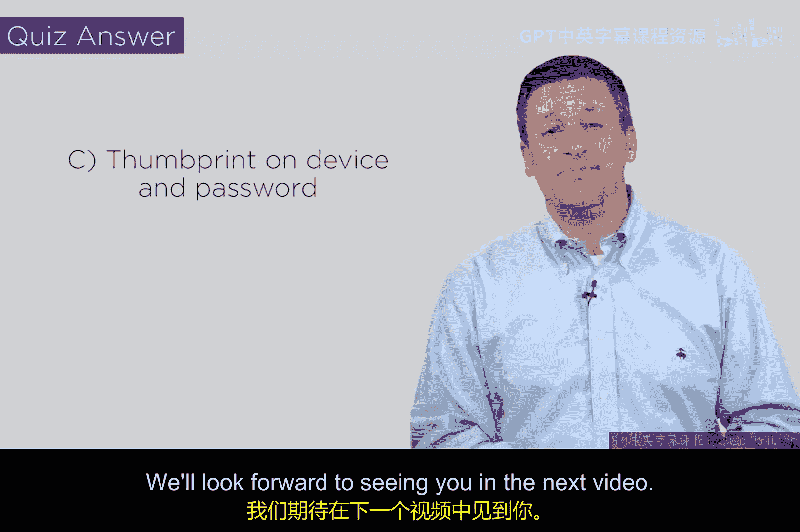

# 纽约大学《网络安全｜Introduction to Cyber Security》中英字幕（deepseek p59 14_认证因素包括双因素认证.zh_en -BV1TFLZzYE26_p59-

Hi， folks at Amroso here。 and in this video， I want to talk to you about the proof factors that are used to validate a reported identity and authentication。

 Now， first question is， what is proof。And a lot of you maybe have studied mathematics。

 maybe studied in high school or you in college， you studied in college。

 or you maybe even do mathematics。 I don't know。 I always find it interesting that when asked the question。

 What is the definition of proof。 You expect a mathematician this really involved sort of detailed technical answer。

 you know what the correct answer is to what is proof， It's convincing evidence， not crazy。

 it suggests the proof， is subjective and contextual， meaning， if I can convince you。

 if I can provide convincing argument that something is the case， then I provided us as proof。

 I provided sufficient proof that something is true。 So here's what we're going to do。

 We're going look at this question of Alice， a client。Reporting an identity to Bob a server。

 And for the most part， as we do this， Alice is usually a client。 Bob is usually a server。

 I'll tell you when it changes。 But you can more or less assume that that makes it easier for us in shorthand。

 if I forget to say， you'll know Alice client Bob server got that。

 So Alice is reporting an identity server saying， hey， I'm Alice。

 And then the server is going to go really prove it， prove that your Alice。 Now， what can Alice do。

 There's a number of different possibilities。 So the one that you're most familiar with is that Alice knows some secret。

 a password or a pin or something。 That's the most universal type of validation proof that's used。

 every single person hearing my words right now has used or is using or will continue to use passwords for a bunch of different applications and systems and network uses。

 And and that's not。Go change Well obviously some weaknesses there we'll get to passwords。

 we're going to talk about them in a subsequent video， but that's the first type。

 and we would say it's something you know could be a phrase， word， number， whatever， that's one。

Second is something you possess。And that's usually something tangible， like my mobile device。

 some handheld something， a calculator type device。

 a little key that you would keep that's something you possess。 So if I have it。

 that means I must be somebody who got it and if I have a trusted distribution mechanism or I trust that mechanism。

 that I know that you have it， then you must have gotten it from that mechanism。

 like a driver's license here in the United States is a highly valued thing to possess because if you have a valid driver's license has your picture has good watermark signal。

 It's got information there about you。 it matches you， it's hard to forge。

 that if I present that then all the power and authority of the issuing group in the United States it would be the division of motor vehicles wherever you're watching whatever country probably have something very similar。

 but all the trust inherent in that provisioning process extends or cascades to that。Validation。

 Do you follow。 We call that in computer science Cascaded trust。 So when Alice says， oh。

 you want proof， let's just say it was， here's my driver's license。

 It's not going to be for computing， but imagine Bob says， who are you。

 say here's the driver's license。 And Bob looks at driver's license。

 All of the confidence Bob has in the issuing authority has been cascaded to that process。

 Do you see it's not just Alice made something up。 but you actually have a third party authority that provides that。

 So that's the something you possess。 Third would be something you embody like something you are。

 And what are the things that are unique about human being。 Well， one is your retinal pattern。

 So you could imagine going， you tap prove it。 And then you put your eyeball up to something wouldn't be my favorite way to authenticate to like Facebook or something。

 But has one possibility。 a fingerprints another one。 and by the way。

 what would be an example of someone who would not be。Able to use thumbprints。

For some sort of validation of identity。 Well， someone with no thumbs。 I mean。

 I know that' I mean that in a glib manner because I'm sure there's probably people watching who don't。

 So if you don't， then you can't use the thumbumbrd。 So it's not always just a slam duck。

 I said retinal pattern。 there might be people don't have a retina that they can use for that。

'd be very careful with these factors when you're dealing with a lot of people。

 You want to be respectful， not everybody's going to be able to do all of these things。 Now。

 one thing everybody can do。100% of you could do。 but 100% of you would not want to do is DNA。 like。

 you know， tapti tapity tap， log in， prove it in the little needle pops up and you go and it takes blood。

 you know， to see none of you are going to like that。

 but all of you can do it if if you're watching this than you have blood and you have DNA。

 but you'd hate that。 So something you embody is a little different。 Now voices in。Interesting one。

 right because voice works。 But what changes about a voice as you get older？

Your voice changes when you get a cold， your voice changes and you can record a very high quality version of somebody's voice。

 And you see a lot of hacks nowadays， where people will call you on the phone ask you a question。

 Get your answer to that question recorded and then use that in a subsequent query as you has' got your voice to answer something。

 I would be quiet。 and I' very careful when it comes to some of these proof factors。

 So something your body。 Another is like some place you are， your location。 That's a squirreling one。

 right，😊，If you have a credit card， you've had the experience of buying something over here。

 credit card company calls you up。 Hey， are you really in New York。

 because I think you live in Paris。 But are you buying something in New York and you say， oh， yes。

 yes， yes， I'm in New York visiting。 Thank you for calling。

 So location sometimes can be used in the context of making sense of all this。

 And then finally something you do， like it's a common one now， the ergonomics。

 like the way you tap into your device， the way you move it around， sounds very space age。

 but there's a lot of companies now doing that。 Now， look， when you put all of this stuff together。

 you can do it in a very contextual manner， meaning best case of all is where I ask you a question。

 you challenge。 And then depending on the situation。

 the challenge and the response might be different， maybe I give you an answer to one。

 but you feel like you need more。 But in another scenario， you feel like maybe you don't need more。

 And that matches normal validation。And thingsing that we would do in our lives。

 like if we met together， let's say we were in one of these lectures physically in a room。

And I gave the lecture and everything's great or big claps。 Hopefully you clap。 and then we're done。

 and we're all mulling around outside。 and I bump into you and I say， oh， hello。

 how did you like the lecture？😊，You're not going to have to say， well， who are you because I'm me。

 you can see I' me， I walked out of there， we're just in that room together。

 you don't need much proof。But if we just gave a lecture and then six months later。

I happen to bump into you。 I look a little different and I say。

  how'd you like the lecture and they go？Who， who are you again， I Sam Ed go， oh。Yeah。

 you do sound like like the contextually。 I need more and computing works the same way。 very。

 very similar kind of setup。 Now， we're going to do a very brief quiz， as we often do。

 just to test our understanding of identification authentication。

 And the answer is C thumbprint on the device and a password。 You'd want to say maybe email。

 but we said earlier， not really clear that your email is a secret。 It probably isn't。You know。

 in some contexts， people will want your email to come from a known domain。

 Maybe there's something about that。 but thumbprint on the device and password is one of the classic examples of two fact authentication。

 So with that， I'll let you go and we'll look forward to seeing you on the next video。😊。

