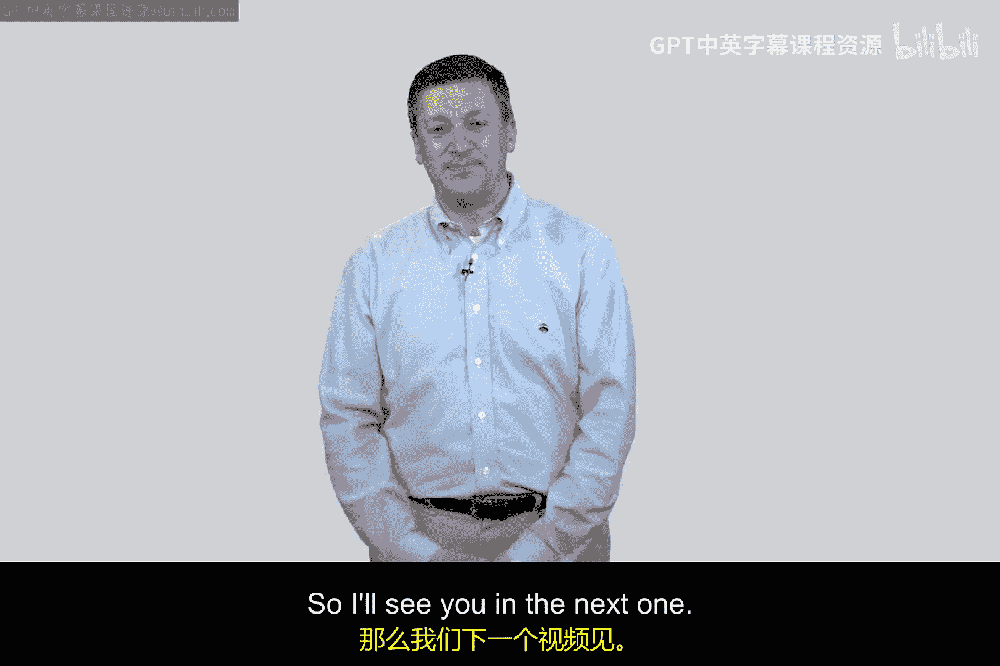

# 纽约大学《网络安全｜Introduction to Cyber Security》中英字幕（deepseek p60 15_认证协议架构与区域.zh_en -BV1TFLZzYE26_p60-

Hi， folks， Ed Am Miosso here。 And what I want to do in this video is I want to take you through the basics of the authentication protocol between Alice and Bob where Alice is the client。

 Bob is the server。 Alice is reporting her identity to Bob。

 and Bob is going to try to authenticate if fair enough。 So that's what we're going to do。

 The first step。😊，In every authentication involves Alice reporting an identity to Bob。

 It's called the identification step。 And a lot of times we just say it's like hi Bob， Alice。

 And it might be reporting a user I an email， a mobile number。

 whatever it is And we've said previously whether that identifier is secret or not is kind of contextual。

 It may or may not be a secret probably not， but it could be。

 So let's assume in that first step I say hi' Alice。 in the second step。

 Bob then goes back to Alice with a challenge。 So step 2 is this challenge step where Bob says， hey。

 all right prove it， please tell me who are you， prove it。 You say your Alice。

 I need to validate that。 So provide some proof。 And that challenge step is so fundamental to the whole concept of authentication。

 because that's we're doing。 We're asking you to validate。 So that's a second step。

 The third steps little unusual。 rather than sort of provide the answer in step 3， we。

Going to call that a computation step where you're actually creating or deriving or doing something to establish the proof。

 Now， it could be as simple as just looking up your password in your brain。

 But it could be something more。 There could be some puzzle you're doing。

 There could be some operation you have to do。 again， you're being challenged。

 And now you're computing the response。 And again， it could be as simple as just looking up your password。

 So that's the third step。 Four step is the response。 That's where I provide back。

 Alice provides to Bob。 The response。 The proof。😊，You said prove it。

 I looked it up at this computation， and now I'm going to supply it back to you。

 now steps  two and4 have a very special relationship because it's a challenge and it's a response and a lot of times we refer to authentication as a challenge response activity。

 the kind of foundational nature of those two steps。 So that's step4。Step 5 is a validation step。

 That's where I'm going to be checking the proof you supplied to me。 Hey， is any good。

 Does make sense， I it not make sense， What did you give me。And then finally， in step 6。

 I'm going tell you， you you pass or fail either I believe you or I don't believe you。

 And that validation steps a little tricky right， because I'm going to be looking。

 checking something， checking your challenge， doing something to see if you did it right。

 and I'm going to notify back to you in step 6。 look， all authentication follows this basic schema。

 And now multifactor is probably going to be doing this multiple times。

 But this is this skeletal view of how it works。 And it's important for students of authentication。

 Student of cybersecurity to have this basic schema in mind and to think through how one to factor and other things potentially provide an instantiation of this。

 But for the most part， well work with one factor and。

 you know a lot of the examples will do a single factor just to go through this。 Now。

 what we draw in the chart here is an onlooker who we call Eve。😊，For Eavesdroppper。

 and sort of common in cryptography and cybersecurity to have Eve be the bad person。

 Eve for Eavesdrop。There's three places that Eve can try and break this sort of scheme。

 And what does it mean to break the scheme， It means to lie or spoof。 Like， if I can tell Bob。

 I'm Alice， get Bob to believe it。 And I'm not Alice， Then I've spoofed the system。

 I'm lying successfully Ive broken the authentication process。 That's the hack to this。

 So the first question is， Could Alice do this to the client。 And we tend to think of the client。

 the network and the server as kind of zones in this。 And， you know。

 we highlight them in the in the diagram as zone 1，2 and 3。😊。

What can Alice do to subvert something like this in Z 1？Steel the proof。

 Let's say Alice is using her mobile or something as a way of authenticating。 if I steal your mobile。

 then I can do it as you。 And so a lot of the real successful hacks authentication will include a client in zone 2。

 I there something Alice can read sort of in the context of the protocol。

 Can she collect information， read the information that's being provided and use that as a basis for a hack。

 Well， it's certainly possibility And then third， can I look at the server。

 can I somehow do something in the server， read or recompute the proof or do some sort of a hack。

 What you're going to find in authentication as that it tends to be easier in zones 1 and3 than in the network。

 because we're going to be using a technique in authentication called cryptography and that cryptography is going to be designed specifically to make it hard for Eve to collect information between Alice and。

😊，On the network for the purpose of spoofing Alice's identity as she validates her reported identity to Bob。

 You got all that。 It's a big mouthful。 But you'll see as we go through this。

 Some protocols are really weak。 like passwords kind of a joke。

 But as we get into more cryptographic implementation， they get kind of interesting。

 They're very strong。 Like the there are protocols that are extremely difficult for hackers to spoof。

 both in zone 1，2 and 3， really get very strong。 doesn't mean they're always easy to use or cheap to implement。

 but they very strong。 So in a subsequent video， we'll dig into this schema using passwords as our example。

 saw see in the next one。😊。

