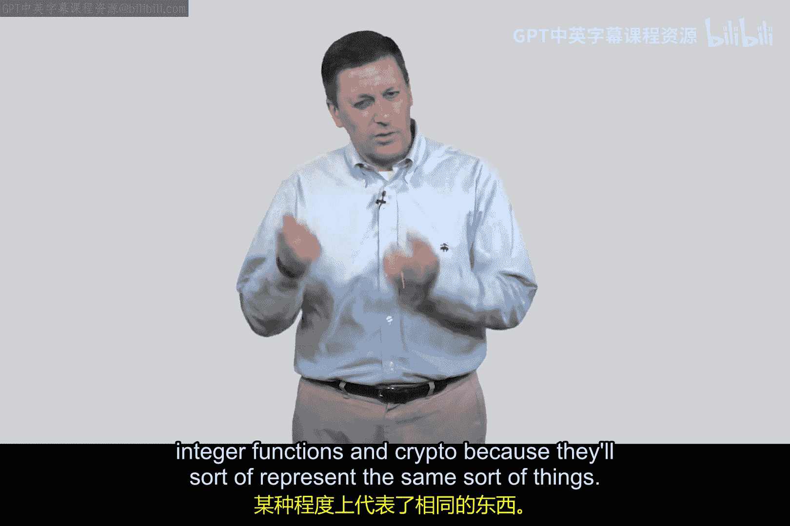
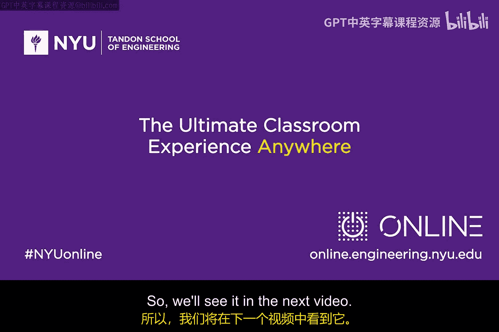

# 纽约大学《网络安全｜Introduction to Cyber Security》中英字幕（deepseek p62 17_手持认证协议第1部分：实现.zh_en -BV1TFLZzYE26_p62-

Hi， folks， Ed alsoso here， you know， before we get into this handheld authentication protocol。

 I want to talk to a little bit about the business of cybersecurity。 Now。

 it's hard to predict whether one technology， scheme， device function。

 protocol in cyberseity is going to make any money or not。 You know。

 I know we're here to learn the basics。 But I'm sure a lot of you spend a lot of time thinking about business and thinking about how to startups make money and what will make money and what won't make money。

 blah， blah， blah。 You get the idea。The protocol I'm going to show you in this video。Made zero money。

And I think it's kind of a good protocol。 And it's unclear to me exactly why people don't like。

 I'm going to show it to you。 and you think through whether you think this is something that perhaps should have made money or should be something we're using。

 It's going to involve a calculator like device， a piece of calculator equipment that you're going get a number。

 and you're going to type something， read the response and type it in。

 and you might think that perhaps a calculator might be kind of a pain to keep track of。

 keeping your pocket。 but think about it。 all calculators are software defined now anyway。

 when was the last time you bought a calculator。 you don't。 you have it on your device。

 you have it on your computer， whether it's your own computer when you're using a library or at school or at home or you probably just don't use calculators Now。

 the hardware has become software defined find。 It's become virtualized。

 which is the way computing really， the direction computing has been in for some time now。So。

Let's talk about a protocol where Alice。And Bob are communicating。

 Alice's client wants to authenticate to Bob。 Bob wants a challenge。

 And what they've agreed to in advance is that Alice is going to carry around a little calculator like device。

 I'm going to pop up a picture here of the protocol between Alice and Bob showing the steps。

 And you can see a little device that implements some function F on integers。 You input an integer。

 you get an output of the integer。 So when we're in the steps here， they're sort of obvious， right。

 I mean， if， if the server just keeps track of the fact that Alice's calculator function is F。

 and that's different from every other user， Like every other user gets a calculator with different function And for those of you who know anything about this。

 you know， it would be the same function with different crypto graphic keys。 But for now。

 forget about that。 We haven't done crypto yet， just think of them as a different function on each calculator。

 So if I have that， the authentication is simple。 Alice says I'm Alice。😊，Bob says， prove it。

 Here's some number。 And you go number。 And you call Lambda。 And in the example， I said 237。

 you go 2，3，7 enter。 It computes F of 2，37。 So it's implementing a function F。

 And that the answer might be whatever the number is 8，81。 You read it on screen 81。 You go， okay。

 typeping 8，81。 It goes to Bob。 Bob knows the function。 Bob knows lambmbda。

 Bob knows F of lambmbdas 8，81。 checks to see what you sent。 They match。 Bo。 We're good。

 How's that sound。I think it's a pretty good protocol， right， why don't we use that？

II think it may just be that as this protocol was invented。

 there may been some clumsiness associated with having a little calculator device。

 Is that a possibility， I guess it's certainly one。 This question of what。Algorithms， protocol。

 systems， whatever are going to be used to make money is really such a difficult question for entrepreneurs。

 I mean， cybersecurity right now has this vibrant industry where there's just so many interesting startups and companies。

 a lot of you watching probably work for startups or dream of working for startups I want to build your own startup and the question of whether what you're doing。

 whether your technical approach， whatever your scheme is。

 is going to make money is such a difficult question， gosh， if I could tell you。

 then I would be a billionaire。 And I'm sure you I'm not。 So。

 so this protocol is one that we're going to start with now。In a subsequent video， the next one。

 which I want you to maybe watch right after this。 We' to look at some properties of this protocol and see something very interesting。

 popop up with respect to this that might be a hint as to why more people don't use this cryptographic protocol。

 This well， again， cryptographic， meaning F of a number is like encrypting it。 that makes sense。

 the lambda plain text， F of lambda ciphert。 So functions in this context like cryptography。

 that interesting。 like we're going to get comfortable with that where we just go back and forth between integer functions。

😊，And crypto， because they'll sort of represent the same sort of thing。

 So we'll see you in the next video。

