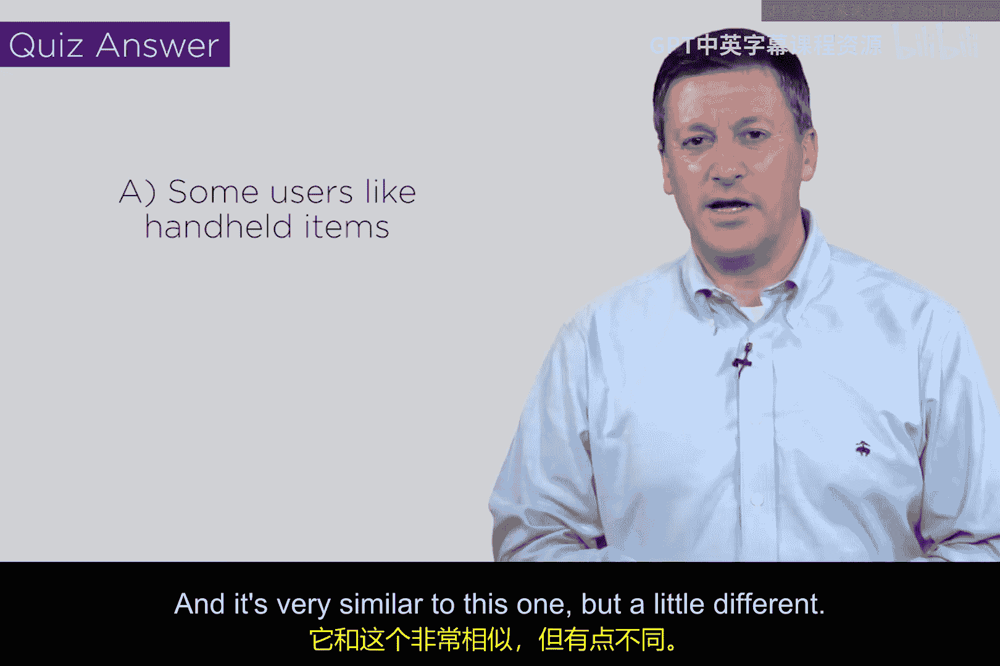

# 纽约大学《网络安全｜Introduction to Cyber Security》中英字幕（deepseek p63 18_手持认证协议第2部分：分析与密码分析.zh_en -BV1TFLZzYE26_p63-

Hi， folks at Ammarossa here。 Now， we're gonna to pick up on our handheld authentication protocol。

 We're going to spend a little time on that。 But let me remind you of something that you may have forgotten。

 I hope you hadn't forgotten it， but we spend a little time on cryptanalysis and some previous videos。

 Maybe you you'd seen them。 If not， I want to refresh your your mind。

 Cryptanalysis is the breaking of codes。 So where' cryptography is making secret writing。

 making codes， using them。 cryrypt analysis is breaking them。

 collecting data from whatevers the gobbledyg， the scrambled stuff。

 The cipher text and trying to unravel that to decipher， Under what you're trying to hide from me。

 That's what cryptanalysis is all about。 It's not valid decryption by an authorized user。

 It's unauthorized cryptana of captured text by somebody who has no business。

 understanding what that data is at all。 You follow tacking。There's three types。 cipher text only。

 That's where youd just see the gobbledy book。 No hints。 known plain text。

 That's where there's some hints。 See get a few little hints to help you。 And then。The codebook form。

 the third form codebook or chosen plain text。🤢，So the ordering is ciphertext only is the hardest known plain text。

 Next hardest codebook or chosen plain text is quote unquote the easiest。

 but all of them are hard because you have， cryptographically and computationally complex function。

 It's hard to just sort of guess。 a gigantic domain。 So you can't guess all the keys。 So you with me。

 So those are three types of cryptanalysis。 So let's look at this handheld authentication protocol。

 You can see， as you recall， I'm Alice。 hey， here's lambda。 Here's a number。 then here's F of lambda。

 And then b b b， you do what you can do。 You log off。 Now another time you log in。 Hey， I'm Alice。

 I'm back， and I want to log in again。 Okay， great， here's a new lambda。 It'll be a different number。

 And then okay， here's F of lambda。 and then I do what I'm gonna to do。 I log off。

 Then I log back in。 Hey， I'm Alice again， I like to log in。 Okay， here's a third lambda。

 a different number， great， here's F of lambda。 Now what's happening here。 I that if Eve。

Is collecting this data， she's capturing the information going back and forth。

 what she's getting are hints。She sees lambmbda。 She sees F of lambda。 Write that down。 Oh。

 I don't know F。 I don't know the encryption， but one thing I do know is F of 2，37 Z 81。 I know that。

 And then the next round， different lambmbda， different F of lambda。 get the point。

What type of crypt analysis is this？This codebook， because you don't have the algorithm not forcing the function here。

Is this ciphertext only。 No， this is not just no hints。 This is called known plain text。

 where you have some hints that potentially help eve the attacker do cryptanalysis in the context of this protocol。

 now， still， if I'm Eve and my life depends on it。I think I'm going after the calculator。

 I I'd be going to zone 1 and trying to arm wrestle my friend for her or his calculator。

 because once I get the calculator， I can spoof Alice。 That's a waysziier attack。😊。

But assuming I can't attack in zone 1 or3， then what I would do is I'd probably be attacking in zone 2。

 right in that and the fact that it's known plain text to a cryptographer is considered quite a terrible thing。

 in their mind。You know， anything but ciphertext only is unacceptable。

Now I have a good friend Jean Spafford， some of you might know from the Purdue University here in the United States。

 he tells a funny story about this， he says。You know。

 when you use cryptography between two endpoints and you're worried about the strength of the cryptography to protect the data。

 he says it's sort of like the following。 Imagine， you know， God forbid he feel so bad for homeless。

 but imagine a homeless person in a。In a park。A bunch of money laying on their chest。

 The wind's blowing。 Some of it's blowing around。And you want to get that money from one person。

Laying in a park or something to another person in a park， also homeless laying on a bench。

So to do that， you hire。An armored car with guns and police。

 You collect up the money off the guy's chest and agains blown all over the place。 You collect up。

 which you can。 You put it in the armored car and you drive with guns blazing。

 make sure nobody steals while you've got this encrypted payload。 And you go over to the other end。

 when you get there， you dump it on the other guy's chest。

 And he makes the joke that we make this big fuss about cryptography and making sure it's super strong when at the endpoint。

 this stuff is probably not well protected on an unpatched windows systems that anybody can break into。

 It's funny joke。 But you kind of get the idea。 So one possible reason。😊。

The handheld authentication protocol hasn't been super successful。 Maybe that's known plain text。

 It may also be that it's virtually impossible for any of us to guess which types of protocols will make money and which won't。

 So let's do a little quiz now， just to to test our overall understanding。

 I think answer A is actually right， Like one reason someone might be inclined to do this。

People flat out just might like having a little calculator。

 Maybe we can see a resurgence of this protocol。 and certainly with software defined protocols on our mobiles。

 you might just see this sort of thing pop up again。 Who knows。

 But I hope you enjoyed that little quiz。 We will see you on our next video where we will look at a protocol similar one。

 that has made an enormous amount of money for a company has been deployed all over the world。 know。

 I think probably close to a billion deployments and it's very similar to this one but a little different。

 So we'll see you in the next video。😊。

