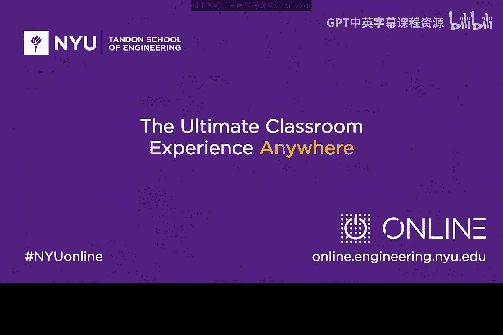

# 纽约大学《网络安全｜Introduction to Cyber Security》中英字幕（deepseek p64 19_欢迎Lior Frenkel.zh_en -BV1TFLZzYE26_p64-

Hi， everybody， I'm at Ammarosso。 And for this week， I've got a great guest。 I've got my good friend。

 Leor Franco， who is the founder and CEO of waterfall security。 Welcome to our discussions。

 Thank you， Ed。 you're in from Israel。 That's your home。 Yeah， I'm in from Israel。

 And I'm here quite a lot。 You know， it's part of part of the business。 That's great Now。

 tell us a lot of young people who are part of our course。

 How did you get interested in technology and computing。 and eventually security。 Yeah， well。😊，I'm。

 I'm like a classic cliche， you know。I got my first computer， when I was。8， well， actually， I I。

 I didn't even get it myself。 My older brother got it for him and。I don't know。 he didn't。

 He wasn't caught up。I， one day， I just SAT in front of the computer and never。

 never left it until now。I， I taught myself how to program， you know。

 back then and especially in Israel。呃呃嗯。We didn't。 They didn't teach coding and in school。

 We didn't have even computer labs and everything， so。I taught myself from， from books and from。

You know， trial and error。 And it was so exciting。 I remember I would， I would go， you know。

 a full nighters just writing and trying and writing and waking up in him， you know。

Trying to stay awake at school because。诶。I didn't sleep all night。 And， you know。

 I'm just like that from then。 So it's yeah， I think part of the part of the enthusiasm is。

Is the amount of control you have， you know， when when you。When you write code。

 especially low level code。Assembly， you know。When you write like really low level。

 the the level of of control you have of the outcome is， is amazing。

 It's something that you almost don't have in any anywhere else。

And I think this is what caught my attention at the first time being able to create something that will actually happen。

 You know， it's not something you want to do。 you're talking about doing。 you think you can do。

 you know， you actually do it。 and it actually works so。Once you get that feeling。

 you want it again and you know， how did you get interested in cybersecurity？

Trying to break things is something that that either you like， you know。

 there are people that like to， to to operate things and work with things。

 And there are other people that like to break things and see how they。How they are built。

 And I think I'm more on that side。 So from there to cybersecurity to to hacking to all of those all of those issues。

's it's like natural。 it's addictive right when you sort of learn to break into things I'd be the best way to learn something break it Yeah。

 no question And so so you know， first of all， really understanding how computer works。

 the low level the internals and also trying to， to break things down to the smaller parts。

 these two things。Allows you to then when you want to operate stuff to operate it optimally。

 So I love that so much myself。 very， very addict。 Now， tell us about your company。

 waterfall security。 What what do you guys do and what are some of the the threat issues that you guys focused on。

 So waterfall security solutions was founded in 207 headquartered in Israel and we are selling worldwide。

 We have a fully owned subsidiary here in the states based out of D C。And。 like our mission。

 the reason that the company was was founded was to be able to secure。

 to better secure industrial sites， you know sites。Networks that control physical processes。

 physical machinery equipment。嗯。From the outside world。 Okay。

 the assumption is there's always a real good need to， to allow data to be sent out。 You know。

 people need to know what's going on in in sites from remote。 it's all good， but。Yeah。

 you really don't want to connect。You know， a power plant turbine to the internet。

 you don't want to to have the production site of a pharmaceutical plant being accessible from the Internet but sometimes there's no there's no other options。

 So solving that problem is is what we're doing we are a technology company we have quite a few really cutting edge technologies the baseline like the basic the flagship technology that we have is called unitdirectional security gateway and it's it's deployed today in in hundreds of sites worldwide in。

You know， critical sites like nuclear power plants and offshore platforms and also in water systems and you know regular manufacturing and so on。

 enabling connectivity， enabling integration between the industrial side and the business side and the internet。

 but in a way that secures the control networks Uniidirectal implies sort of a data diode capability。

 is that the right way to think about it， like yeah information flowing and one we don't call our technology that because it oversimplifies what the technology does。

So if you want a better analogy， the the company is called waterfall because water in a waterfall can go only in one direction。

 It makes sense。 Yeah， and and the technology is very similar to that in in a way。

 because it creates like a physical barrier。Between the outside world。

 which is let's call it downstream and the internal world， which is the control network。

 which is upstream and water through the waterfall can only flow downstream from the control network from the power plant out to and there's a physical limitation。

 water cannot you know climb up the waterfall sense Now how do you deal with the massive number of protocols and legacy technologies that all completely nonstandard。

 at least as I understand it。 hundreds of it must be very difficult hundredundres of work years of R and D。

A lot of specific work。Going in learning those protocols， learning those systems。

 building the right interfaces， verifying them。 in many cases。

 we work with the vendors of the products。To make sure that everything is supported from both ends。

And this is what we do。 this。 This is a big part of of。

 of what waterfall does is make sure that we can connect to all of the existing systems and variations of and。

Propriety systems and it's， you know， it's it's a headache， but it's， its it's business。 You know。

 I want to ask you something I think our learning community would be interested in hearing a lot of them are preparing for first jobs or dreaming of working for a cool cyber company。

 What do you guys look for when you're when you're hiring and interviewing young people coming in。

 Yeah Are there some things that that that you you have in your mind that you think are really important for somebody to get into the kind of work that we do。

 Yeah Well of course， it depends on the position。 Yeah but。In waterfall， we， when we bring on people。

 we bring on people。 We don't feel positions。 You know， we don't bring a personhen。To do this job。

So we look more on the quality of， of the people making sure that they are of。A highigh integrity。

 you know， that they have a drive to succeed， that they don't stop when things become， you know。

 they don't bail out when things become hard。And then we see which current position is available and their experience fits or their desire fits。

And。And we employ them。 And， you know， maybe， you know， we have。

We have people working from waterfall since inception。 You know。

 We have people working from waterfall for like。Six years， seven years。

s it's these are large terms for startups in this in this industry。 and， and but， but it's。

 I think it's better because people know that they are here， that they are valued and that we will。

 you know， in the positive way， make the the most use of what they can over time So we have many people that started as as you know。

 R And D in and， you know， writing code and are now。You know， doing， doing other things。

 we have people starting in in marketing and now they're doing biz dev。 and we have。

 we have people doing started with Q A and， and now they are high in the hierarchy on on the operations and and customer customer customer interfaces its。

It's， I think it's。It's a bit different from other companies。 And it， it's very different from how。

Things are happening here in the US well， I hope you'll give extra credit to anybody who applies for a job who's taken this course。

 Okay let me know if you start getting some resumes Listen on behalf of our whole community here。

 I want to thank you for traveling so far to visit and share with our our whole group and we wish you and your whole team Thank you your time Thank you。

