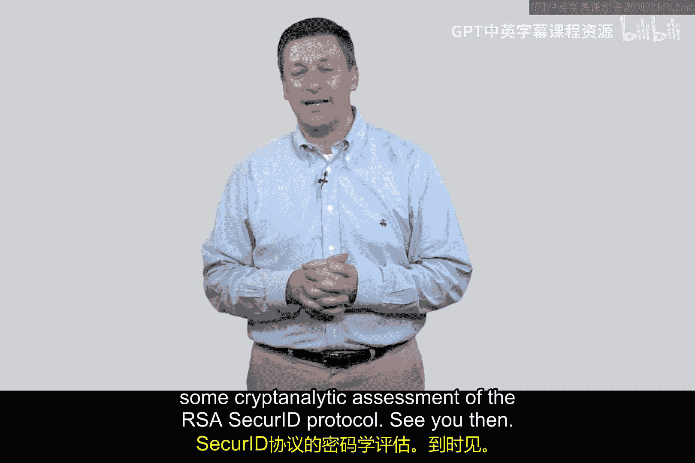

# 纽约大学《网络安全｜Introduction to Cyber Security》中英字幕（deepseek p65 20_RSA SecureID协议第1部分：实现.zh_en -BV1TFLZzYE26_p65-

Hi， folks Ed Emmarosso here in this video what we want to do。

Is look at an authentication protocol that's turned out to be spectacularly successful。

 It's one by a company called RSA。 It's not the RSA algorithm， but it's a product from the company。

 R。 And if you know anything about cryptography， you know that Ron Reve R Addy Shamir S and Lenn Aelman A RSA have been three wonderful contributors to cryptography。

 having implemented the diffy Heman scheme using an algorithm that will go through in a subsequent video。

 But the company that was created partly as a result of their original work at Mi T。

 as one that created a little device。 They actually acquired a company It was called security dynamics many years ago。

 and created a device that they used to authenticate。😊，Reported identities。 It's very cool。

 It's called the secure ID。 and it's a little physical thing where you can do it virtual。

 you can do it on a toolbar， you can do it on your mobile where you can get something physical that you can hang on your physical key ring and it does a very interesting sort of thing。

 I say it' such a popular protocol。 if you came to visit me in my office。

 You'd see have a picture of myself with the CEO of RSA probably 20 years ago or so。

 maybe yeah probably about that maybe 1718 years ago we're shaking hands。

 and I bought the 1 million RSA secure I token you know。

 at the time in the position I was it's funny because they go a million to like a billion since then。

 but let me show you how the protocol works。 it's different than handheld authenticator even though in its formative years。

 it still involved something physical that you held a tangible physical item。

 So the way the protocol is gonna to work is that you can。😊，I'm Alice and then the second step。

 the server is going to say prove it， not here's a number。

 it's going to say prove it and the reason it can get away with that is the first secret that's stored both on the little token that you're issued as part of the infrastructure so you'll go to a desk and you fill out a form and somebody will give you a token。

 one of the things that's on there is already a seed value， a number， a once， a random number。

 random integer and over at the server I'm going to write down in a little table， your name。

The token I've given you and your seed value Lambda。 So the server has Lambda and you have Lada。

 You got it。 So I have a shared secret。 Similarly， when I issue the token to you。

 it implements a function。 just as we saw on our handheld little calculated device。

 So we've got a function F， I'm going to keep track of that on the server。

 Another thing is there's going be a clock in both places。

 the server is going to keep track of the clock and the little token is going to keep track of the clock。

 So I say， hi，' Alice。😊，Servicees prove it and what you're going to do then operationally as a user。

Look at the device。 There's going to be a number there。 You're going to type it in and send it off。

That's F to the n of lambda， I'll explain that in a minute。But it's f to the n of Lambda。

 the server is also going to be computing F to the end of Lambda。

 check to see if it matches and then either they match in your Alice or they don't。

 you say doesn't work now， here's how it works。At the time， I issue the little device to you。

 the server and the device both have a clock。 So they say， all right， ready。 we both have Lambda。

 We both know F。And when I say go， we're going to say that's time T initial。 Are you ready。

 We synchronize the clocks。 You say， ready。😊，Go now。

 some set interval that the server knows and the token no。 Let's say it's 15 seconds will pass。

 You're gonna go 1，2。 go up to 15 seconds。 at the end of those 15 seconds。

 Both the server and the token will'll encrypt Lambda。 So I've done F to the one of Lambda。

 And now what， I wait 15 more seconds。15 seconds ready， I get to 30 seconds。Boom。

 I encryptryide an F to the two of lambmbda。 Now， wait again，15 more seconds。

F to the three of Lambda，15 seconds， F to the four， you get the idea。

 they're both encrypting over and over again。And when you， the server。Ask the client， are you Alice？

You give the number you currently have， and it should match the number I currently have。

 Is that crazy？It's hard to believe that it be' so easy to keep that in sync。

 you think the clocks would drift， sometimes they do， but for the most part。

 clocks have gotten pretty accurate。It works cool。 Like when you have the thing operationally。

 there's usually some little lines that are going that Lakeles 5 bars。 and。

 and the five bars might every three seconds。 One bar goes away。 next bar goes away。

 Next bar goes away。 Next bar goes away。 And when you see one bar。

 and it asks you what the number is。 You see one bar and you go， wait， I better wait。

 because I don't want be on the edge of the 15 seconds。 you wait， boom， you get a fresh number。

 and you usually use that one when you get a fresh number just to make sure there's no sink。

 Is't that cool。 That protocol。 That set up。😊，Billions of deployments。And you go， all right。

 the calculator is zero， you make no money， nobody uses this thing。Many， many， many， many of them。

Why。And'm not sure like I wish I could tell you there's some easy answer， like in the next video。

 I'm going to provide maybe， maybe some hints to why this thing was more successful than than the one。

 but for the most part。😊，I think it's just maybe good marketing。Good luck。

 But you'll see again in the next video， there might be some cryptananalytic reasons for why the secure Id protocol was a little bit more successful than the previous one。

 So we will see you in the next video and we'll dig into doing some cryptananalytic assessment of the RA secure I protocol。

 See you then。😊。

