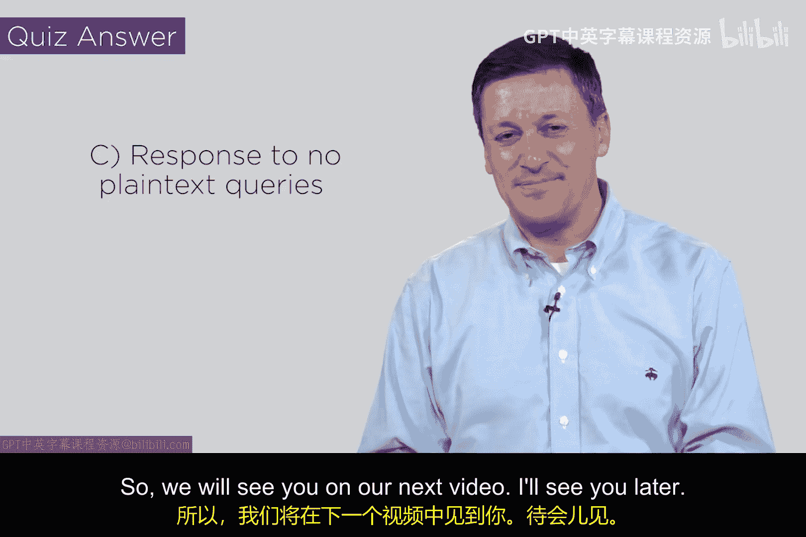

# 纽约大学《网络安全｜Introduction to Cyber Security》中英字幕（deepseek p66 21_RSA SecureID协议第2部分：分析.zh_en -BV1TFLZzYE26_p66-

Hi， folks at Emmarosso here。 And in this video， we're gonna have some fun now with the secure Id protocol。

 You remember in the last video， I showed you the different steps stored secret at both the client and the server。

 same function， keeping track every， say 15 seconds or so。

 We're doing a repeated encryption of the seed， to the point where at any given time。 You know。

 a number of ticks would be going off。 I'm able to go in and any given round and provide back。

 You know what I see。 And it should match with services， Very cool concept。 Well。

 let's think about now what Alice sees in all of this。 Alice is going to see。😊，From the server。

Just a request to prove that you are Alice。No seed， no， no integer。 So I say， I'm Alice， prove it。

 and then what do I provide F to the n of Lambda， where n is the number6。嗯。That's interesting。

 So Eve just writes down F to the N of lambmbda。 Then you do your work。 You log off。

 You come back some time later。 and you say， hey， I'm Alice。 and Bob goes， okay， prove it。

 Now you're going to provide whatever the F to the n of lambmbda is at that instant。

 and N is going to be further along。 We compute N as the time current minus time initial divided by the interval。

 And that's the number of ticks。 So of introduce that notion in the last video。

 Let' just want to make sure you're clear that F to the n of lambda is the number of times you're encrypting。

 If the interval is what it is in 15 seconds seems like a perfectly reasonable presumption。😊。

So Eve collects a series of cipher text answers without the corresponding plain text hint。Now。

 we've said before， what's crypt analysis， It's either。Ccipher text only， known plain text。Codebook。

 which of the three is this。 Are there any hints here。So what is this？Cprotext only。

 which is stronger than known plain text。 I think it's kind of funny。

 A lot of those crypttographers will say that's why secure ideas is so powerful and so used and Ed。

 that's why you have a picture in your office with you shaking hands so happily and they sold billions because it vindicates the fact that having stronger cryptography making it more difficult for cryptana to be done。

 That's the business success factor。 But it doesn't explain passwords， right。

 if passwords are popular。 then now how do you figure because that's like the weakest thing on the planet。

 I think it's more this just hit the market at the right time。 People liked it。

 you didn't have to type anything， you just read and answer。 So I think ergonomically。

 it was much more interesting and easy and just the logistics of doing it seem to be make more sense。

 One thing that I think is's funny is you might be wondering， when does this all end。

 Does the thing just go on forever。 It goes on into the license you paid for。😊。

Runs out so you paid three your license。 that thing is running for 36 months。

 And when you're at 36 months and one second boom， it's stopping。

 And I think that's a perfectly reasonable thing because that's what you paid for。

 But I think it's just a fun， interesting protocol。

 and it's nice to kind of compare and contrast the handheld authenticator to RC secure I they're so darn similar fundamentally different financial values and usages associated with the two one is stronger in terms of cryptographic strength clearly。

 But both have weaknesses in zone1 and zone 3。 I mean， in this one， you just again。

 you beat up your roommate and take their token and you can authenticate using their token as them。

 That's the easiest way to break the scheme。 still zone one。 So we have that problem。

 Now just to test our understanding of secure I， let's do a little quiz here。

 And I think the answer if you think about that a little bit。 you know multiple challenges。

 challenge response。😊，No plain text is C， right？ There is no plain text query here。

 That's the strength of the secure ID protocol。 The fact that there's no plain text makes this a ciphertext only cryptanalytic situation and certainly makes the cryptographers happy。

 And I think it should make you happy as well。 if you use one of these things。

 It's not going to be easy for Eve to go in， collect your responses and do some crypt analysis。

 that's going to be very difficult。 So we will see you on our next video I'll see you later。

