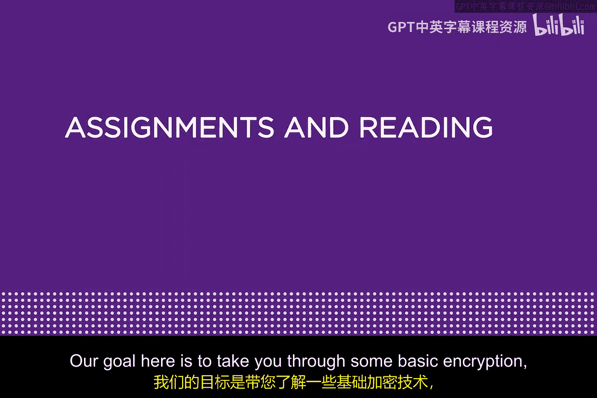
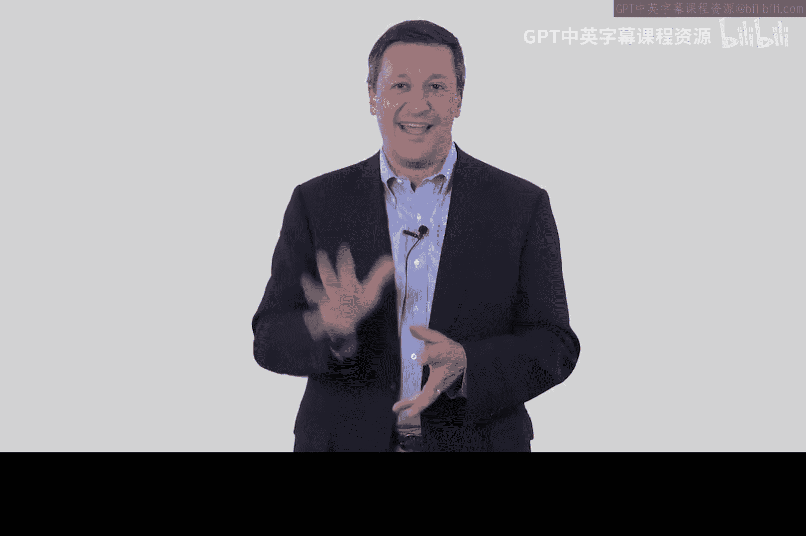
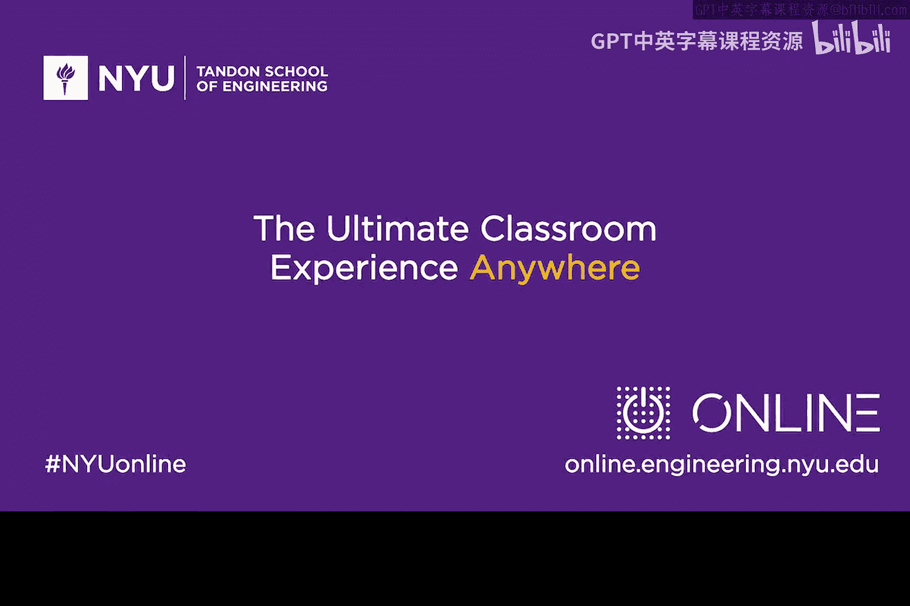

# 纽约大学《网络安全｜Introduction to Cyber Security》中英字幕（deepseek p67 22_作业与阅读.zh_en -BV1TFLZzYE26_p67-

Hi everyone Ed Ammarroso here， and I want to welcome you to this module。

 Our goal here is to take you through some basic encryption。

 basic cryptography and also to look at Kbers， which is one of the real cool implementations of a cryptographic based scheme that allows you to take passwords off networks。

 very， very， very cool protocol。 youre enjoy it。 Now there's some papers。

 optional books and a video I'd like you to take a look at to complement your learning in this module。

 one is。😊，It's not really a paper。 It's a patent。 And I think everyone should have the experience of trying to read a patent。

 Sometimes they're just terrible a lot of legalese and stuff in there。

 but I think you should take the time and then we get the title of this right。

 This is the data encryption standard Pat The method of implementing the data encryption standard with reduced computation as a mouthful。

 but I want you to look at that。 do the best you can to go through it。

 know you're gonna to see some things in there that just don't look like they're applicable。

 but try and get through as much as you can。 It's good experience to read a patent。

 maybe you're writing one at some point you probably will write one。

 So would be good practice Now there's a couple of optional books that we think would make sense as resources for this module。

 One is an ebook you can get on Amazon that I wrote with my son Matt。

 It's called from CIA to AP And if you go through chapters 13 and 14 of the book you'll see that in some sense。

 complements the work in this module。 Again， it's optional。 but it might help you。

 It's a useful companion。 And then second I think you。😊。

A good TCPIP textbook to help you with the material in this module and in anything you do in cybersecurity。

 Stevens， I think has written one of the best。 and there's some versions that have co-authors。

 but the Richard Stevens book TCIP Illustrated volume 1。 if you go through chapters 13 and 14。

 I think it'll help you with your learning here。 There's one video I'd like you to watch。

 It's an interview with a good friend of mine。 the guy has been at Cisco systemss for many years his name is John Stewart。

 there's an interview that was done with him in 2013 at the RSA show。

 So it's RSA cybersecurity with John Stewart， I think it's a cool interview and I'd like you to be exposed to John's kind of wit and humor and knowledge so I think you'll enjoy that。

 Hey I hope you enjoy the whole module and I hope you take advantage of these fine resources。 thanks。

