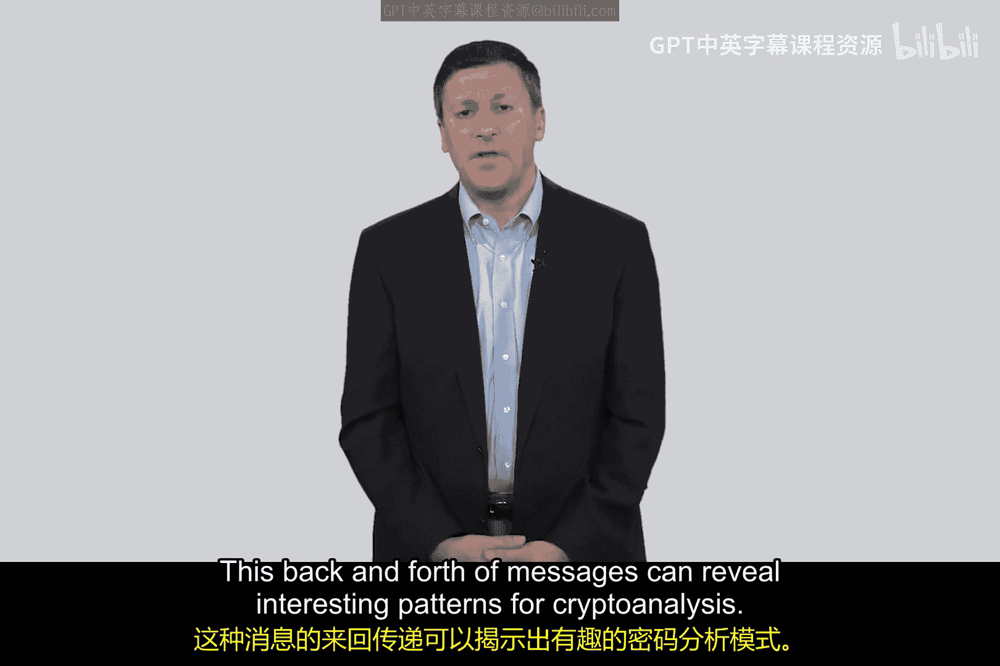

# 纽约大学《网络安全｜Introduction to Cyber Security》中英字幕（deepseek p69 24_Lamport密钥协议第2部分：分析.zh_en -BV1TFLZzYE26_p69-

Hi， folks at Amarosso again。 and we're going to spend some time in this video crypt analyzing the Lampert Eski protocol。

 You remember from previous video。 I hope you've watched it。 If you hadn't。

 you gotta go back and watch it。 But the idea is that the server stores F to the N of some seed。

 The client sends F to the n-1 as a challenge， The server encrypts it one more time and then compares now。

😊，The first thing you notice in this protocol is that when Alice is challenged to prove who she is。

 there's no seed that's sent over， so we always want to say， oh。

 if there's no seed then there's no hint， hence it must be ciphertex only crypt analysis because as you recall。

 ciphertext only is no hints， no plain text is hints。So you'd think that。

 But here's what kind of interesting When you think about the definition of F to the n of lambmbda。

 it means let's say it's f to the three of lambda。 F to the n of lambda， F to the three of lambda。

 That's F of F of F of lambmbda。 That means encrypt it once， encrypted twice encrypted three times。

 That's what F to the n of lambda means， which means that if I give you f to the two of lambmbda。

And then you encrypt it one more time。 You get F to the three of lambda。

 So F to the three of lambmbda is F of F to the two of lambda。 Sorry about all these F's。

 And you might be going crazy。 You can always rewind and listen again。 But here's the point。

When you're trying to break an encryption function， when I show you F of something。

 what you want to do is you want to know the something inside， right， That's what crypt analysis is。

 If I encrypt something， it's the something that you'd like to know。

 But I don't want you to know that。 So I only let you see F of that。 the encryption of something。

 So F of plain text is ciphertex。 So think about this。

 F to the n of lambda is F of F to the n -1 of lambmbda。😊，But in the Lampert protocol。

 each round reveals successively the previous value that's being encrypted。 think about it。

So in some round， I'm looking at F to the n of lambda， right？What Eve would see。

Going from Alice to Bob is F to the n-1 of lambmbda。Which if you think about it。

Is the plain text sort of to the next round。 If you wait one round。

 you see the plain text that was used in the successive rounds encryption。

 You might have to think about a little bit。 in our chart， I sort of show you round 1，2，3 and 4。

 So when these little puzzles that you have to just get in your mind。 But when it clicks。

 it's really awesome because you can see that in spite of the fact that no hint。

 no plain text is provided as part of the challenge， it's still known plain text。

 this is not Cyphertex only there are hints， because each round reveals the hint from a previous round。

 I think that it's such an interesting sort of mathematical kind of artifact that comes out of some of these protocols。

 when you study them。 Now， is that why people don't use Lampert's protocol， I don't know。

 I thought it was an awesome protocol。 And I think for things like firewall and hosted Internet facing that。

😊，are exposed to all the different problems that come from being internet facing。

 I like the fact that the S key protocol doesn't store a seed lambda value， but you know， again。

 as we've talked about in previous videos， Most people using secure IDd or passwords or as you'll see in subsequent videos。

 curberosis popular， as is obviously public key cryptography。

 which is really overtaken just about everything。 I mean。

 most most applications use public key cryptography， which which we'll look at。

 But I like you to see S key because it illustrates the beauty of how these this interaction between clients and server handshake。

 this back and forth of messages can reveal interesting patterns for crypt analysis。

 I hope you've enjoyed this and we'll see on the next video。

