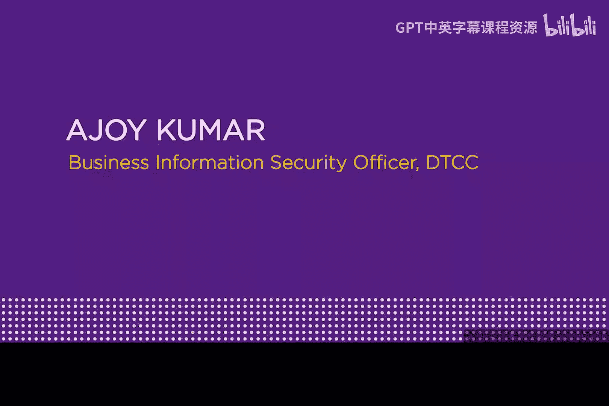

# 纽约大学《网络安全｜Introduction to Cyber Security》中英字幕（deepseek p70 25_欢迎Ajoy Kumar.zh_en -BV1TFLZzYE26_p70-

Everyone， Edroso here and I want to welcome you to an interview with a good friend of mine。

 Joy Kumar， who is the business information security officer for DTCC。

 welcome to our interview series。 Thank you Profesor Hey DTCC。

 What is that stand for It's deposit trust and cleaning corporation It's probably one of the most important financial services company that I'll bet a lot of the kids watching never even heard of。

 It is definitely a critical financial utility。 We play a role in critical finance infrastructure for the US government It's not a government company but it's industry owned body and that's what we do We settle the books for the Wall Street So we are just basically the tail end of with the transactions basically made their final fate That's where we are That sounds so important is it is。

 It's fun job。Now let's talk about you， tell me a little bit about how you got interested in this technology career that you're involved in。

 what was your journey to get to the point that you're at now sure。So this started I think many。

 many decades ago my father worked as a statistician and economist back in India and I used to visit his office sometimes as a career day or whatever those days those things recall and he was into data processing and he had some punch card computers on always days that's what he was using and in my eighth grade I saw actually the first PC which was 8085 base I played a lot of Pokemon and not Pokemon Baman games or that so Facman games there and that sort of intrigued me at that time they were also playing with something called Lotus1 to3 which was actually equivalent in those days and I could see like him basically getting excited about number crunching and I think that sort of like intrigued me I did my undergrad engineering in computer science from India and then that was a good start for the career but I wanted to see。

Something more I ended up doing a electrical AE masters with focus on control and instrumentation。

 which I never got to use in career， but as I was doing more and more work over years in US here I was a database manager and I got a project which was on basically securing access to production so that we can protect our databases from developers and somewhere there I got into security。

 basically did some projects to prevent developers from changing things in production that feel intrigued me so much that I ended up basically signing up for a graduate certificate program at Stevens I took firstclass with you after many decades of school and from there on it built on me that that was a career that I wanted to stay in it was very interesting topic for me something very new to learn something very exciting to do on newly basis on daily basis and that something excited me and here I am。

13 years later14 years later doing the same same field That's great now a lot of young people watching might be thinking I'd like to get into the security field what would be your advice do you think they should be doing more technical things or programming things or hacking what's a good way of say youngster who's interested in this sort of thing might what would be a good path So I think technical path is definitely an important one you should know at least two plus programming languages in this day and that is a very very good way to get into to this field what is two good programming languages Well I like Python and Java must statement so most definitely those are very important languages that gets you a very good understanding of what you're trying to solve as a business problem and also gets you a very good feel of security because once you're playing with those languages you need to see through like how you can break。

right what are the constructs that you can use to exploit to get into the applications and that basically knowing that is very important to get into this field so my focus has been always on the technical side and that's where that's where my strength lies but at the same time someone who is a little bit more advanced I would say that that they need to pay attention to the operational part of it as well because if you're not paying to operational part on how that thing is gonna fit and sit into the production environment or a larger ecosystem then you could miss out on the overall security aspect so it's a combination of focusing on programming application infrastructure and making sure how they sit in a larger operational scheme and essentially make sure that they work securely What do you think are some trends like in cybersecur now do you think the attacks are getting more difficult to stop like is it take a lot more skill now to do cyber defense effectively Yes cyber defenseenses definitely。

It's a new field it has evolved in the last few years and it is expanding growing challenging I think it takes several skills for information security professionals to deal with right so they need to have leadership courage to say like this is the right way to solve it then they should have a strategy and planning on how they want to deal with those on systemic basis。

The third more important field is technical expertise if you're just trying to solve it by process and that's good。

 but in lack of technical skills， you may not be able to see the full picture and last but not the least is ensuring that it basically you are balancing it with a finance aspects of it because you cannot be endlessly investing in one area to protect and miss out on the other areas so the defense or in-depth kind of concept has to play out well to ensure that you're protecting all the assets in a meaningful way So yeah it is growing field it is interesting it keeps you excited on daily basis there is new news that happen on daily basis and that's something that keeps me excited that's so different that what you're describing as logical but a lot of people think wow it should be hacking breaking into things and then I can become a security expert those are two very different skills like breaking into things versus having the。

Lo thought process to come up with a you mentioned like defense and depth that take some careful planning it's a little different than just hacking right they're different skills yeah so the way I have seen this field evolve is at high level you can say that there are two streams of thought there is offensive security and there is defensive security my focus has been on the defensive security and that's the reason that leadership and the planning and operational excellence and technical things basically resonate better with me。

Just basically being a Robin hood and saying that I'm going to do offensive security I have not done that and those are the areas that some people may find more interesting but at the end of day this defense problem will be solved with the defensive mechanisms for most part some offense is good there is new work happening in that area but I think right now the focus has been more on defense Yeah let me ask you how do you keep up like keep up your skills you use books or websites or articles or courses what's a good way or maybe it's just a daily sort of all the work that you're doing might be the way you keep up how do you how do you stay current Yeah it's a combination of things so obviously work keeps me busy and I get to know a lot through that and then then definitely a lot of reading on regular basis I listen to a lot of podcast I do volunteer my time with organizations like OA and I've spent a number of years working with them and thats community that forms there basically tells you like what is。

ubling up to the top what you need to pay attention to and on top of that like the feeds that we subscribe to for the company and all that basically tells me what is happening what's like big ticket items I need to be watching on daily basis。

 what are the things which are basically growing in the marketplace which are three months away and how do I protect from them So a combination of things that's what I do to keep up with that's going on but it's like always behind the car I think that's the way to see it because there's so much happening on this field you mentioned Oas the application security there are opportunities I think there are opportunities for for students and others to get involved Yeah absolutely that and other things I on and on absolutely O has been a good platform for me in past when I was like newcomer and I have basically sent like people like interns who work for me and other folks who work for me I always encourage them to take a membership it's lowcost membership students used to get free membership but they can attend。

s for free。 they offer a lot of information。 you get getting involved in number of projects。

 you can help maintain the wki so there is a lot happening in that space that they offer for anyone to learn more and the community that you form there the information you get the leads you get the knowledge sharing that happens on regular basis is very important I think seems like you really enjoy what you're doing Yeah I love it well I'm glad you do it because if you did't I think our financial services industry would break if're getting all these trades and things clear that's a really important so that is a bigger effort that's right effort and more of ecosystem that is formed around the financial sector I'm just playing my part but yeah I love it I'm very passionate about it I' we'll keep doing a great job for us Thank you so much and thanks for absolutely wonderful to see you Sam we will see you next time Thank you。

