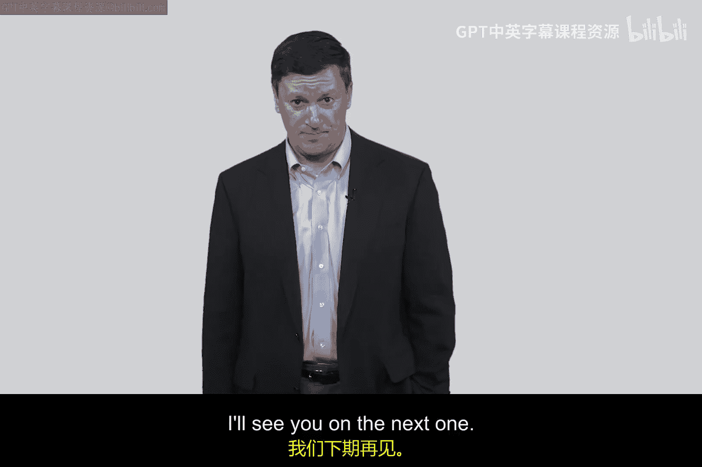
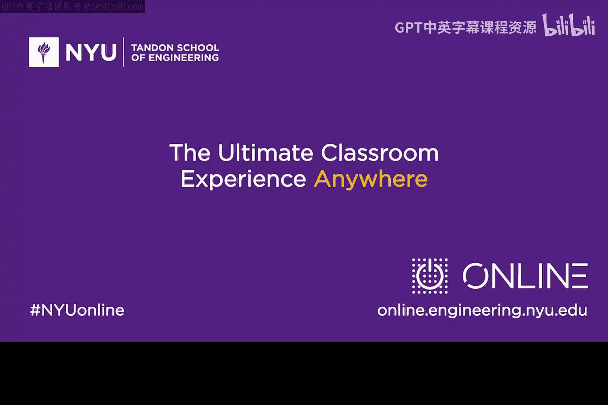

# 纽约大学《网络安全｜Introduction to Cyber Security》中英字幕（deepseek p71 26_Kerberos第1部分：实现TGT颁发.zh_en -BV1TFLZzYE26_p71-

Hi， folks at Emmarroso here。 I want to take you through on this in some subsequent videos。

 protocol called Kbers。 I'll bet you've heard of it。 It's a very popular protocol。

 It's built into windows and a lot of different software that I'm sure you've used。 Now。

 let me tell you about the idea。 So a group of students at MIt some number of years ago who decided that what they wanted to do。

 I have students and administrators that what they wanted to do was pull passwords off a network。

 meaning if Alice wants to log into Bob over the Mit network or any campus or enterprise network。

 Can I set the protocol up so that no cleart passwords are flying around。

 See like that would be simple， but it turns out to be quite a challenge to build a protocol to make that work and what they required was something called a key distribution center。

 Now， listen， we haven't really in our sequence of videos gotten to pure cryptography sort of explaining and defining crypto。

😊，Coming， but I like the idea of showing you protocols before we do the definitions because makes more interesting when we get to the definitions。

 that can be crushingly dull。 So so I like doing some things first and you seeing it。

 So so bear with me as we go through the notation and it's kind of the concepts that are embedded in Kbos。

 Now the first thing is there's this key distribution center。

 and then there's a bunch of participants。 and we can as we usually do break them up into a bunch of clients or users and a bunch of servers。

 with that server clients， key distribution center， campus or enterprise network， not the Internet。

 This is something that would have some some non significantant scaling okay。😊。

So here's the way it works。 The key distribution center sets up private keys with each participant。

 So Alice gets some case a a that the key distribution center gives to Alice， Bob。

 the server gets K a B that the key distribution center gives to Bob and so on for everyone。 Also。

 there are clocks。 Everybody's got a synchronized clock。

 that's going to be important because it'll help us in some sense。

 make sure that we don't have sort of cheating in the protocol。 So everybody follow we've got clocks。

 everybody's got keys。 and the idea is that Alice， Bob， whomever is using Kbers。

 it's okay to type a password into a local machine， but we don't want passwords on the network。

 That's the goal。 Keep passwords off the local area network because as you've learned。

 anybody with a sniffer with a computer that just accepts packets or messages。

 can read your passwords。 So it's not a good idea to have passwords flying over network。

 So here's the way it works。 in the first。Aliceice types password in to Kbose logs in Kboose checks it。

 no passwords over networks， but youre kind of quote unquote logging into Kbs the next thing that will happen is that Alice's machine will send a standard message defined by an internet request for comments RFc kind of interesting concept and how you define standards to the key distribution center saying Alice needs this thing called a ticket generating ticket It's like a ticket to get tickets to get to Bobbs。

 that makes sense So what'll happen in that TGT generation is that the first thing the key distribution center will do is it will generate something called a session key for Alice Now here's the idea Alice's K sub a is called a root key that's a base secret Well anybody to know but once Alice wants to try logging into something we're going use the base secret K sub a to generate a more temporary secret called a session secret。

Session key， the idea beingv somebody breaks the session key。 Well， it messes up this session。

 but at least they didn't get our root key。 You follow in cryptography。

 we want keys to be as shortlived as possible。 you want to use longer livedved or root keys to generate shortlived session key。

 So that's one of the things that gets put in this ticket generating ticket。 this TGT。

 So think of it essentially as a message that's encrypted signed by the key distribution center。

But the way it's going to be signed is a weird sort of way。

 Like rather than signing it the way you might expect using the key distribution center's key。

 It's going to sign it with Alice's key。 Okay and then send it over to Alice。

 Now if Eve is watching what's going on， she's not going to be able to read the message that goes back to T GT because it's signed with Alice's key with Caa A。

 And in there will be this temporary session key。 So what happens is Alice basically visits the key distribution center says。

 hey， you can have a ticket generating ticket。 and there's also some authentication that may be going on using the clocks and might be encrypting the clock message to ensure that。

 you know， there's no timing problems could be a man in the middle grabbing a message and passing it along。

 We'll set that aside。 But the idea the goal here。 the first part of Kbs is to get a ticket generating ticket。

 A T Gt across to Alice that she can then use。To request access to Bob at some point that makes sense Now it's sort of for your additional consideration as you ponder Kibos because we're going to go further。

 That's the first part of Kbo subsequent video will pick it up from there whereas Alice actually tries to do something。

 but you think that's kind of complicated like just to I have to go through these steps getting a session key and maybe doing some authentication using the synchronized clocks and other types of things。

 you think that's a lot of work。You know， just to get ready to ultimately log into Bob， I mean。

 you're used to just log in password。Now I'm going through this setup to get some cryptography in place so that I can then do some other way of logging and think about that because complexity may not be such a bad thing if it's hidden。

 if the complex is embedded in some functionality， but to the user it's still pretty simple。

 that may not be terrible， so think about that as you ponder Kberose。

 we'll come back with part two of Kberose picking up from the TGT generation from our key distribution center。

 I'll see on the next one。😊。

