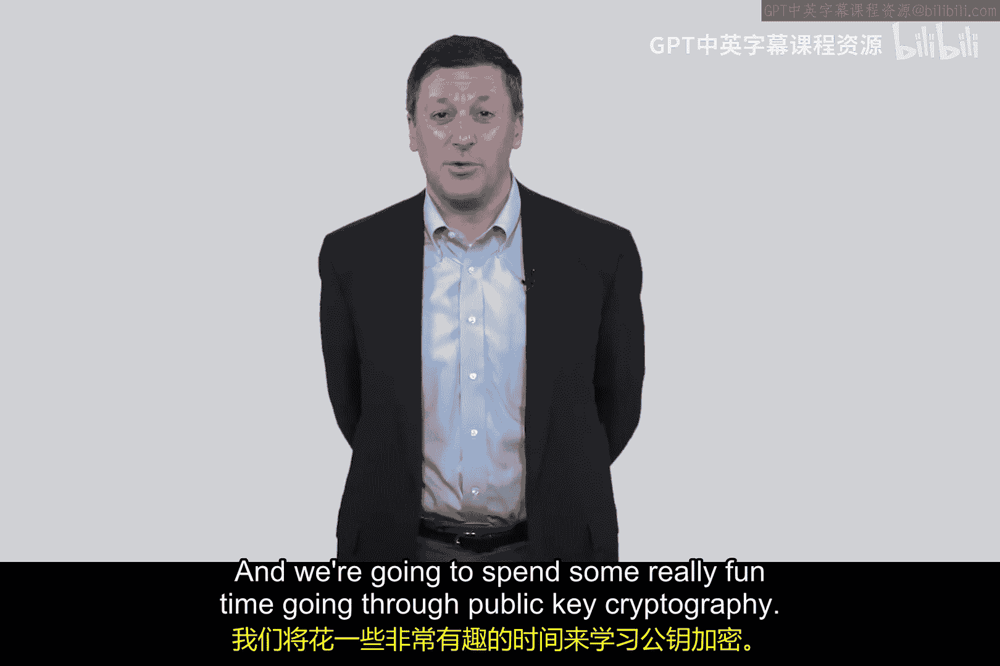
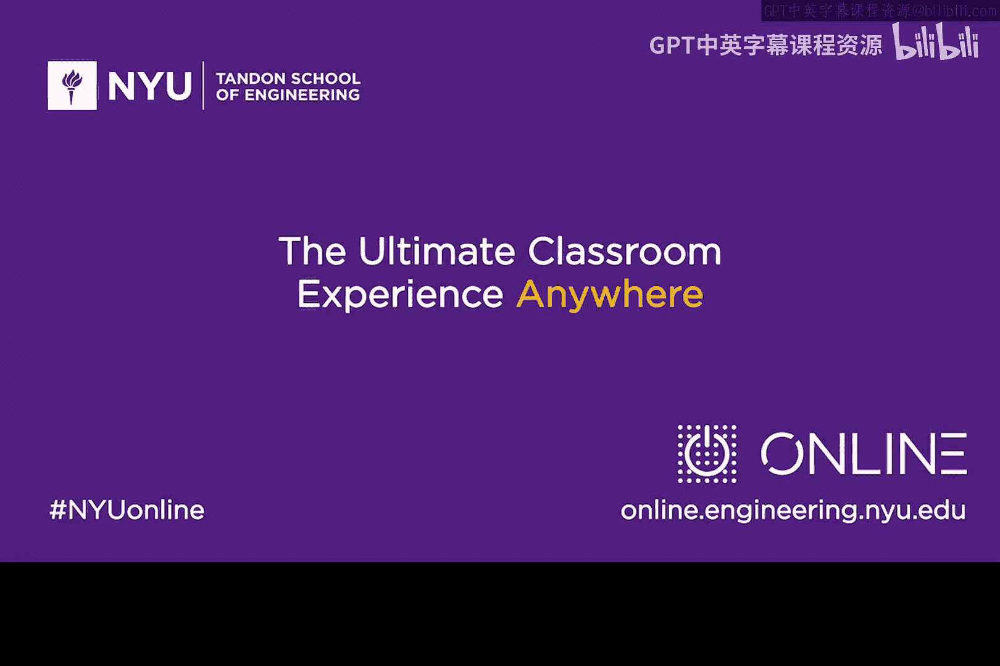

# 纽约大学《网络安全｜Introduction to Cyber Security》中英字幕（deepseek p72 27_Kerberos第2部分：实现TBob颁发.zh_en -BV1TFLZzYE26_p72-

Hi folks， we're back for part two of our discussion of Kbos， now you recall。

 in the first video we got to the point where Alice was able to get this ticket generating ticket this TGT。

So now Alice would like to request some way of communicating with Bob， you know， logging into Bob。

 doesn't want to use a password。 And interestingly enough， the way the RFc's written。

 actually refer to the ticket that you'll get for Bob as a ticket to Bob。 Sorry。

 that's the name well call T Bobob。 So Alice basically says to the key distribution center。 Hey。

 I'd like to connect to T Bobob， can you give me， you know something there。

 And I'm also going to use the clock to sort of synchronize using the session key。

 he gave me last time。 So now you recall， we got rid of the root key， didn't get rid of it。

 but we agreed we're going to use our session key now for communication。

 So I send off an authenticator to the key distribution center。

 Basically the clock encrypted with my request to connect to Bob。 And by the way。

 I don't have to encrypt that request because Kbers is not about traffic analysis prevention。

 It's about keeping passwords off the network。 So if bad guys like Eve want to watch to see。

That I'm connecting to Bob。 That's not Kiberosis's problem Don't worry about that。 So it says hey。

 I won' to connect to Bob So what does the key KDC do now。

 KDC key distribution center it now creates a joint session key for me and Bob it's kind of a cool concept。

 The KDC is friends with Bob has a secret with Bob the KDC is friends with Alices has a secret with Alice Alice says。

 hey， I'd like to connect to Bob and by the way she provides the ticket generating ticket which she could not have gotten if she hadn't had Caabe in the previous step so she's proven look I'm giving you TGT I'm really me so now the key distribution center can say I know you I know you。

Here。I'm going to give you a secret to give to him。

But the KDC is going to wrap that secret in Bob's key。And。

 and if I can provide that to Alice and she presents it to Bob， Bob goes， wow。

 you got something that was encrypted with my secret。You must have gotten it from the Kay secret。

 Sure didn't get it from me。 Isn't that kind of cool It's like it's called this arbitration。

 That's how the key distribution center works。 So session key， essentially， you know， S sub A B。

 And it wraps that in a signed message。 And you can see the on the screen。

 We've got some little shots here of the different protocols going back and forth。

 You can see that we're sending this up so that Eve can't see what's going on。 That's the whole idea。

 You want Eve， to get in there and see this。 But ultimately。

 when I get this thing back over to Alice， she then has T Bob。

 she has the session key S sub A B because she can decrypt that。 It's sent back with S sub A。

 And And this T Bob is encrypted with K A B。 So now what do you think just what you would expect when it's time to log in to Bob。

 All she's got to do is take a message and it with。it's already encrypted with K A B。

 that's the TBob， but she can encrypt it with S sub A B。

 which allows Bob then when he uses K sub B to decrypt TBob， he gets S sub A B。

 which can then be used to decrypt the time that's sent over。 Wow， is that complicated。

 You'll probably want to go back and look at the charts here。

 and we've got some materials that we recommend that you can look at to dig through Kbos。

 But I want to give you a little pep talk。 I mean， we're at the point now where the Kbro session is then set up。

 Alice and Bob have a session key。Kurose is as complicated as it gets。 If you're sitting there going。

 I don't get this。 Well join the crowd。 Everybody gets confused by this one。 This is hard。

 If you can go back， rewatch this video a couple times do a little bit of analysis on your own and get to where you understand that handshake that Alice Bob Handshake using the K D C。

 I can't think of a protocol， an authentication protocol anyway， That's more complicated than this。

 And I would ask you as a sort of additional consideration。 Do you think that's reasonable。 I mean。

 it' this really complicated stuff。 Now， one other thing I'd like you to ponder is the idea of how this would scale。

 And you can see it doesn't scale well to the Internet。 Why。😊，Who's the K D C going to be。

 Is it going to be the government of the country where you are in， Is it going to be Walmart。

 Is it going to be Google， I don't know。 that's the problem。 Nobody's quite sure。

 I came up with this concept called realms， R E A L M。 If English is not your main language。

 realm is like a group or a circle or a community。 A realm。It's a weird word。

 But Kibers said this concept of realms where one KDC would do its community。

 Another KDC would do its community。 And if you're over here， you're Alice。

 and you ask your KDC for a connection to a server that's over here。 The KDC checks around。

 Oh is that one of my servers， No， it'll ask another KDC， Hey is this your server。

 And you can imagine how a hierarchical structure could be used so that you could traverse a tree efficiently to find a server。

 you know， that doesn't really been the way Kberos has gone。

 Kberos has tended to be much more useful for enterprise campus applications。

 then for big old internet type things。 And why the reason， is public key cryptography。

 which turns out to be so much more flexible and scalable。

 and we're gonna spend some really fun time going through public key cryryptography。

 So we'll see on the next video。😊。

