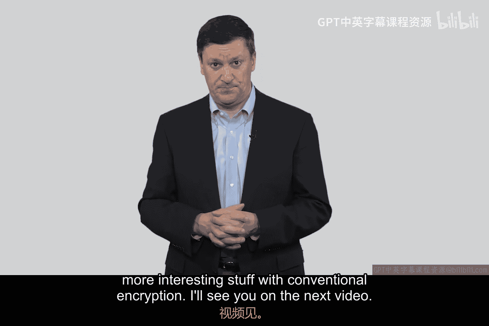

# 纽约大学《网络安全｜Introduction to Cyber Security》中英字幕（deepseek p73 28_基本密码系统与特性.zh_en -BV1TFLZzYE26_p73-

Hi， folks， Ed here。 I'm going to take you through the basics of cryptography now。 Now。

 we've gone through。Secure Id。 We've gone through S key。 We've gone through Kbo。

 So you've seen a lot of these things in action。 I've shown you notation without even explaining it to you。

 We pop it up on the screen and gotten you sort of comfortable seeing squiggly braces and something inside and a little subscript next to the squiggly brace。

 And and you may or may not think， wow， you know， they're just assuming I get that。

 I'm assuming that you're sort of absorbing that。 But now I'm gonna to take you back。

 I always like doing this。 I've been teaching cybersecurity for 30 years And I've learned that if you start with the basics。

 people don't get it。 But if you start with showing them stuff and just assuming they're getting it。

 and just assuming and showing them them the fun of Kbs and get them through And then once they've seen a bunch you say。

 hey， why don't we back up and let me show you some of the things we've been looking at。

 I've found that to be a more effective means of explaining cryptography。

 which like I said I've been doing for three decades。 I bet half of you you know， weren't even born。

When I started trying to explain these basics to people。 So so trust me。

 I think this is the way to go。 now cryptography is secret writing。

 It's trying to come up with a cookieook crazy way for me to communicate with you and have others that we don't trust unable to hear or understand what we're doing。

 it's that simple。 And that the way you decipher what I encrypt is that you have a special secret or equipment or software。

 something we agree on that we assume intruders or outsiders don't have access to。

 That's cryptography。 that's how it works。 And you try and make it hard。

 like you want to make sure it's computationally difficult。

 So it's not obvious for somebody to pick up on what's going on。

 And you also want to make sure that it's not possible for them to use brute force tactics to guess every possible thing we would be saying and for speech that's ridiculous。

 but you could imagine that for certain types of messages， the input domain might be small。

 people can get。So it turns out there's five components to a crypto system as a computer scientist would lay it out set of plain text。

 that's stuff you understand set of corresponding cipher text that stuff you don't understand。

 There's an encryption function that takes plane to cipher。

 There's a decryption function that takes cipher to plane and there's a set of keys。

 Those are the five components。 a nice way to kind of think about it is using the bitwise X or function。

 which a lot of you are probably familiar with x or checks to see whether a zeros and ones are different。

 So if a01 are different than0 x or1 is one。 it checks it's one when they're different。

 It's the same they're the same。 So you can sketch out a plane text series of zeros and ones as input and then some random key which bunch of zeros and ones Take the x or bitwise to produce the ciphert that you would presumably send over the internet。

 then that cipher text you can decrypt same。X or with the original key。

 And you get back the original function。 It's kind of a nice way of illustrating plain text。

 key encryption to ciphert， key decryption back to original plain text。

 It's a nice way to illustrate the concept。 Now， notationally。

 you can do almost come up with anything you want。 But the standard notations are either to put a capital E for encryptpt。

 and then parentheses P。 and you get say and similar decrypt using capital D， but。That's not as cool。

 Like， it's a little bit more， Im more hip to use notation。 It's not so obvious。

 So tend to use squiggly braces for both encryption and decryption depending on the context。

 and we use subscripts next to the squiggly braces to denote keys。 Now。

 conventional cryptography is symmetric in the sense that we're using one key or at least the ability to derive one key from another to do encryption decryption for our purposes。

 we're just going to assume I have one key， and I'm going to encrypt or decrypt with that key。

 So imagine I'm encrypting is walking to the right。 So if I go boom， boom， two steps to the right。

 Well， stepping to the right is the encryption， the key is two。 Now。

 if decryption is stepping to the left。 and I go boom， boom， and I step back to my original spot。

 the decryption is stepping to the left， the key is two。 So in some twisted sort of way。

 you could imagine if you。😊，No2 is the key。 And I walk over there somewhere。

 You don't know how to get back because you don't how many steps。 you don't know the key。

 So that's how to think about this。 Now， the basic schema。

 the architecture for encryption decryption for conventional cryptography。

 We've got it on the screen here。 we'll show you the Alice and Bob's sort of arrangement between A。

 you can see there's that key distribution or key management center。

 specifically want to use different terms because in your readings。

 you might see different references， key management center， KMC， key distribution center KDC。

 there may be even others。 but those are the two most popular。 we'll go back and forth。 KDC KMC。

The idea is at some central authority， a key authority is providing the keys to the participants is literally dropping the keys into their encryption decryption function and you can see Alice provides plain text to the encryption。

 it then gets decrypted， it's now cipher text over a network where it's received by the decryption function of Bob。

Deryptps it and then produces plain text。 And we have our three zones。 so to speak。 client zone。

 It's plain text， network zone， It's ciphert， server zone， It's plain text。 right， remember。

 we did some of this in prior videos with secure Id。 I had to crypt analyzing stuff。

 So you've already got the basics here。 But there's two properties that are awesome with respect to conventional cryptography。

 The first is that if Eve is sitting there watching this stuff。

 She can't read the ciphert on the network。 Now， remember， we said。

 so maybe she goes over to the client， that's a different problem。

 That's a different cybersecur issue for cryptography。

 worry about the network and things being encrypted。 And yeah。

 you can use encryption certainly at rest on on a network。

 But for now we're just assuming the cryptography in in the network。

So secrecy is one property that we have where Eve can't read this stuff。

 The second is that Alice can technically authenticate to Bob。 if Bob says， hey， who are you。

 And she encrypts using a shared key and Bob decrypts it and it makes sense。

 and we'll see what makes sense is how that's implemented in the context of digital signature in a little bit。

 But the idea is if Bob can make sense of that， he can conclude that it must have come from Alice or。

That it may have come from the key distribution or key management center， too， right。

 So in a court of law， be a little careful because if Bob presents evidence to a judge and says， hey。

 you know， look， I got this thing from Alice that says， hey， Bob。

 you're a big dummy and got me all upset。 And I'm suing Alice。 The judge would say， well。

 it's possible that that could have come from Alice， you're right。

 or could have come from the key distribution center or you， Bob could have created。

 It so the legal issues are kind of interesting here。 But for Bob。

 Bob can confidently state that if he interrogates Alice and gets something back that's been encrypted properly with Ki K。

 which is shared between Alice and Bob， then have authentication。

 Those kind of rock and what we're going to want to do as we study conventional cryptography。

 is make sure that we don't lose those properties as we mess around with this and try different types of implementations。

 So with that， I'm going to leave you， we'll come back and we're going to do some more kind of interesting stuff with conventional encryption。

 I'll see on the next video。

