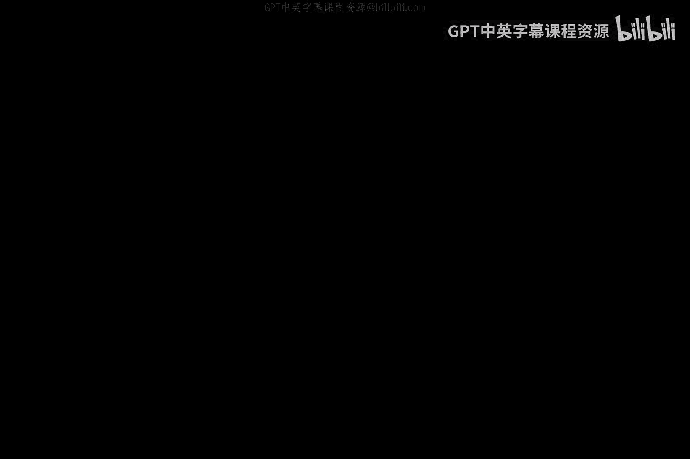
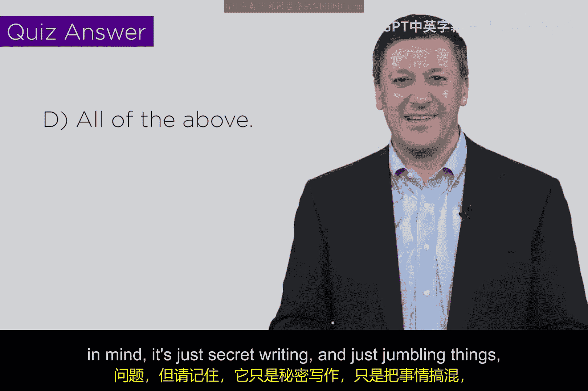

# 纽约大学《网络安全｜Introduction to Cyber Security》中英字幕（deepseek p74 29_密码算法设计.zh_en -BV1TFLZzYE26_p74-

Hi， folks on this video， I want to spend some time with you on cryptographic algorithm design。 Now。

 you might think youd have to be a complete mathematical genius or total gearhead to come up with a good crypto algorithm。

 And that's kind of right。 But I want to decode a little bit for you just to show that there is method to the madness。

 And if you wanted to make up a crypto algorithm， you might be able to。

 Here there's two strategies that are used frequently for creating crypto algorithms。

 The first is called substitution。 So that's where I'm doing a replacement of one thing with another。

 So the dumb examples Ise one letter with another letter。 not the greatest substitution cipher。

 but it gives you the idea。 I can do things。 but I can also do it non nonlinearly like it doesn't have to be one letter。

 another letter。 It could be weird sort of substitutions like my daughter My two daughters and my wife have this language that they use when theirre children。

😊，aroundAnd and it's a way of talking in gobbledygook so that the kids can't understand。

 like if you want to take kids out for ice cream， you know， you never say， hey。

 let's go for ice cream because then the kids hear that and it's not good so they have this language that they use where they prepen the letter A and B in front of every vowel。

And and they say it like my name is Ed。 So I'd be Abed。 We're on a video right now。

 So it would be vid Abe Abo。 follow， so they'd say Abedbed abe it sounds like that's what it sounds like to me。

 So it's an example of aline substitution cipher that my girls use to talk around kids and the kids don't get it。

 Now you have to be able to decode it right， keep in mind that when you're building a cipher。

 you can't just map everything to the letter a， that's a great way of hiding information。

 but you can it back。 you have to have a way of doing the inverse function。

 you can do function of be able to do the inverse back。 So substitution。

 linear nonlinear preferably nonlinearar would be tend to be in almost every cipher。

 A second example， second strategy It's called transposition。

 And that's where you create a matrix arrangement or representation of information。😊。

So think of it as rows and columns and you do linear algebra。

 matrix arithmetic type transformations on the matrix。

 remembering what you did you got to get back like think of a matrix like this。

 you can traverse it this way， you can traverse it this way all kinds of crazy garbllings and if you've ever taken a course in linear algebra。

 which by the way was the first graduate course I ever taught as as I was doing my PhD I have these fond memories or maybe their nightmares of linear algebra because it's not easy but if you combine substitution with transposition matrix manipulation keep track of that。

 you can see how you could come up with some kind of fun julings of plain text。

 you could write programs pretty easily to do that。Now。You'd say， but Ed。

 I might not do it very well。 And let me give you the two requirements that have to be true。

 If your cipher， your algorithm is any darn good。 The first is it has to be complicated。

 And in mathematics， we call that computationally hard。

 I know that doesn't sound like a very technical term。

 But if you've studied the theory of N completeness， Or if you've studied， you know。

 a recursive functions， things like that。 then you know that there's a class of problems。

 a very special class of problems called the N complete problems。

 where we're pretty convinced this mathematicians， we can't prove it。

 We're pretty convinced that the only way you can solve it is to try every possible case。

 And the classic example of this is you take two prime numbers and you multiply them together。

 two big primes， multiplying together， then I give it to you， and I say， hey， friend。

 is this the product of two primes。 What do you think。😊。

The only way that we know as mathematicians to answer that problem today is to divide by  two。

 divide by3， divide by 5， divide by 7 and so on。 Now， if somebody breaks that that'll be you know。

 equivalent in my mind to sort of Newton's insights about gravity。 Like， I mean。

 that would be incredible if somebody can figure out a shortcut to to that particular problem because a lot of other problems were trans sort of transposed from that one and become basically the same problem and a lot of cryptography hinges on that。

 And in particular， multiplying two primes and making it extremely difficult for you to find one。

 you're going to see later， and we look at public key cryptography。

 we're going to multiply two primes and one of the primes is going to be a key。

 So if I gave you the key boom， you're done。 if I don't give you the key， you don't know， you know。

 essentially how to decode that that piece of numbers。 So that's the first。Requirement。

 the second is that the domain size， the number of things that are being crypted。

 has to be gigantic because if it's not as we saw in a much earlier video where we went through and I had you cryptanalyized the Caesar cipher by writing a program that just created or duplicated the histogram that comes from the frequency distribution of the English language。

 I mean， if you have a small domain size， or write a program， I just decrypt everything。

 you could have a really complex cipher， but if I can do all possibilities， then it's not very good。

 So think about it， combine the two things。 gigantic domain size。

 like think the number of possibilities equal the amount of grains of sand that exists on the earth。

 like that kind of a number， that big combined with a problem that can only be solved by trying everything you've got some pretty good cryptography then because you've got to trim all and Ive try。

One case for every grain of sand on earth。 Good luck on that。

 So that's the kind of stakes that we have in mind when we're talking about cryptography。 Now。

 to test your understand，'ve got a little quiz here。 And as you would guess， it's day right。

 if it's all of they're all of those。 They're not very technical terms， jumbling things around。

 but you should keep that in mind， you know， a lot of you probably have spent some time looking at cryptography。

 maybe in school or something。 it always seems like thiss really hard mathematical thing。

 But keep in mind， it's just secret writing。 It's just jumbling things。 And you can try it。

 It's actually kind of fun。 So we'll see in the next video。😊。

