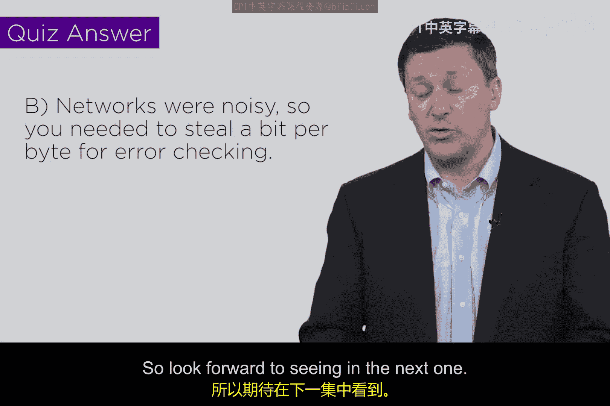

# 纽约大学《网络安全｜Introduction to Cyber Security》中英字幕（deepseek p75 30_DES设计.zh_en -BV1TFLZzYE26_p75-

Hi， everyone。 I want to talk to you in this video about really important encryption standard algorithm called Des。

 The data encryption standard。 It's got an like kind of an interesting story to it back in the 1970s is a long time ago。

 I'm sure the vast majority of you were not born then I was。 But anyway。

 the banks at the time were starting to use cryptography to send things to each other。

 And they thought， what we should do is we should， instead of everybody having different encryption functions。

 Let's have one encryption function。 a standard and just have different keys。 that way。

 we can all interoperate。 They make perfect sense as computing was becoming more important in our world。

 So they put out this thing called a request for proposal。 And they being the US。😊，Government。

 and it was the National Bureau of Standards。 NBS。 If you're here in the US， you know them as NISist。

 Now， the National Institute of Standards and Technology。 But at the time it was called NBS。

 And I think most of it was driven by the banks。 And whatever country you were in。

 they were going through the same process。 Everybody saying we need to find ways to standardize on cryptography。

 So I put out this request for proposal， how many companies would you guess bid on it。

 Like think back， you think， wow， you know， different universities Group， the answer is0。

 Nobody bid on it。 There wasn't much of a crypto community then。

 So NBS looked around they realized they needed somebody to do something。

 And they found a group group at IBM LED by a really genius Pioneer in crypto name Ht Fetel。

 And Im never say that right But I say it in my American accent。

They convinced him that an algorithm he and his team were working on called Lucifer would be perfect for Des。

 So they pushed the RFP out again and how many people bid one。

It'sF because if you do that now there's teams from all over the world。

 the cryptography community is so vibrant now， but in the 70s。

 not so much and here's what they came up with。 this is what Lucifer and ultimately Des look like。

 I've got a little shot here of the different components。 It takes 64 bit blocks。

As input and produces corresponding 64 B blocks as outputposts。

 So think of your data stream as a train。 and each train car is 64 B。

 It gets into like the encryption tunnel or something。 I。

 that's a bad analogy because tunnel means something encrypt。 but gives a little encryption box。

 and I take the train and boom， another train pops out。 that's encrypted。 The next car comes out。

 boom， I encrypt that。 So it's called block encryption block by block，64 B。 That's the first thing。

 Second is that there's a 64 B key。 But。Computer networks were such a bummer in the 70s that you had to use one bit of each 8 bit word as pary check on whether the first seven had gotten garbled。

 So you really only have 7 B per8。 hence really a 56 bits of effective key length and Des。

 So think 64 B block，56 B key that's used to generate sub keys， for16 rounds of guess what。

 substitution transposition X or。 That's why I had to do that stuff。

 And look at those in previous videos from substitution transposition Xor 16 rounds of them。

56 bit key，64 B block。It's interesting when you think about that， you think。Well。

 those three numbers in some sense， may be a hint as to whether or not this algorithm is going to be any good。

 And it turns out that the 16 rounds is not such a big problem。 that turns out to be pretty strong。

 but the other two numbers and problems。 and it's not so much the 64 Bs。

 but rather the fact that it's block。And we'll get to in a subsequent video some understanding of how we solve that and think about it。

 How do you think you would solve block encryption problems with。Blockchain。

 so we'll explain blockchain。 and you'll see that it's based on a patent that was written in the 70s。

 Blockcha is not new。 It's an old concept， but that 56 is a big problem。

 turns out that two to the 56 possibilities is child's play on a current computer in the 70s。

 no problem。 You know， the computers were used to get tired and weze just trying to multiply。

 but but now it's a joke， and it became a joke sort of into the late 70s。

 It became clear that maybe this wasn't going to be enough。

 So it turns out that Des has been an incredibly good standard。

 The concept is actually referred to as like a feistal structure。

 That idea of doing successive rounds of substitution transposition where you break up the 64 B blocks use the keys。

 It's really cool algorithm。 So that's fine。 People have not really had much success。😊。

oteCrypt analyzing are coming up with shortcuts to break Des。

 but the two to the 56 turned out to be a gigantic problem。

 and a subsequent video we'll spend some time looking at both that and the block weakness。

 but just to sort of test your understanding of Des with a little quiz here。

 The answer is B right that we talked about the fact that networks were kind of noisy couldn't use the whole 64 bits in that word use 56 bits。

 kind of an interesting artifact from the computer limitations that we had at the time。

 So we'll see in a subsequent video we'll start fixing some of the problems in Des and in particular。

 looking at a couple of things that in my opinion， are some of the most substantive contributions that computer security experts have made to computer science。

 So look forward to seeing in the next one。

