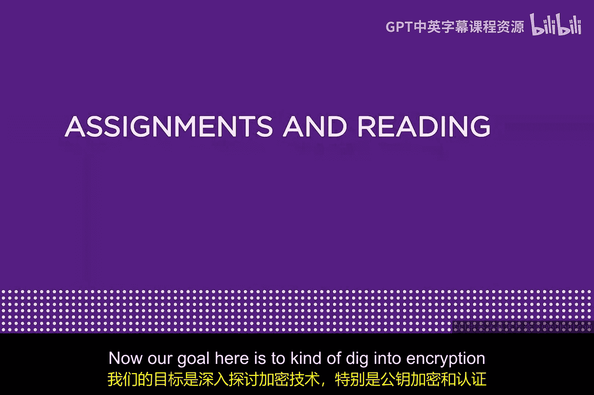
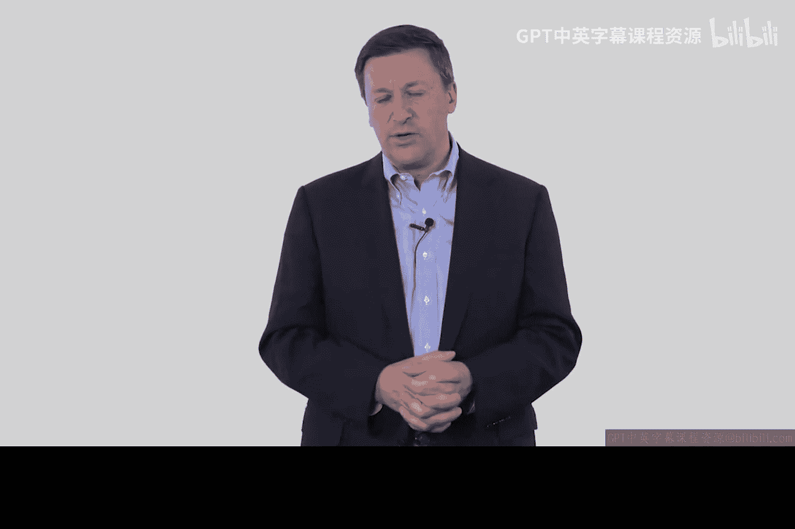
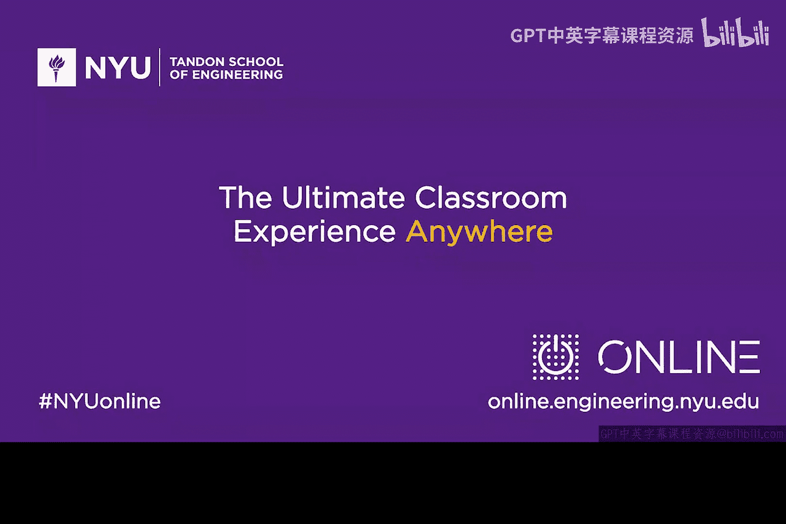

# 纽约大学《网络安全｜Introduction to Cyber Security》中英字幕（deepseek p77 32_作业与阅读.zh_en -BV1TFLZzYE26_p77-

Hi， everyone， Ed Ammarosso here， and I want to welcome you to this module。

 Now our goal here is to kind of dig into encryption with a particular emphasis on public key cryptography and certification authority。

 So very relevant topics to E-commerce and future Io and stuff。

 So I think you'll enjoy the material here。 Now there's some papers and optional books in a video I'd like you to look at as companion as you go through the module。

 So first is a couple of older papers that lays some of the foundations here。

 one is the classic paper by Diffian Helman， the two great masters of cryptography called New directions in crypto。

 I think you could argue that it might be the most famous and most important paper ever written in cybersecurity。

 say really do want to take some time to go through that。

 And then second there's a little known paper by a guy named James Ellis who is a British cybersecurity expert he' called cybersecurity then because he lived in the 60s and 70s。

It was still working somewhat in the 80s it was more just about basic cryptography than wrote a paper called nonsecret encryption that's really astounding because you could argue that it actually predated the work that diiffy and Heman had done in cryptographyies。

 it's called paper to read the historical references are just really delightful。

 Now a couple of optional books that we think would make sense as you go through the module。

 One is an ebook that I've written with my son Matt， It's called from CIA to AP。

 an introduction to cybersecurity。 You want to go through chapters 15 and 16。

 you get the book on Amazon and again， it' it's optional。

 don't have to but a lot of you might like a companion book and it's very expensive。

 Now one thing that maybe a little more expensive is getting yourself a good solid TCPIP book。

 It's a worthwhile investment。 took a few young person。

 I think having a physical TPIP book is a good idea。 you know at some point。

 maybe you make the investment。 But if you decide to do it here， Richard。

Stevens has written a good one， he's written some versions with companion authors。

 but if you read the Richard Stevens TIP illustrated volumee 1 chapters 15 and 16。

 I think would be a useful place to be as you go through this module so I hope you'll do that they're optional but I hope you'll consider doing it and then it's kind of a cool video from one of my good friends。

 the chief of security over at Akaai one of the great content distribution Network companies it's called a brief history of cryptography with Akamai Chief Andy Ellis so you'll enjoy hearing from Andy and Learning a little bit more compliment yourre learning as you go through this module so I hope you enjoy it。

