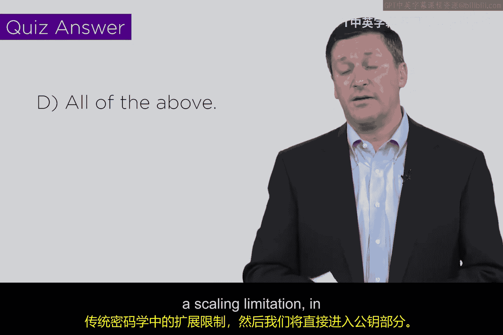

# 纽约大学《网络安全｜Introduction to Cyber Security》中英字幕（deepseek p78 33_CBC模式分组密码.zh_en -BV1TFLZzYE26_p78-

Hi， folks， you'll remember that in a previous video， we talked about Des， single Ds。

 and the problem we had with 64 B block cryptography。

 meaning a train comes in a 64 bit block comes in， I encrypt it and boom out bos a 64 B block output。

And then the next one comes in 64 in， 64 out， 64 in 64 out。

 it allows for something called a covert channel。 And you remember we talked about that previously。

 where you use a wall maybe to knock on to communicate with somebody you know。

 it's a little crazy to think that that's how somebody would actually communicate。

 but cryptography clearly can include leaks of information as part of the plain text to ciphertex transformation。

 It's crazy。So we have to come up with a way to make the 64 B block and 64 B block output。

Less prone to cover channel。 Like if I just make the blocks all the same。

 then I get the same output each time and I can signal。 So back in 1970s。

 there was this patent written by a group at IBM。 And to this day。

 I think it's one of the fundamental patents in cybersecurity。

 It's something I'm actually going to have you read as part of the required reading。

And here's what their idea was。 They said， let's。Chain the blocks。 And if you guys hang out on tour。

 or if you read about Bitcoin and blockchain， you know what a chaining of blocks is essentially putting things together in a way to make the cryptography more undecipherable。

 So here's the idea。 Here's how it works。Normally， I would say block A F of block A is B。

And then F of block a prime is B prime and so on。 That's block cryptography。

 But chained block cryptography works as follows。 I take the output of one round。

 and I make it part of the input domain to the next round。

 And then whatever pops out of that becomes input。To the next round and on and on and on。

 So think of it this way。And there's one part that's kind of weird。 You have to start somewhere。

 So you go， whenever you have something that chains， you go， okay， so how do you start。 And in block。

 you have this concept called the Genis block。 So let's start with the genesis。

 which is me making up that I did one already。 And I'll make believe that's the output to some fictitious previous round。

 I say this is my genesis block。 So now when I encrypt a block that comes in， I encrypt the block。

 plus the genesis from previous one to get a new output。😊，Now。

 that new output gets encrypted with the next block to produce a second output and that second output gets encrypted with the third block to produce a fourth and on and on and on。

 Is't that kind of a cool concept like this idea that you're chaining things， makes it harder。

 not impossible， but much harder for some to create a covert channel。 Now。

 this really is the basis for blockchain for a lot of the real interesting concepts。

 But the thing you should keep in mind is that there's work involved in going right and left。

RightSo as I go from where I am now out to subsequent blockchain computations。

 I'm doing work to do that。 If I came back and I fuss with something。 I change something here。

 I mess up the whole chain。 and I have to work real hard to catch up and might actually come up with some different outputs depending on what I'm actually doing。

 see gives you a little hint as to how powerful this chaining concept's going to be。

 But the main thing that the guys back in the 1970s at IBM were trying to do is you sit down a covert channel in in single does and obviously works also in triple does。

 so I think it's a beautiful way， a beautiful way of solving a problem in an elegant manner without having a real change to the base cryptography。

 Now we have a little quiz here to test your understanding here。 And the answer is none of the above。

 none of them anything to do with blocking blockchaining closes covert channels， Okay so。

Through that in for a little trick question to see if you're listening， but I hope you enjoyed this。

 and what we're going to do in subsequent videos is we're going to start moving in the direction of public key cryptography。

 you'll see in the next video in our series we're going to talk about a basic limitation。

 a scaling limitation in conventional crypto and then we'll dive right into public key So we'll see in the next one。

😊。

