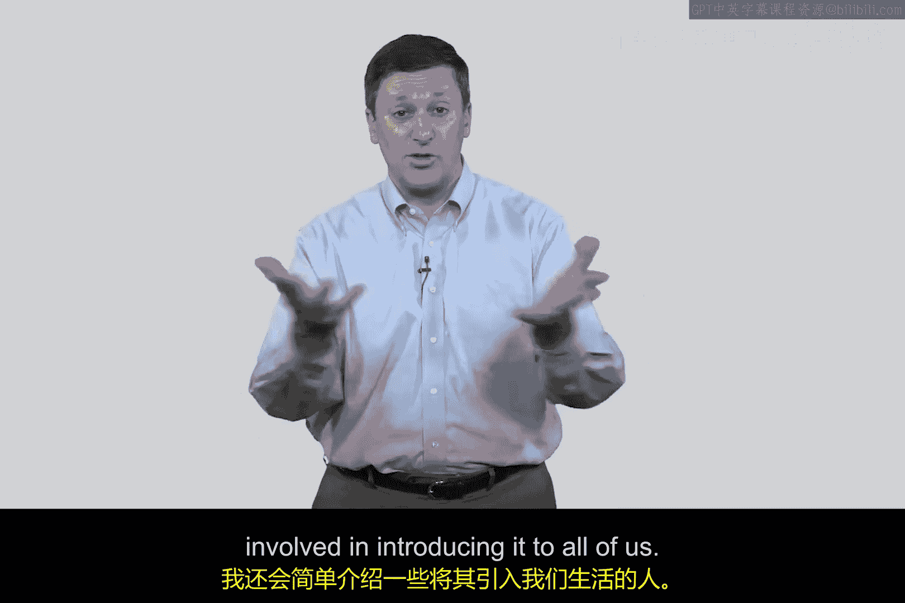

# 纽约大学《网络安全｜Introduction to Cyber Security》中英字幕（deepseek p79 34_传统密码扩展问题.zh_en -BV1TFLZzYE26_p79-

Hi， folks， Edosso here。 Now we've spent a lot of time in videos looking at conventional cryptography。

 conventional encryption。 but one thing we haven't looked at， that's kind of a fatal problem。

 but we'll see in a minute， it's not totally fatal， but it seems fatal。To conventional cryptography。

Is that it doesn't scale and rather than just whip an equation at you。

 which is way it was always explained to me。 I want to show you kind of we'll build a progression of the problem。

 and you'll see， let's say you and I are together and we want to be able to do cryptography between us。

 We want to use conventionalual cryptography。 So how many keys do we need the one， right。

 you and me one。 Now， let's say a new person joins us。 So then we have three people。 Okay。

 we have three participants。 what we need now， it turns out our three shared keys， right。

So as a little bit of extra work Now， somebody joins us。 We have one。 You have one。 I have one。 Now。

 let's say a fourth person comes of a fourth participants。 guesss what。 we need。6 shared keys。

That doesn't sound great， right？ You can see the drawing that as we build the drawing here。

 This is not good。 It seems like the amount of work to add a participant is growing。

 Get to five participants。 You need 10 shared keys。 And guess what。

 when you get the six participants， you need。Teeen shared keys。

 so the amount of work it took to add the sixth participant is five times the amount of work that was required to add the first。

So we had two。That's not good。 That suggests that if you've got a big auditorium full of people。

 end people in the room and then somebody comes in and wants to be part of the we're all set up where we've got you know。

 mutual shared secret shared keys between all of us， if the N plus first person comes in。

Then that person has to do a secret with all any of us。

 And you can see that that's not a great thing。 That's why when you go to buy something on Amazon dot com。

 the scheme doesn't involve， oh， you want to be able to buy from Amazon。 Oh。

 why I have to somehow have a secret with Id give you a key。 Your personal private key with Amazon。

 That's crazy。 That's not going to work that wouldn't have scaled。

 If we had stuck with this scheme as the basis for cryptography on the Internet。

 we wouldn't have companies like Amazon。 Now， I do want to say。

Conventional cryptography is amazingly efficient， It's amazingly efficient。

 We' want to throw out the power of block encryption。

 chained block encryption in multiple modes that we want to keep。😊，But the question is。

 can we come up with a way to scale it？And in computer security， cyber security， we've had a few。

Incredible contributions。But the solution to this problem。

 the solution to the scaling problem in conventional cryptography in such a manner that allows explosions of numbers of people that can use cryptography to buy and sell and interact and build communities and build businesses has been one of the great contributions of computing to our world。

 This is almost like the invention of the printing press。

 Our next few videos are going to take you through a technology that has changed your life。

 my life and everybody， you know， It just has changed the world。 by solving this problem。

 namely the scaling problem for conventional crypto。

 but somehow keeping the efficiency of cryptography so that we can do things very quickly using efficient algorithms。

 but in a way that doesn't require a third party to adjudicate or arbitrate in the middle of the protocol。

 So I want you。Just for additional consideration， why don't you take some time see if you can give up a little mathematical equation for the scaling if you can't find you look it up。

 it's actually very simple but but think about the equation of how you go about adding and scaling up cryptography and you'll see that it's not going to be very conducive to the kinds of things we're going to want to do in the Internet。

 So in the next video we'll introduce the basics of public key cryptography of public key infrastructure or PKI and I'll tell you a little bit about some of the people who are involved in introducing it to all of us So I look forward to seeing in the next video。

