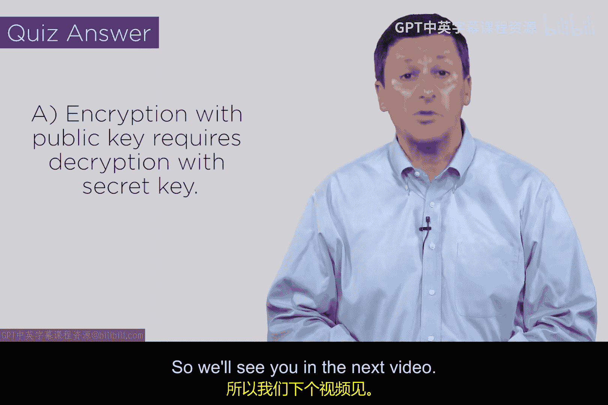
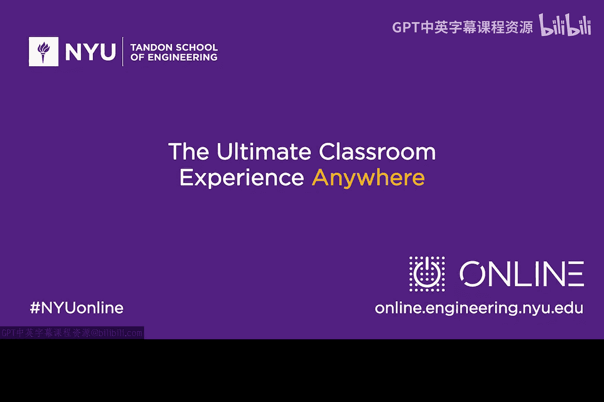

# 纽约大学《网络安全｜Introduction to Cyber Security》中英字幕（deepseek p80 35_公钥密码基础.zh_en -BV1TFLZzYE26_p80-

Hi， everyone at Emmarosso here。 In this video， we're gonna have some fun。

 I'm going to introduce you to a topic that is foundational and absolutely essential to understanding modern cybersecur and how it enables different types of things in our world。

 So we go back to the problems of conventional cryptography main problem being that it doesn't scale。

 We liked the fact that it was efficient， love that。

 were able to solve the covert channel problem with chaining。

 We're able to solve the size of the keys with things like triple Ds and using multiple options so that depending on the criticality of your application。

 you could pick a key size that makes sense。 fixed all that。

 but we didn't fix this problem scaling so these three wonderful people I you can see their picture here It with diiffy Marty Heman and I also show Ralph Merrkel。

 They were all at Stanford and the work that they did back in the 197。

which turned out to be an extremely creative time for cryptography and for computer security has resulted in something we would all refer to as public key cryptography。

 Now， the idea that they came up with was instead of having one key that Alice and Bob would use to and cry。

 They said let's break the key Let's have it in two pieces。 And furthermore。

 let's not have it given to us by a key distribution center。

 but rather every participant follows an algorithm。

 and I'll share with you later that the RSA algorithm has really been the implementation strategy of choice for public key cryptography。

 there had been others but we think of RSA as the main one。

 They said the idea is everybody would run an algorithm locally that generate to key pair。

 I don't have to ask anybody for it。 I don't have to go to a key distribution center。

 I just generate it。 And the idea is that the public portion of that and secret portion would be treated differently。

 The public piece is something I tell everyone。 Now we'll get。Into key distribution later。

 But for now， think of it as put it in a directory。

 put it in a place where everybody can sort of see it。 I not a secret， your public key。

 but the secret key is something you put in your back pocket。 Some people refer to as a private key。

 I like to use secret because secret starts with S public starts with P and I could write P A for public key secret key but private would be acceptable as well。

 just like I said， the same letter。 so it's somewhat more awkward to work with that term。

 So here's the idea when I encrypt something with a public key using a public key algorithm。

 This is not Des triple De， those are all conventional algorithms。 diffy and Heman were positing。

 they were imagining if I had an algorithm where I could encrypt it using a public key。

Pub key I generated that it should be the case with the algorithm that the only way I can decrypt it is if I have the corresponding secret piece。

 Do follow I use the public piece to encryptpt。 I use the secret piece to decrypt and the reverse。

 So if I encrypt with the secret key。Then the only way I can decrypt is using the public key and there's uniqueness theorems as well。

 meaning if I encrypt something with public key。And then I decrypt with something and I get the message back。

 then that something had to be the key to secret portion of that public key secret key is unique。

 There' are not going to be 10 different possible answers here， there only be one。

So it's a beautiful concept， absolutely wonderful， it again， predicates。

This idea that you could come up with an algorithm like that。 Not that， you know。

 hey they'd come up with it now， Ron Reve Add Shamir and Len Aelman from from MIT in fact。

 did come up with an algorithm that uses this idea of multiplying primes together absolutely beautiful concept you multipied two primes together。

 and the result is something that encapsulates the secret key in here。

 but the combined the product of the two primes is something I don't mind sharing with everybody。

 that can be a public。 and that's sort of how the RSA algorithm was implemented。 But for now。

 we'll just stick with this idea of this notation being set up in a manner that， you know。

 I write squiggly brace with a sub subscript might be piece of A and then squiggly brace around that subscript S sub A that shows Enpt with public key decrypt with the secret key and get the message。

Gm back， that's the notation that we'll be using。 have a little quiz here for you just to kind of test your notational understanding。

 The answer is a， obviously by definition， that's what we said encryption entail。

 So with that we're going to go on in our next video to start using public key cryptography to build up the properties that we need to make it useful in practical settings。

 So we'll see in the next video。

