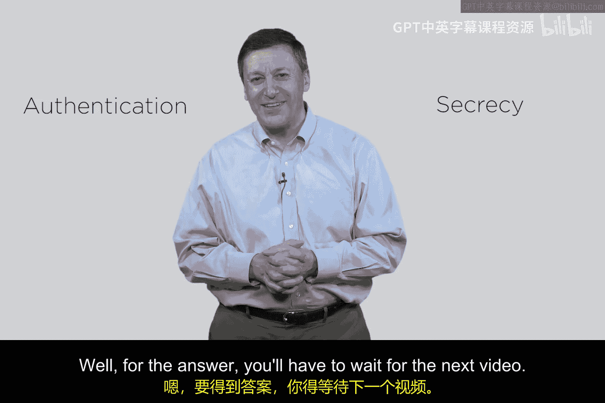

# 纽约大学《网络安全｜Introduction to Cyber Security》中英字幕（deepseek p81 36_公钥保密性.zh_en -BV1TFLZzYE26_p81-

Hi， folks， in this video， we're going to take some time and look at the way public key cryptography can be used。

To send a secret message。 So we're going start playing with the concepts of Diffy and Heman。

 And you'll recall in a previous video， we said that， you know， Alice and Bob or whoender receiver。

 you know， are， in some sense， doing something locally to generate their key pair。

 There's no key distribution center。 And the key pairs are set up such that encrypt with secret decrypt with public and so on。

 So let's assume， and will pop up a little chart here that shows Alice and Bob。

 And is their precondition will list out what they have。

 what they know or what they've been set up with。 and the setting up is called infrastructure。

 and for public key， it's called public key infrastructure， P K I， which you may have heard of。

Tends to be a lot of work to set up PkiI for a typical setting。 But for now。

 let's assume Alice is going to have both a public and secret key pair。

 which Alice generated locally， pushed a button， ran the R algorithm。 Bo pair pops up。 P S A。

 but she also has the public key of Bob， because we're gonna to make the assumption that everybody knows everybody else's public key。

 Is that fair enough。 Similarlyly， Bob， what does Bob do。 runs an algorithm locally。

 generates PB S B， has that key pair。 It didn't have to go to a key distributions everywhere did it locally。

 but also has PA has Alice's public key。 Everybody's got everybody's public key and we can throw Eve in there。

 too。 Eve is the eavesdroppper。 I don't care what Eve's public key pair is， Yeah。

 she generates her own key pair but who cares。 but she does no P， and she does no PB Fair enough。

 that's the precondition。 Now what I'm going to do。 is Alice is going to encrypt a S。

And what are the things she can encrypt with whether there's PASAPB。 Let's encrypt with PB。

 Let's see what happens when I encrypt something with public key of the recipient。 When I do that。

 the message goes across to Bob and when it gets to Bob。

 Bob can decrypt it because Bob has the secret key， but let's think about Eve in the middle of this。

Can Eve read an encrypted message M using public key of B， Well。

 what needs to be present to decrypted SB？Bob has that。 Eve does not。 Eve can't read the message。

 So if the message is like your credit card number or something， then in theory。

 I get blast us across the whole Internet to some online retail store。

 The retail store gets the credit card number。 Nobody else can。' fair enough。 So it's secret， but。

Could Eve have somehow crafted this message。 Like， let's say it's not an credit card。

 Let's say it's a note asking Bob to do something。 Well。

 can Bob be confident that that was actually produced by Alice， what。

 was the message using using the public key of B， Everybody's got the public key of B。

 So do I have authenticity， No， So this is kind of interesting， This shows。

That one of the options here， taking a message M。And having Alice encrypt it with the public key of the recipient。

Makes it secret。But does not respect authentication properties。 It does improve that you are you。

 Let's go back to credit cards。 If you send a credit card to a company。

 do they usually care who you are。 Well， it depends on the business， right， I think they probably do。

 But a lot of times they don't。 So this might be very useful protocol。

 But what do we say about conventional cryptography， We loved the fact that we had secrecy。

 And we had authentication， We liked that。 We didn't like if we lose one of those properties。

 and that's what's happened here，So。This is not going to do it。It's not acceptable。

 you want secrecy and authentication， so what can we do， how can we solve this？Well， for the answer。

 you'll have to wait for the next video， I'll see on the next one。

