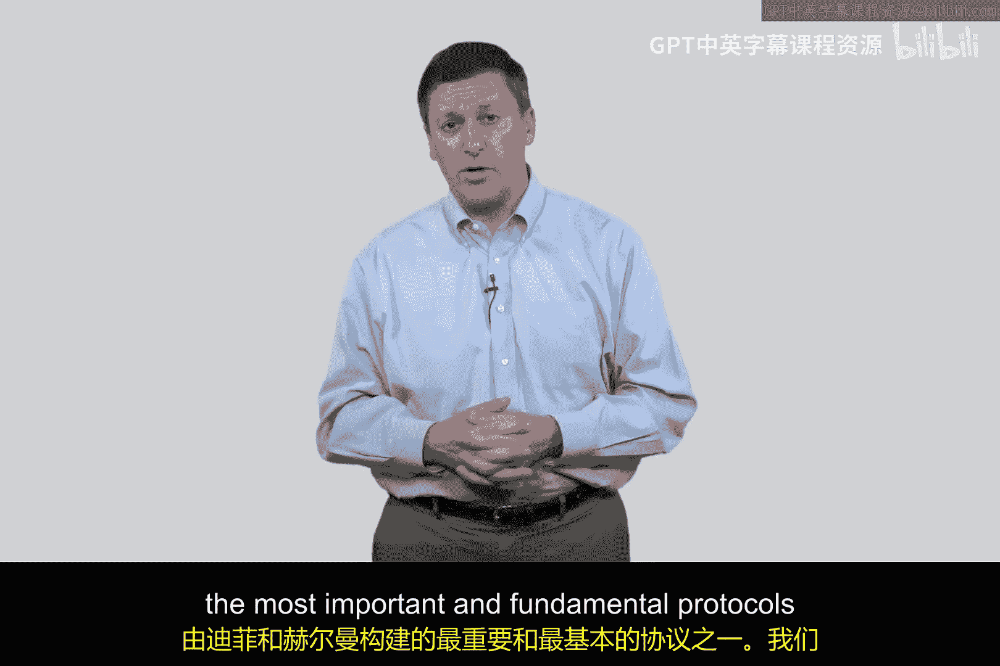

# 纽约大学《网络安全｜Introduction to Cyber Security》中英字幕（deepseek p82 37_公钥数字签名.zh_en -BV1TFLZzYE26_p82-

Hi， everyone at Emmarosso here。 So remember on our last video， we were。

 we learned how to send a secret message from Alice to Bob using public key cryptography。

 And it was kind of fun。 we said。😊，Send a credit card or something， youve can't read it。Well。

 what's another possibility， We weren't happy that we didn't have authenticity。

 We wouldn't have the ability to authenticate。 So another possibility is maybe that message M。

 we might encrypt with this your own secret key。And and in cybersecurity。

 when you use your own secret key for something， we call that digitally signing it。 Okay。

 so create a message Am， I'm going to encrypt it with a secret key of A me， Alice。

 I'm going to send it over to Bob。 Okay， so you guys with me and you know Bob will be able to decrypt that because Bob has a public key of me but。

Eve is sitting down there watching all of this， and what did we say Eve had？

She has everybody's public key。So she's got my public key。 if I'm， if I'm Alice。

 which means that when I send a digitally signed message using my secret key to Bob。

 Eve can read the thing。 So that's not good。 Now， the good news is if I asked you whether Eve could create or craft or spoof that message。

 Remember， we learned to turn spoofing。😊，Can she do that？No， because she doesn't have my secret key。

So you got this weird setup here， don't we where。Previously， I had secrecy。

But I didn't have authentication。 Now， I have authentication。 and I don't have secrecy。

 And I don't like either of those cases。 They're both somehow missing an important property。

 How are we going to solve this thing。 How are we going figure out how to solve it。 Now。

 before I give the answer， which we'll do in the next video。

 There's still one more thing here that we didn't test。

 like I didn't try encrypting with my own public key。 just for completeness sake。

 if you encrypt with your own public key and send it somewhere。 that in theory。

 nobody can read it except you。 So you could imagine some weird kind of thing where you're storing sensitive stuff。

 maybe your important intellectual property or pictures， you know want， you know。

 family photos and things you don't want your cloud provider to see， I don't know。

 I could imagine that， but it tends not to be as important。 a case。

 the idea of using your own public key， turns out in public key cryptography。

Two important cases are using the public key of a recipient and using the secret key of you。

 meaning when I see you， I use your public key to laser focus something to you in a secret manner。

 and when I want you to know who I am， I use my secret key to sign it in a way that you can be certain came from me。

 those are the two important building blocks。 but we've seen in two pretty obvious protocols so far。

That we haven't gotten the properties that we're really looking for。

 So we're going to get to that in the next video。 Stick with us and you'll see how we put these things together into one of the most important and fundamental protocols built by Diffy and Heman。

 We'll see that in a moment。

