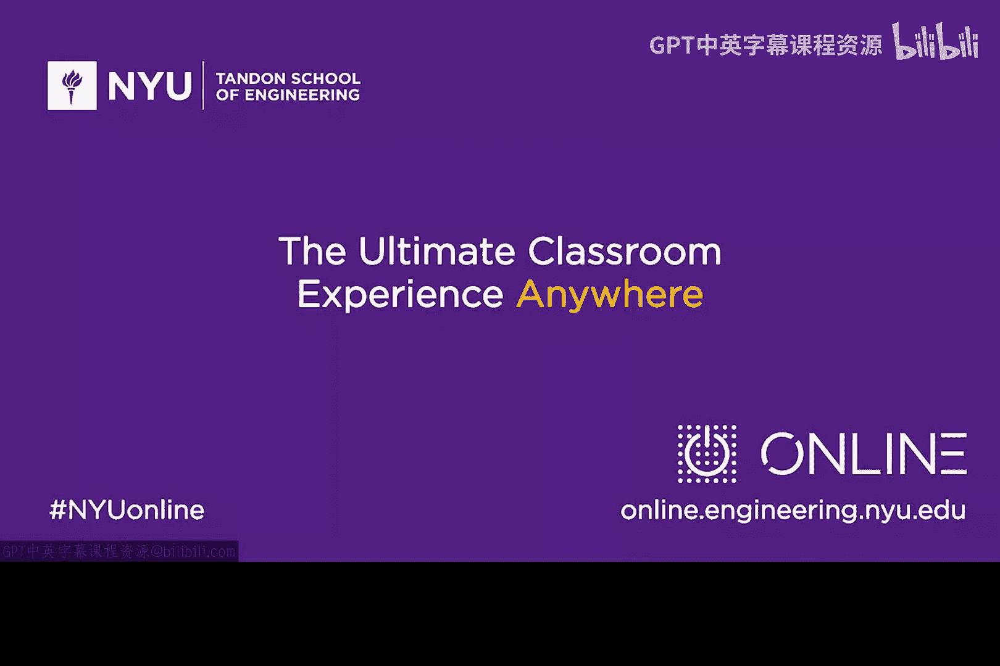

# 纽约大学《网络安全｜Introduction to Cyber Security》中英字幕（deepseek p84 39_Diffie-Hellman密钥交换.zh_en -BV1TFLZzYE26_p84-

Hi， folks， I want to talk about some protocol here called Diffy Heman Key Exchange that I think is just the absolutely most marvelous thing。

 The most marvelous contribution from cybersecurity to computer science。

 I don't think there's any question that this is the greatest thing。

 we as cybersecurity people have done for the larger discipline。

 but I want to back up a little bit and talk about something called the touring Award。

 So the association for computing machinery， ACM is our oldest professional society focused on computing。

 There's another one called IEE， which is as a broader reach that's been around a little longer。

 but ACM has been kind of at the forefront of computing for many years。

 they publish a magazine called Coms of the ACM CAM。

 which has always been kind of our best journal and I hope some of you if it's possible maybe through work or whatever become members of the。

ACM， but they give out this award each year called the Turing award named after Alan Turing。

And it's really our version of Nobel Prize。 You know， for us。

 it's probably the greatest award you can win with Diffy and Marty Helmman won it for the protocol I'm going to be showing you。

 I asked with Diffy once what it was like to win the award。 And he said he got the phone call。

 and he was numb。 just so excited。 it was right before the RSA conference。

 there's a conference each year held in California。

 And he wanted ACM to announce it because the conference was just coming up。

 And we was sort of the first security guys who'd won the award。 So we were all excited。

 and I think ACM was willing to move the award date up to be coincident with our conference。

 But point is that it's funny how cyber security and computer science sort of intertwined。

 And this concept that I'm going to share with you right now。

 is just so fundamental to everything you do on the Internet today。

 So let's make sure you understand it。 So let's take a minute。 And let's。😊。

Look at in a sort of generic manner how these keys work and how the algorithm kind of builds ultimately to the approach that Tian Heman use。

 and I'll take you through the math。 a couple little examples that show their actual algorithm。

 but let's build the concept。 I want you to understand at an abstract level how this works up you remember that we said that when we encrypted a message or in this case。

 a key with the public key of a recipient。 then we get secrecy we blast it out over the Internet。

 we get secrecy Similarlyly， if we encrypt a message or a key with the secret key of a sender then you get authentication is's only the sender has that。

 Now the beauty of this sort general concept is you do both of them。

 you encrypt with secret key of the sender and the public key of the recipient。

 do them both and you get both properties。 you get the beauty of sort of combining both secrecy。

An authentication， you can also do some integrity properties with that kind of a setup。 Now。

 that should be the piece that motivates。The understanding of how sort of diiffy Heman came up with this very interesting little mathematical trick that I'll show you in a moment。

 Now， Here's the goal。 Here's kind of the idea of what you would know as diiffy Heman key exchange。

 The idea is that Alice and Bob would like to somehow come up with a shared secret that Eve。

 who's listening can't determine based on eavesdropping wiretapp， watching what's going on。

 And we're going to use all the concepts we've been talking about the idea that we're happy to share public information。

 We're not happy to share private or secret information We to generate that locally and keep that secret。

 we want to use functions that are easy to perform but very difficult to reverse。

 all of these things we want to have as part of this generation of shared secret。 And obviously。

 we don't want a third party in the middle of all this。

 That's a whole point We want to have something secret。

 So let's start with this idea that Alice and Bob would agree on some sort。😊。

Of a public piece of information。 what we're going to do is pick a couple of numbers that they would arrive at。

 We're going to call one of them a generator and one of them a modulus。

 and the modulus should be prime。 So we'll use little example numbers here。 But in reality。

 these are going to be big numbers。 Let's say the generator they each pick is 5。

 Alice Bob agreed 5 is going to be there。 generator and the prime modulus would be 17。See 5 and 17。

 there's agreement on that。 And we can assume that Eve knows that number as well。 Now。

 here's sort of the fun part。 And this is sort of the genius of the Diffy Heman key exchange concept。

 And that's that， you know that if I take a number to some power。 and then I take them power again。

It sort of doesn't matter what order you do that in。

 So if Alice picks a secret number and raises her generator to that number， modulo。

 whatever we picked 5 and 17。 Let's say she picks 6 is her number，5 to the6 modo 17 is something。

 right， let's say Bob then picks 8 as his number，5 to the 8 modo 17 is something。

 If they exchange the information。 So now Alice has what Bob generated using 8。

 and Bob has what Alice generated， using 6。 They have their original secret。

 they can raise those numbers again， and do the same operation。

 So now5 to the 6 to the 8 is the same as5 to the 8 to the 6。 you follow， It's the same calculation。

 and it generates a shared secret。 really nice little trick。

 Certainly worthy of all the different theory we talked about。 I mean， talked a lot about。😊。

How you know， wonderful diffy and Hemaning when the Turing award， I know this is a little trick。

 but the beauty of it is that it respects all of the theory we talked about earlier。

 this idea that you know we have public and private information。 we combine them together。

 We get rid of a third party。 we can exchange keys。

 they came up with a mathematical implementation that made sense。 Now， yes， in practice。

 you can't use little silly numbers like5 and 19 and 7 and 6。

 These are not acceptable because be too easy to run through brute force attacks to reverse。

 But once you get to very big numbers。 know again， with the modulus arithmetic not easy to reverse and it turned out to be the basis for quite a bit of computing security。

 a lot of the things that we all do today on the Internet sort of answer back to this original concept。

 I took you through the abstractions。 and then you sort of see the mathematics。 The examples。

 works out very nicely。 So I hope this is something they。Some insight。

 It's one of the things that it's like， it's like a rite of passage as we learn cybersecurity to kind of follow the abstraction。

 follow the math and kind of understand and appreciate the beauty of Diffy Heman Key exchange。

 I hope you've enjoyed this。 I'll see you on the next video。😊。

