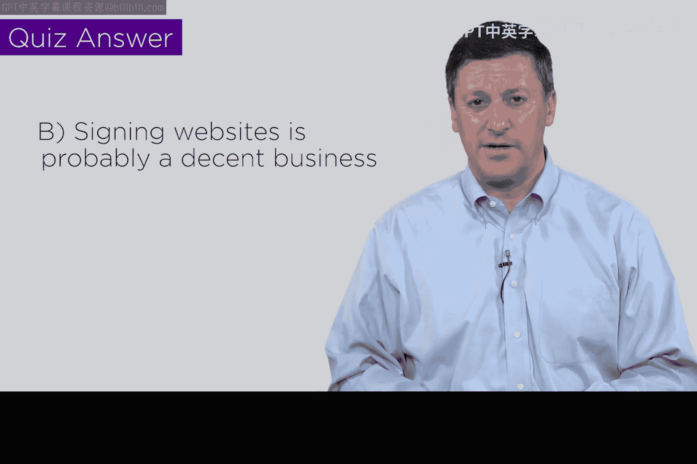

# 纽约大学《网络安全｜Introduction to Cyber Security》中英字幕（deepseek p85 40_密钥分发与认证机构.zh_en -BV1TFLZzYE26_p85-

Hi folks at MRossoak。So you probably noticed a little pattern to the learning here and to the the presentation on these videos。

 I get all excited about something。 And then I say， but。There's a problem， right，s。

 There's great idea and then a problem， great idea。 And then a problem。

 iss sort of how science moves forward。 So Diffy and Heman， their key exchange algorithm。 we were。

 we love the touring award。 beautifulful， changed our world， but。😊，There's a problem。

 and the problem is I haven't told you yet。How you get those public keys to each other， right。

 we said。If you just assume you put it in a directory somewhere。I mean。

 do you do that with Amazon when you go buy a book， do you look up their public key， I bet you don't。

So it must be something else。 Now， let's look at a couple adope options。 One is manual distribution。

 Some of you might use OpenpGP or some mechanism with your friends for doing cryptography。

 And if you do something with your friends， you can have a little key exchange party where everybody shares keys。

 that's fine， but it doesn't scale and you're certainly not doing that with an online store。

So that's not going to be a scalable option。 Another one would be to use a directory like you generate your key pair and then post it to a directory。

 And a lot of tools like PGP and others will do that。 And actually have hashes to directory entries。

 You could put the hash on your credit card use that as an index to find somebody's key。It's okay。

 but it's not going to work for commerce in neither of these schemes。

Actually work what the community came up with。Is this new concept called a certification authority or C。

 And you can see on the screen here I shown you a little diagram that sort of shows the schematic of a certification authority。

 The idea being a new third party is going jump into the game here。 Now you might say。

 didn't we want to get rid of third parties before we didn't like a key distribution center。

 Now you're going to put a certification authority in the middle doing something。 Well。

 turns out the Ca is just going to do a little bit of administrative work at the infrastructure level。

 And we're going to try and minimize the amount of work for clients and and and accept some level of work that needs to be done if you want to use cryptography for things like commerce。

 and it's going to be referred to in our industry as signing your server。

 you might have done some of that。 if any of you watching have sold a single item on the Internet。

 know， from a server that you managed and you。Well have gone through the process that I described here now here's the idea a certification authority is going to be an active entity in this whole game。

 having its own public and private key pair， we're going to refer to the central certification authority as a CA and a PC SEA has its own key pair and what's going to happen is that it's going to in some sensevouch for。

A certificate that'll be provided to you on request that includes a public key that you need。

 You got that。 I'm going to say to you， hey， give me your public key。

 And instead of you just mailing it to me， which could be easily spoofed。

 You're going to mail me a certificate that's signed by that guy， the big C， A somewhere。

 And I'm going need a protocol in place to validate its authenticity。 Do you follow。

 So that's the protocol。 That's how it works。 Now， here's the first step。A server will send to a C。

Its name and public key that it generated locally and asked for the CA to bind or sign into a certificate。

 the name and public key in this case of Ser bo。Now it turns out there's three levels of assurance for doing this。

 one would be I just email you my public key， you look at my email address。

 you see it's some reasonablecompname。com， it's not you know one of these email accounts that you can get for free that would be anonymous。

 but it actually ties to a domain that seems legit， seems legit。

And that's called a low assurance process resulting in a low assurance certificate from a CA here in the US。

 you might pay a few dollars for something like that。

Second possibility is that the CA makes you do a little more work。

I you do some legitimate twofactor authentication to increase the likelihood that you really are who you are。

 your' some website selling sneakers on the Internet we sell you great sneakers on the Internet com and you want the C to take that public key and bind it to your domain。

 So it might require that you send an email， and then maybe it send you a mobile code。

 and then you put the code in or whatever。 but there'll be some sort of a handshake that's more than just checking your domain that's called medium assurance。

 And then the third， the most important and most high assurance。

 obviously is in person in personson identity proofing where you show up physically。

 you provide credentials to the Ca。 I remember many。

 many years ago when I was working at Bell Laboratories who went through this process using an old box from a company called BBN。

 And it had these crypignition keys that we used to generate our key pair， which we present。

At the time to one of the early browser vendors and each bunch of us on the team there。

 Bell Ebs had one of these physical crypignition keys was in 1994， I think。

 and remember my daughter was one。 she's now graduate of NYu but I remember she was eating it。

 I think she said the 18s8 Bell Ebs had one of the piece of their cryp ignition keys generating their key pair in her mouth I thought that was so cool。

 But anyway， So there's those three levels of assurance， low assurance， medium assurance。

 high assurance once you get that certificate you drop it on your server now you're set because a protocol that we would now call SSL or secure sockets layer can happen。

 Here's how it works。 Very simple。 And the beauty of understanding how things are set up。

Is I probably don't even need to show you。 I'm going to show you。

 But I think you can figure out what's going to go on here， right。

 The client is now going to visit a website and say， oh。

 I would like to buy a pair of those sneakers。 They look really great， hey。

Are you really you send me your， you know send me something that you know。

 I can use to make sure that I'm really sending to you the server is going to provide a certificate。

And it follows a standard。 There's a standards group that created a structure It's called Xta 509。

 It's part of the X 400 X 500 series of standards， International standards。

 but the Xta 509 dictates the stuff that's in the Cer。

 There's going to be serial numbers and expiration dates and all kinds of stuff about who signed it all that。

 But the main thing for you is it's got your public key。

 public key of the website and the name of the website comes to me and it's essentially signed。

By the CA。Signed by the CA。That means the CA signed it with their secret key。

Which means I have to get the public key of the CA now。So how am I going to do that because again。

 the reason I'm asking you for this is because if I have your public key and I trust that it's you。

 then I put my credit card in I encrypt my credit card with your public key。 Remember。

 we said the public key of the recipient。 cryrypto credit card Bo， send it to you。

 Lased across the Internet gets to you。 Nobody on the Internet sees it except you。 To rocks。

 But now I have this problem， How do I get the public key。Of the certificate now。

I think there's two reasons anybody does anything in computing。

 One is because they want to achieve some sort of fame or contribution or some nonmonet stuff。

 and two is monetary。And they're both valid， perfectly reasonable。 It turns out that， you know。

 look Diffy and Heman and so on。 those were not financial motivations that drove them。

 These were academics。 Again， they're not post making money。

 but wasn't that was the main driver But you'll see on our next video that the primary driver here between the solution to this problem and an implementation was one rooted in economics and something that was embedded in the way the Internet was evolving。

 And you'll see in a minute。 the way， assuming you go on to the next video。

The way this thing was solved。 So we're going to sort of leave it at that。

 I've got a little quiz here just to sort of test your understanding of C。The answer is actually B。

That's a weird answer。 It is a pretty good business。 No。

 It's done with mobile devices It probably not。 It's fun not gonna be done。 and it is't insecure。

 It's different levels of assurance。 But is decent businesses an awful lot of companies。 Go look。

 and you'll see I'll bet you， there's 1000 Cas。 Now we prefer Cas to be large and omnipotent and available。

 But it turns out that that isn't exactly right。 there's some big ones， and there's some small ones。

 But on our next video， Let's dig in and we'll see how really interesting solution to the SSL C public key problem we solved by somebody that I'll bet you you've heard of。

 We'll see in the next video。

