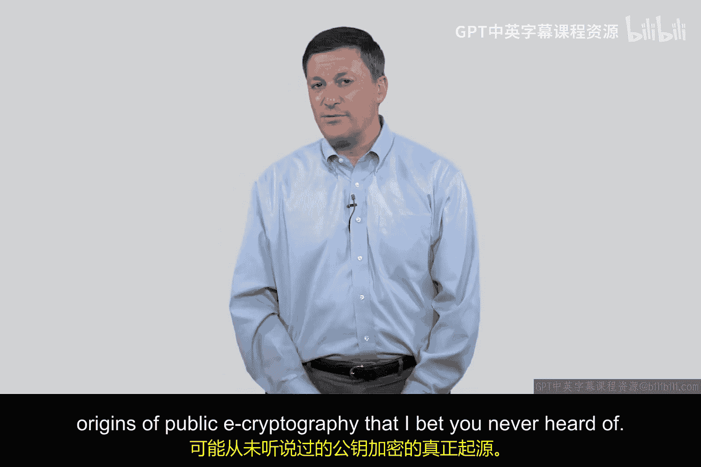
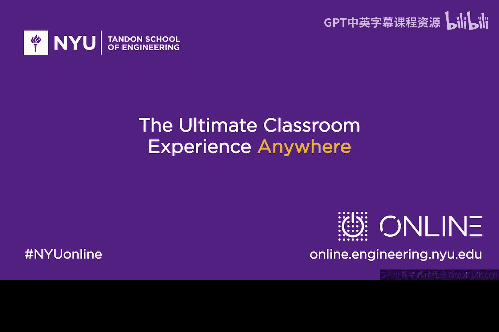

# 纽约大学《网络安全｜Introduction to Cyber Security》中英字幕（deepseek p86 41_安全套接层.zh_en -BV1TFLZzYE26_p86-

Hi， folks at Emmarosso here。 and I want to talk to you in this video about secure Sockets layer SSL and the problem of getting a public key from a CA so that I can decrypt a certificate that I've received from say a commerce site that has a certificate signed by the C using its secret key。

 Boy， is that a mouthful right if you understood that that's pretty good。

 Like I'm always surprised that I can say it without getting it all jumbled up。 But here's the idea。

 you've just received a certificate from we sell awesome sneakers on the Internet co and it says。

 hey， we want you to buy our sneakers。 look， here's a certificate。

 embedded in the certificate I that website's public key which you can now use to send credit card information over。

 But to somehow get that， I have to decrypt with the public key of the C who signed that cert。Now。

 the solution to this is also just about as elegant as you can imagine。

But it was invented by a company， a fledgling company in the 90s called Netscape。 Now。

 if you share a generation with me， you think of Netscape as the first browser as the brainchild of Mark Andreesen。

 who's now probably the most famous venture capitalist in Silicon Valley， just an amazing person。

 But back in the day， Netscape was a small company that was figuring out its way in figuring out how to make money with browsing。

 And their idea， in my mind， is one of the great contributions to e-commerce。 In fact。

 we would have no Amazon， No online selling without the following idea。

 Here's what Mark Andreson's team came up with。😊，They said。

Your browser somehow needs the public key of that CA because if it has the public key of the CA。

 you can decrypt theert， but I don't want users to have to go get the cert。

 I'd rather go get the public key。 I don't want to be buying a book and then have to go get the public key of the store that I'm buying。

 you know a book from。Here's what they said。 And again， so genius。

 And if you see this theme of simple， clean， elegant concepts moving things forward。

 then you got the right idea。 And here's what Mar andre and the team said。

 They said you got to download a browser， right， Everybody has to download a browser。

 So we will put the public keys， burn them in to your browser。 How cool is that。

 You download the browser。 The browser has all the public keys through prearrange between the Cs and the browser companies to put them in there。

 and to the degree that you trust the download from Netscape or from microscope or from Google or wherever。

 If you trust a download embedded in that will be a frequently updated list of valid certification authorities that they've gone off and checked。

😊，It's a closed loop。 your mom， your friend， you whatever you want to go buy something on the Internet。

 You download a browser。 You're using the browser。 It's got public keys in there for Cas。

 I go to we sell awesome sneakers on the Internet dot com。 I say， I want to buy this。

 and it goes great。 sends me a certificate。 It's got their public key。

 The certificate is signed by a Ca A。 My browser does a look up。 finds it。 Wow， that's a valid C A。

 I have the public key。 I decrypt the certificate。 I get the public key。

 I send the credit card information。 and we have the world we live in today。😊，That's it。

 that's how it works。That's why。You don't have to do anything to buy something securely on the Internet。

 It's like magic。 Now， for some of you have a little bit more experience and you're thinking about this。

 you're going wait a minute， Ed。 There's a lot of problems here。 How do I know the C A is valid。

 and how I know they did a good deal with the browser。 You're right。

 There's no question that that's an issue。😊，There's a lot of little seams in the way these things work。

But for the most part， you've gone from no assurance。 It's a pretty solid assurance here。

 I think you've got to admit that this is a closed loop in the sense that it provides a means for me to get my credit card to you without having to go off and you know。

 look around for keys and look around for search a directory or ask somebody for a public I don't do any of that。

 long as I download the browser。I have pretty much everything I need。

 and I don't need to be a technical person。 I don't need to go to a key exchange party。

 I don't need to be sort of a gearhead to accomplish the kinds of things that you see on the internet。

 and I think contrast this。With email， where I'll bet you， you and I。

 whoever you are watching me right now， I'll bet you。

 we couldn't send secure email to each other without doing a bunch of work because the infrastructure is not there。

But if you go off and set up a website。And get a certificate。

 Then I can buy something from you and we don't have to meet。 I don't need to know who you are。

We don't ever have to meet。 I can come and use a standard protocol。 Why is it that security commerce。

 it's all worked out， email， it's not。I think it's just because the financial model is better for security commerce。

 that's the reason。I mean I wish I could give you a better computer science reason， but there isn't。

 It's just the reason that's been put together is because there's such a wonderful business model there。

 Nothing evil about that at all。 It just need to understand that as a technologist。

 A lot of you are probably fledgling。Entrepreneurs， maybe you're thinking about starting a company。

 The bottom line is having great technology is going to be important。

 But luck and business models and hitting things at the right time and knowing what you're doing from a business perspective。

 may just as important。 Give Mark In in a lot of credit。 I think， you know。

 we think of him as a great entrepreneur venture capitalist。

 But I think the contributions that he and his team at Netscape made in and around secure Sockets La is one of the great contributions of cybersecur。

 So I hope you've enjoyed this。 And the next video。

 I'm going to tell you a story that's going really seem kind of interesting。 I hope you have。

 if you have some free time， you'll go right on to the next one and look at our discussion of James El and Clifford Cox and some of the real origins of publicly cryptography that I bet you never heard of。

 I'll see in the next one。😊。

