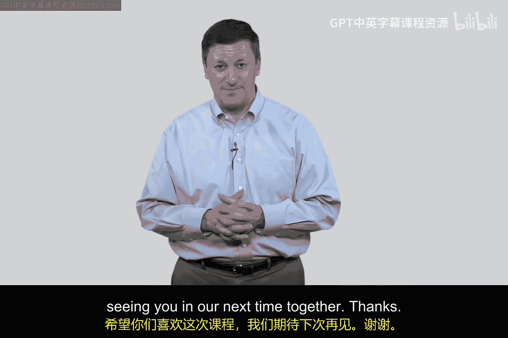

# 纽约大学《网络安全｜Introduction to Cyber Security》中英字幕（deepseek p87 42_James Ellis与Clifford Cox的故事.zh_en -BV1TFLZzYE26_p87-

Hi， folks， Ed' Miosso here。 And I want to tell you a story。 So this is not a techie sort of video。

 This one's more kind of human interest and part of our history in cybersecurity。

 Probably something that you don't get a lot of when you read books and things about cyber tends to be a lot of math and protocols and things that we've been doing。

 But I want to digress and tell you something I think you should know about。 Now。

 wonderful contributions by Whitiffy Marty Heman can't be underscore enough。

 They were the ones who introduced publicly key cryptography to all of us。

 and then Reveshm or and Naelman， the wonderful algorithm in the work they've done。 Again。

 they want a touring award。 All of them deserve it。 all of them are incredible。

 Comp scientists and and models。 And I think I've referred to them as heroes。 and I believe that。

 But I want to take you further back to the 1960s。Now。If you're in the 1960s。

 let's say you're in Great Britain。 What do you think an engineer looks like。Male or female？

I think you would agree probably male be speckled， wearing a white shirt with tie。

 probably a bunch of stuff jammed in the pocket， know pocket protector with all kinds of pens and pencils。

 very modest look and I give you one person named James El so this was an engineer essentially a quasi mathematician who'd been working at GCHQ which in Great Britain is the agency that does cryptography。

 sort of the equivalent to the National Security Agency here in the United States and you can decode what GCHQ stands for。

So James Ellis was working there。 and he hadn't been there very long。

 It just sort of started work there。 And for whatever reason， he was given a problem。

 I've heard a joke that it was sort of busy work。 I've heard a lot of different origins of why he was given this problem。

 But the problem was the following。 I said to James， this was in the mid to late 1960s。

 So it's almost a decade before the diffian Heman work。

 The problem was essentially conventional cryptography and the fact that it doesn't scale。

 Remember in previous video， I showed you the little curve that I have two people then three people。

 then four people in5， Look， how do you scale that。

 And how do I do without a key distribution center。 How would you do that。 So James Ellis went off。

And in a very short period of time， came back with a short paper， in fact。

 it's required reading in this course called non secret encryption。

And he gave it to his boss and said，Here I solved the problem。

think it took a little time for his boss and for colleagues to take a look。

 Some of these names of colleagues and people he was working in and around are now sort of famous Fred Williamson being one name。

 But anyway rate， eventually the team there GCHQ got around to reading James El's short paper and they looked at it and they went。

 here's what it said。 Well， instead a one key， you should have a secret key and a private key and I'm sorry。

 public and secret， the public one， you tell everyone the secret one you put in your pocket。

 don't tell anybody if you can encrypt with this， you decrypt with that， you get the idea。

 You basically laid out the diffine Heman scheme。Now， it took， like I said。

 took some time for people to realize， my goodness。

He's laid out a scheme here that makes sense like they' brought in some outside crypgraphers。

 it's all classified， by the way， at the time， totally classified。

 you can see the paper there that eventually came out in 1970。

 the possibility of secure nonsecre digital encryption before diiffing Heman。

So people looked at it and they went， wow， this is really kind of interesting。

 And James Ellis says that one of his inspirations was he was looking at telecommunications and engineers say Bell Las。

 who were adding and subtracting noise of a certain time type to communication。 So at any rate。

 the good news was they validated that it was a good idea。 the bad news is two bad news。

 One is its classified。 So he can't tell anybody。 And the second is computers in the late 60s were just so slow that it was like。

 who could ever invent an algorithm that would work like this。

 because James Els didn't have an algorithm。 He just said if one existed。

 Remember we said that about Dffy Heman， It took Revechemeir and Adelman to provide the algorithm。

 but Dffy Heman had actually come up with the scheme so。

What you had was and what you have is James Ellis in a very similar situation to the situation Diffy and Heman were in when they publish their paper。

 so fast forward a month， couple of years。And a guy starts work at G CHQ by the name of Clifford Cox。

 And he gets around to meeting James Ellis， they talk。And James tells him。

 here's this thing I'm working on。 And Clifford Cox listens and says。

 I think I know how to implement that because Clifford Cox had just finished his graduate work in mathematics。

 and he tells James Ellis that his work was in the area of prime number theory， he said。😊。

I think if you multiply two primes together， you get this thing。

 maybe that could be the public key and one of them be private， blah， blah， blah， blah。

 the stuff we all talked about。Before Diffen Hillman， before RSA。But classified。

So this guy will work at a British spook agency。 They've invented this incredible thing。

 They can't tell anybody。 Now， here's what happened。1979， some number of years later。 Now。

 this is after， you know， they're sitting off in relative obscurity。 Yeah。

 nobody knew that they'd done this。 James Ellis was a beekeeper。 Like。

 that's his you've drive a little car。 I lives in Great Britain。 Like。

 I guess you probably know it is to keep bees below rug over your bees。

 That's what like you get the this image of very modest sort of engineer。😊，1979。

 at a big conference computer conference， the director of the National Security Agency at the time was Bobby Inman。

And he was up at the podium and he's giving a speech and somebody's hand goes up and says， mind you。

79 was a couple years after Diffy and Helman had published。

 and this is Ellis and Cox watching Diffy and Helman become famous。 They win touring awards later。

 they're hailed as these great people。 nobody knows El and Cox， I mean。

 other than just as mathematicians from GCHQ。 Some asks a director Inman in the QA portion of the speech。

 Hand goes up。 Director Inman， will the Diffy and Helman work that's just come out。

 know Diffy Heman Key exchange make it harder for NSA to accomplish its mission。

 Its S mission of collecting data and decrypting the things that these agencies do。

 It's kind of funny like 1979 is so long ago， we think of those debates as being so current。

 and Bobby Inman from the podium starts laughing and goes，ha ha Diffy Helman。

 Well we knew about that。10 years ago。And they're in the audience。With diiffy and others going。

10 years ago， we just wrote that paper。So。They start nosing around with diffy start to ask it around。

 Look at NS S A come on come on， come on， come on。 Who did Who did somebodybody whispers him the name James Ellis。

 So diffy and his wife get on a plane， fly over to England。 They w to know， they go there。

 meets James Ellis。 And， and to this day。The report what Diffy would say is that the only thing James Ellis ever said was they were backing their car out to go。

 I guess in Great Britain， you go have ale here in the US， we go have a beer。

 but whatever backing the car out and James Ellis said and I quote。

You did more with it than we would have。Like you said that mind is all classified。

 You wouldn't admit having do anything disowned thing。 So， you know。

 time progresses and kind of people knew， but it kind of wasn't。 We get through the 80s。

 We get in the 90s， still， British GHQ will not declassify the reports。 Then finally。

 they decide in the mid90s。 They're going declassify this stuff。 They're ready to put up a website。

 And what happens， James Ellis passes away。 The poor guy get no credits like this should be a TV movie or something。

😊，So to this day， I think we need to remember James El Clifford Cox as people who had the integrity。

To do wonderful work。 But to keep their mouths shut about it， it was classified， they didn't。

 They didn't crave the need to tell reporters。 There were no leaks。

 I guess other than maybe the little Bobby Inman won to some degree。

 I think it's an interesting story for those of you young people who are studying， you know。

 cybersecurity。 I take a little time and go look up James Alice read about him。

 He's one of the great contributors。 he gets no name to won no touring award won no fame during his life。

 But now I think it's important that we honor him And Clifford Cox and Fred Williamsson the whole team there。

 for having really been the ones who who invented to this day。

 Diffy and Helman and others will always say that they were the ones who introduce public key cryptography to the world。

 And they deserve all the credit credit where credit is due both for the folks at G C HQ。

 You can see we've popped the picture up here from the IE It's a little plaque that kind of validates。

 This is not a wellknow story， not an oftentraed story， but something。😊。

I wanted you all to know about so hope you enjoyed this。

 hope you enjoyed this session and we'll look forward to seeing you in our next time together。

 thanks。

