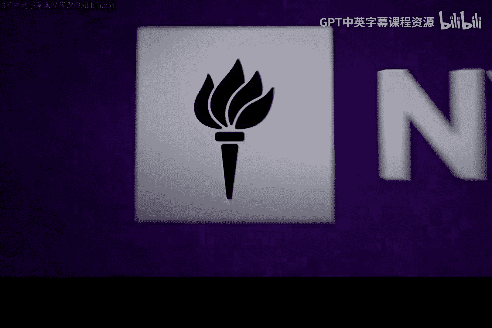
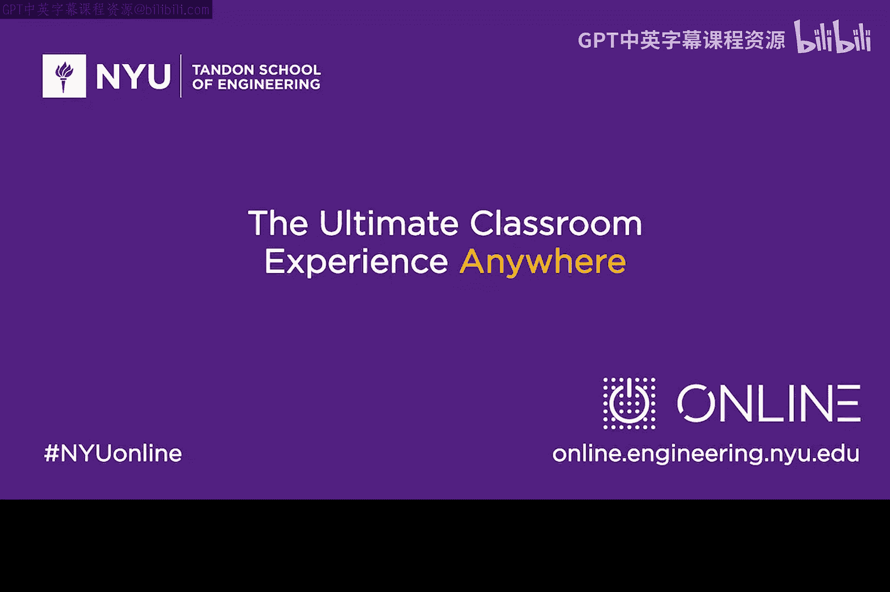

# 纽约大学《网络安全｜Introduction to Cyber Security》中英字幕（deepseek p89 0_网络安全课程介绍：你将学到什么.zh_en -BV1TFLZzYE26_p89-

Hi everyone Ed Emmarosso， I want to welcome you to our course now on Realtime cybersecurity。

 I think you're going to enjoy this。 If you were with us for other courses that we've done here。

 we spend some time on preventive cybersecurity。 that's we just set up technology cryptography authentication。

 different types of capability that are designed to stop an attack before it happens to prevent the attacks。

 but I think we all have to be reasonable。 I'm not understand that in a practical setting there are going to be cyber attacks that happen。

 So it's a branch of cybersecurity that we're going to focus on in this course that looks at techniques for watching activity。

 observing making decisions based on traffic patterns。

 making decisions based on packets or on a session or on some sort of a request from client to server or whatever you'll see I think you're going enjoy it。

 So about really fundamental goal here is to introduce you to those basic techniques。 second。

Wouldd be to demonstrate them in a practical setting and third is hopefully to inspire you to a career in this area。

 you're going to find that a lot of companies， government agencies and certainly militaries are very interested in this aspect of cybersecurity。

 this real time situationally where capability that we'll be spending time on so if you're inspired from these lectures then perhaps it will spur you on a career in realtime cybersecurity so I hope you enjoy the course。

