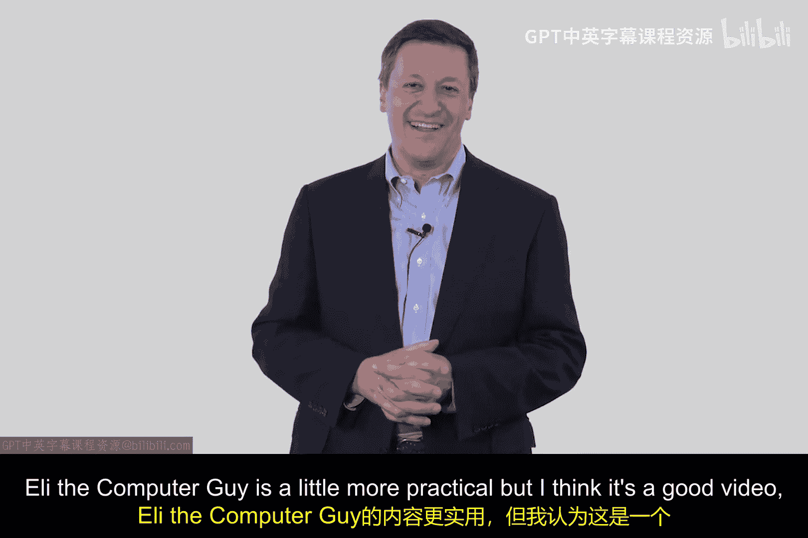
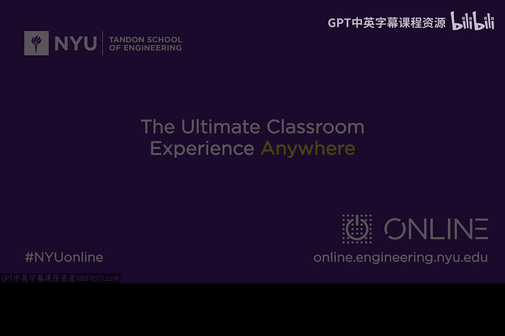

# 纽约大学《网络安全｜Introduction to Cyber Security》中英字幕（deepseek p90 1_作业与阅读.zh_en -BV1TFLZzYE26_p90-

Hi， everyone Ed Ammarosso here and I want to welcome you to this module。

 Now our goal in this module is to kind of dig into realtime network security and you can't do that without focusing a little bit on TCPIP hacking So I think you'll enjoy。

 It's kind of fun little different than the crypto stuff that a lot of you may be familiar with in cyber realtime security is a little different。

 Now there's papers and a couple of optional books and a video that I think will help you compliment your learning as you go through the module here。

 let me tell you about them。 So the two papers， one is written by two of my most favorite colleagues Steve Bellivvin。

 Bill Cheswick wrote a paper called Network firewalls that I think is a kind of interesting predating of a lot of the virtual security and firewall appliances that we see in cloud operating systems now。

 very interesting early paper on those concepts of distributing security。

 So I hope you'll look at that。 And second is a nice paper by someone named Guang。

At Iowa State University。 It's called the Introuction to TCPIP Network attacks。

 It's a good solid survey。 One of the best I've seen that I think you may want to take a look at as well。

 Now， a couple of optional books that could help you there's an ebook you can download from Amazon again。

 optional written by myself and my son Matt。 It's called from CIA to AP an introduction to cybersecurity。

 if you're gonna to do it chapter 17 and 18 would be good to sort of go along with as you do your learning in this module。

 And another option is I think you should have a good solid TCPp book。

 there are a lot of them out on the marketplace。 I think it should be on your bookshelf。

 I kind of like Richard Stevens TCPIP Illustrated volumee 1。 And if you decide on that book。

 chapterpt 17 and 18 would be good ones to look through again， optional。

 but that's the kind of thing you should probably have on your reference shelf。

 Now in terms of videoss kind of a whimsical one for this module。 guy named Eli， the computer guy。

 I love his videos on YouTube。 And he's got one。haacking DNS， it's pretty good。

 I think you should look at it you a little difference in some of the deep academic stuff Eli the computer guy is a little more practical but I think it's a good video and I think it'll enhance your learning as you go through this module thanks。

😊。

