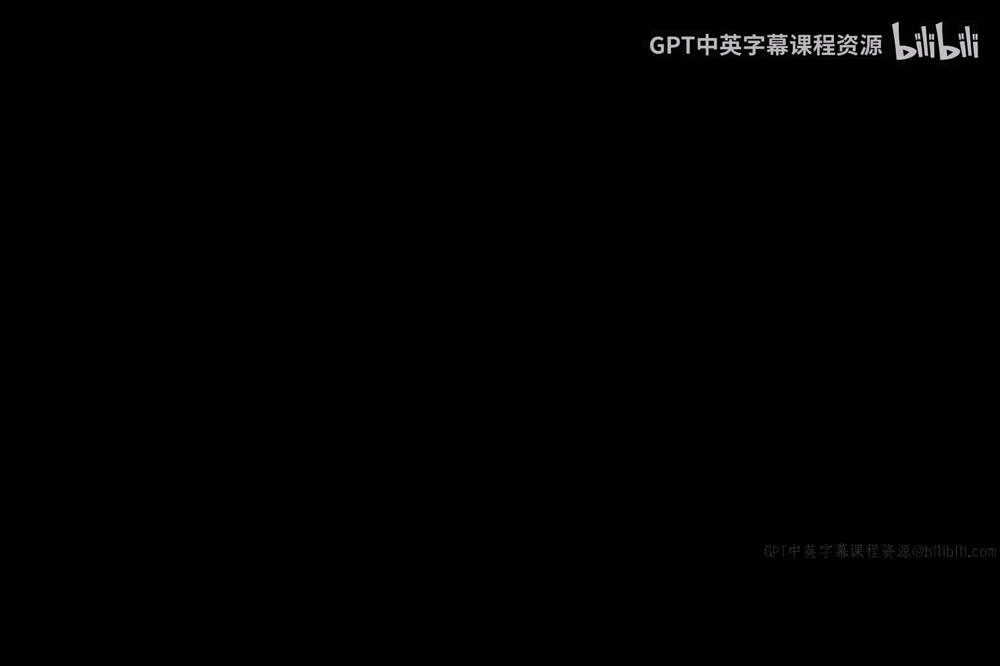
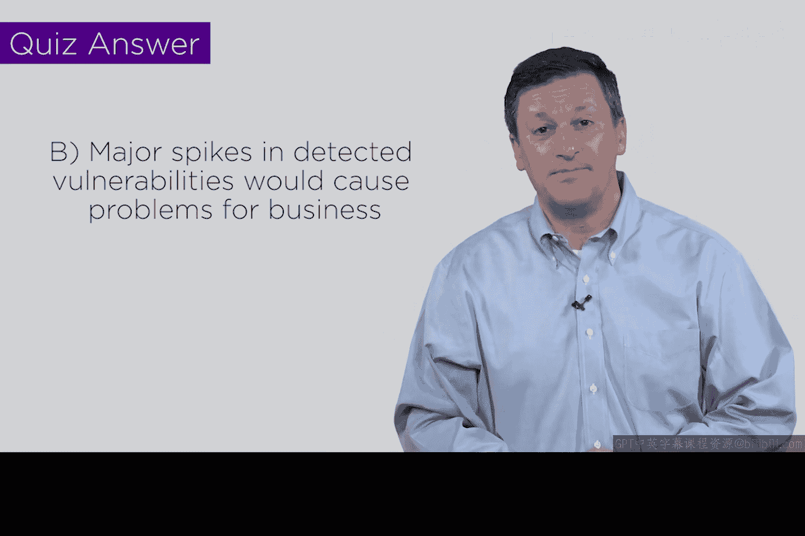

# 纽约大学《网络安全｜Introduction to Cyber Security》中英字幕（deepseek p91 2_通过隐匿实现安全.zh_en -BV1TFLZzYE26_p91-

Hi， everyone Ed Ammarosso here。 Now， in cybersecurity。

 there are certain mottos or slogans or ideas that just pervade what we do。

 And one of them that's pretty universally accepted is that security through obscurity。

 I'll explain what that means in a minute。 is generally not a great idea。 Now。

 I think it's a more complex concept than that。 let me give you some idea。

 So in the cryptography community。 security through obscurity means I'm going to make my cryptographic algorithm more secure by just not telling you what it is and hoping that maybe you don't find out。

 Now you can see how that's a terrible process because in our world。

 it seems like keeping secrets is almost impossible。

 So you you'd prefer something to be secure in the full knowledge that your adversary might know exactly what it is that you're doing。

 which is the opposite of security through obscurity。 However。

This introduces a little bit more nuanced set of concerns when we talk about software Now。

 I think a lot of you are familiar with more or less the two types of software that we deal with。

 One is called open source， that's where we celebrate the openness of the code。

 we share the ability amongst all of us to look at the code and there's usually rules depending on what community you're dealing with around if you make updates you share and so on。

 you're familiar with the idea of open source， but for our purposes now it's just that you see the code。

 you know the code， you can look at different types of routine statements and so on it's in the code and you'd be able to understand it The second type is proprietary software and that's where a software vendor makes the specific business decision to keep their code secret Now what does this mean in terms of security through obscurity。

 Well let's take let's look at a little graphll pop up on the screen。

 you can see in the graph that if I have a piece of code that is in fact open。Then over time。

 once it's released， it's subjected to scrutiny and you can see the intensity of known vulnerabilities will grow obviously as it's subjected to more scrutiny。

 you will find more vulnerabilities So you're going to see a graph in some sense going up to some very intense point where perhaps maximum scrutiny on the code and you've looked at through very thoroughly whole community whole world maybe but what happens after that typically is that things start getting fixed at a more rapid pace than they're getting found do you follow as you're finding vulnerabilities。

 yeah， you're fixing them， but it's usually the case with open source you find them so quickly that you do see that intensity graph go up。

 but over time eventually things get better like think UniX in the 70s， 80s。

90s kind of was at its peak since then Uniix is by far the most robust。

 the most secure operating system that we have because we've been staring at it for 50 years。

So obviously， you come way down the curve and you see the benefits of all that scrutiny and of all that review。

 code review。Now， proprietary in contrast， when it's released and is secret。

 you can't see the kernel， you can't see system code。

 can't seem source code tends to see a much flatter sort of a known vulnerability intensity curve it's flat and it will stay flat because as long as you keep it hidden then there's no reason to believe that you'd have a more intense period of scrutiny unless somebody gets lucky for some reason or something leaks。

 but if you keep it proprietary then it'll stay the same now what this suggests is that if the same piece of code made open source were made proprietary and they start on different paths。

 you have a latent set of problems embedded in proprietary code that you haven't noticed yet because nobody's noticed it even looked at it you follow so the advantage of open source is eventually you get to a pretty good place the disadvantage is it gonna be a bumpy ride the advantage of proprietary is that over a life。

Cycle， there's a very good chance that you can stay just below some acceptability threshold think Windows operating system right I mean。

 in fact， to kind of test our understanding here I want to give you a little bit of a quiz as we often do The answer obviously is be right so we would see a spike the characteristic spike that comes with making something open source it would probably cause a lot of problems for business as you would expect over time maybe things would be better。

 but it'd be a pretty rocky ride。 so between you and I I hope that Microsoft never makes the decision to just wake up one day and open source windows because we'd all see some problems so I hope that's been helpful and we'll see in our next video。

